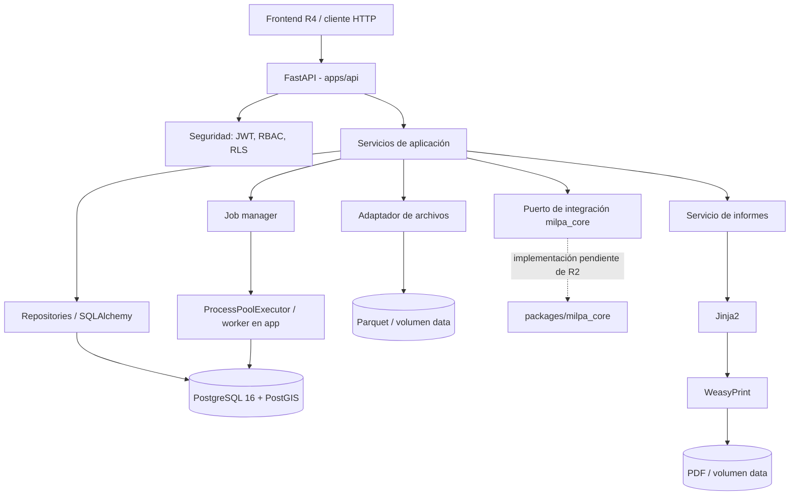

# MILPA RESILIENTE 3.3
# Especificación técnica — R3: Backend y Plataforma

**Estado:** Borrador técnico de trabajo para inicialización de R3  
**Versión del documento:** 0.1  
**Fecha:** 14 de noviembre de 2026  
**Componente responsable:** R3 — Backend y Plataforma  
**Documento de referencia:** `MILPA RESILIENTE 3.3 — Arquitectura técnica integral del MVP`  
**Reglas de ingeniería:** `CLAUDE.MD`

> **Advertencia de alcance:** este documento extrae y organiza los requisitos de R3. No reemplaza la especificación integral de MILPA RESILIENTE 3.3 ni los contratos que deben entregar R1, R2 y R4. Los elementos no confirmados se marcan como `PENDIENTE`; no deben convertirse en supuestos silenciosos.

---

# 0. Cómo leer esta especificación

## 0.1 Palabras normativas

- **DEBE / OBLIGATORIO:** requisito necesario para aceptar R3.
- **NO DEBE / PROHIBIDO:** restricción que no puede incumplirse sin aprobación formal.
- **DEBERÍA:** recomendación técnica que puede requerir justificación si no se aplica.
- **PUEDE:** opción permitida dentro de las restricciones del proyecto.

## 0.2 Estado de definición

Cada requisito o decisión debe identificarse con uno de estos estados:

- **[Definido]:** la especificación ya fija el comportamiento.
- **[Propuesto]:** diseño establecido, todavía no implementado ni validado.
- **[Pendiente]:** falta contrato, dato, decisión o responsable.
- **[Verificar]:** debe comprobarse contra documentación oficial, compatibilidad o evidencia real.
- **[Implementado]:** existe código, pero no implica que esté probado.
- **[Verificado]:** existe evidencia de prueba ejecutada y aprobada.

No se puede cambiar un estado a `Implementado` o `Verificado` sin evidencia.

## 0.3 Fuentes de verdad y precedencia

1. `CLAUDE.MD` define las reglas de ingeniería y restricciones del repositorio.
2. La especificación integral MILPA RESILIENTE 3.3 define alcance, arquitectura, modelos, endpoints y criterios del producto.
3. Los ADR aprobados registran decisiones arquitectónicas que precisan o resuelven aspectos no cerrados.
4. Los contratos oficiales entregados por R1, R2 y R4 definen las interfaces que les corresponden.
5. El código implementado debe reflejar los documentos aprobados; el código no convierte por sí solo una suposición en contrato.

Si dos fuentes se contradicen, se debe documentar el conflicto y proponer resolución mediante ADR. No se debe resolver cambiando silenciosamente contratos o tecnologías.

---

# 1. Resumen ejecutivo

MILPA RESILIENTE compara estrategias agrícolas frente a historial climático y escenarios sintéticos. R3 construye la infraestructura de aplicación que permite exponer los datos y resultados del sistema a través de una API segura, gestionar usuarios y permisos, ejecutar trabajos, generar informes, mantener trazabilidad y operar el MVP de forma reproducible.

R3 debe desarrollarse como un **monolito modular**, no como una arquitectura de microservicios. La aplicación se ejecuta junto con PostgreSQL/PostGIS en Docker Compose. Los datos de series y matrices se almacenan en archivos Parquet; PostgreSQL guarda entidades, permisos, procedencia, estados de trabajos, corridas, escenarios, resúmenes y metadatos de informes.

R3 debe poder desarrollarse sin que R1, R2 y R4 estén terminados. Para ello debe crear adaptadores, puertos, contratos provisionales explícitamente identificados, pruebas aisladas y documentación de integración. No debe inventar contenido ni resultados que dependan de los otros equipos.

## 1.1 Resultado esperado de R3

Al finalizar R3, la infraestructura debe permitir:

- Arrancar la API y PostgreSQL/PostGIS desde un clon limpio.
- Ejecutar migraciones controladas.
- Autenticar usuarios y autorizar el acceso por rol y pertenencia.
- Aplicar RLS sobre recursos privados.
- Crear, seguir y cancelar trabajos persistidos en PostgreSQL.
- Gestionar zonas, parcelas, datos de suelo y CSV según contratos confirmados.
- Consultar resultados y orquestar las operaciones del motor científico cuando R2 esté disponible.
- Generar informes PDF mediante un modelo de informe validado.
- Mantener hashes y linaje de datos y resultados.
- Ejecutar pruebas de contrato, integración, seguridad y rendimiento.
- Proporcionar OpenAPI, documentación y entorno de demostración.

## 1.2 Limitación esencial

La infraestructura puede quedar preparada antes de recibir los módulos externos. Sin embargo, R3 no puede afirmar que el análisis científico, los datos históricos, los escenarios ni los informes científicos estén completos si los entregables de R1 o R2 no existen o no se han integrado y probado.

---

# 2. Contexto, responsabilidades y límites

## 2.1 Componentes del proyecto

| Componente | Responsabilidad | Relación con R3 |
|---|---|---|
| R1 — Datos y evidencia | Fuentes, ingesta, curación, catálogos, procedencia y paquete de demostración | Entrega esquema/estado de ingestas, datos curados, catálogos, metadatos y contratos de archivos |
| R2 — Motor científico | `milpa_core`, algoritmos, DTOs científicos, evidencia y modelo de informe | Entrega firmas, tipos, enums, DTOs y funciones científicas |
| R3 — Backend y plataforma | API, persistencia de aplicación, seguridad, trabajos, informes, plataforma, reproducibilidad y pruebas de su capa | Responsable de esta especificación |
| R4 — Frontend y producto | SPA, pantallas, componentes de presentación, textos y plantilla final de informe | Consume OpenAPI y entrega requisitos de presentación/plantilla |

## 2.2 Responsabilidades incluidas

- Monorepo y configuración del workspace de backend.
- FastAPI, routers, dependencias, servicios y repositorios.
- Modelos de persistencia y migraciones que correspondan a R3, coordinadas con los propietarios de los esquemas compartidos.
- PostgreSQL 16 + PostGIS.
- Autenticación, RBAC, RLS, consentimiento, auditoría mínima y borrado.
- Tabla y ejecución de trabajos mediante `concurrent.futures`.
- Endpoints de zonas, parcelas, suelo, análisis, ranking, escenarios, procedencia, trabajos e informes.
- Adaptadores de lectura de Parquet y del motor científico.
- Generación PDF con Jinja2 y WeasyPrint.
- Docker Compose, Makefile, CI y modo demo.
- SHA-256, manifiestos de reproducción y documentación.
- Pruebas de contrato, seguridad, privacidad, integración y benchmarks.

## 2.3 Fuera de alcance

R3 NO debe implementar ni apropiarse de:

- Descarga de NASA POWER, GPM IMERG, DEM o SoilGrids.
- Conectores Earthdata ni procesos `milpa_etl`.
- Limpieza, imputación, QC y curación de las series climáticas.
- ET0, precipitación efectiva, fenología, Kc, exposición, balance hídrico, riesgo, cohortes, escenarios o algoritmos de adaptación.
- Ranking científico, estabilidad del ranking o Soil VoI.
- Catálogos agronómicos definitivos y umbrales sin cita.
- La SPA React y sus componentes visuales.
- La lógica científica de `ReportModel`.

R3 puede validar contratos, coordinar llamadas y persistir metadatos/resultados. No puede sustituir el cálculo científico.

## 2.4 Fronteras de dependencia

- `milpa_core` no importa FastAPI, SQLAlchemy, la red ni módulos de infraestructura.
- `apps/api` puede utilizar `milpa_core` mediante un adaptador/puerto cuando el paquete exista.
- `apps/api` NO debe importar `milpa_etl`.
- La API consume los datos curados mediante archivos/contratos documentados y el registro de ingestas.
- `apps/web` consume la API mediante OpenAPI; no importa módulos Python.
- Los routers no deben importar implementaciones científicas internas.

---

# 3. Principios arquitectónicos obligatorios

1. **Monolito modular:** una aplicación API, un proceso/worker integrado y PostgreSQL/PostGIS en el MVP.
2. **Separación de responsabilidades:** routers, schemas, services, repositories, models, jobs, security y reports separados.
3. **Núcleo científico externo:** no duplicar ni reimplementar algoritmos de `milpa_core`.
4. **Contratos explícitos:** OpenAPI y DTOs como frontera de comunicación.
5. **Procedencia primero:** los indicadores y cifras visibles conservan su objeto de procedencia según el contrato de R2.
6. **Degradación explícita:** ausencia de datos o módulos genera estado/error claro, nunca resultados ficticios.
7. **Seguridad en profundidad:** validación en API y autorización reforzada en PostgreSQL mediante RLS.
8. **Minimización de datos:** no almacenar geometría exacta cuando el MVP no la necesita.
9. **Idempotencia:** trabajos y procesos de reproducción deben soportar reintentos controlados.
10. **Determinismo:** mismo código, datos, configuración, parámetros y semilla deben permitir reproducir resultados dentro de las garantías definidas.
11. **Infraestructura proporcional:** no agregar Redis, Celery, ARQ, Dask, MinIO, TimescaleDB, Dagster, Sentry, Prometheus, OpenTelemetry, Terraform o Kubernetes al MVP.
12. **Decisiones trazables:** toda modificación de arquitectura o contrato compartido debe registrarse mediante ADR.

---

# 4. Arquitectura lógica y despliegue

## 4.1 Arquitectura general



## 4.2 Contenedores MVP

Docker Compose debe definir dos servicios principales:

- `db`: PostgreSQL 16 con PostGIS y volumen persistente.
- `app`: FastAPI, archivos estáticos del frontend cuando R4 los entregue y worker en proceso.

Puede existir un volumen de datos compartido para Parquet, reportes y datos demo. No crear un servicio de cola distribuida.

## 4.3 Procesos

- Proceso HTTP: atiende peticiones, valida, autoriza y coordina servicios.
- Worker/procesos: ejecuta tareas de CPU/IO según diseño y límites del MVP.
- Los procesos de trabajo crean sus propias sesiones/conexiones de BD; no reciben objetos `Session` ni conexiones vivas serializadas desde el proceso web.

## 4.4 Operaciones síncronas y asíncronas

**Síncronas:** consultas sobre resultados ya calculados, estado de recursos, resúmenes, gráficos, heatmap y ranking/estabilidad/VoI cuando la operación está limitada a datos y resúmenes ya disponibles y el contrato científico lo permite.

**Como trabajo (`202 Accepted`):** ingesta iniciada por zona, corrida base, grilla o nuevas combinaciones de escenarios, generación PDF y borrado complejo de parcela.

El objetivo de latencia no se fija como hecho antes de medir. Se establecerá a partir de benchmarks reales.

---

# 5. Stack tecnológico y dependencias

## 5.1 Stack obligatorio

| Capa | Tecnología | Uso |
|---|---|---|
| Lenguaje | Python 3.12 | Backend |
| API | FastAPI + Uvicorn | REST, ASGI, OpenAPI |
| Contratos | Pydantic v2 | Validación y serialización |
| Base de datos | PostgreSQL 16 + PostGIS | Datos relacionales y espaciales |
| ORM | SQLAlchemy 2 | Persistencia y transacciones |
| Migraciones | Alembic | Evolución del esquema |
| Tipos geográficos | GeoAlchemy2 | Geometrías/PostGIS |
| Entorno | uv | Dependencias y workspace |
| Hashes | hashlib SHA-256 | Integridad y reproducibilidad |
| Procesos | concurrent.futures | Trabajos concurrentes |
| Seguridad | argon2-cffi, PyJWT | Contraseñas y JWT |
| Informes | Jinja2 + WeasyPrint | PDF |
| Pruebas | pytest, Hypothesis, Schemathesis | Unitarias, propiedades y contratos |
| Calidad | Ruff, mypy | Lint, formato y tipos |
| Infraestructura local | Docker, Docker Compose | Entorno reproducible |
| CI | GitHub Actions | Automatización |

## 5.2 Dependencias complementarias

| Tecnología | Uso permitido |
|---|---|
| pandas, NumPy, PyArrow | Adaptación/lectura de formatos y soporte de datos según contrato; no duplicar ciencia |
| Parquet | Datos curados y matrices de resultados |
| xarray, rioxarray | Solo cuando una función de lectura de ráster dentro del alcance de R3 lo requiera; la ingesta sigue siendo R1 |
| pandera | Validación tabular/CSV cuando sea parte del contrato compartido |

## 5.3 Restricciones de dependencias

- No agregar tecnologías fuera del stack sin ADR y aprobación requerida.
- No fijar versiones supuestas: verificar compatibilidad y registrar versiones en `pyproject.toml` y `uv.lock`.
- No incluir dependencias no utilizadas.
- No instalar herramientas de infraestructura descartadas para el MVP.
- La selección del driver PostgreSQL debe documentarse como decisión técnica si no está ya fijada en el repositorio.

---

# 6. Estructura del repositorio

La estructura final debe respetar lo ya existente. La siguiente es una guía de responsabilidades, no una orden de crear duplicados:

```text
milpa-resiliente/
├── CLAUDE.MD
├── README.md
├── LICENSE                         # estado/licencia según decisión del equipo
├── CITATION.cff
├── Makefile
├── docker-compose.yml
├── .env.example
├── .github/workflows/
├── pyproject.toml
├── uv.lock
├── regions/                         # propiedad R1
├── catalogs/                        # propiedad R1/R2
├── packages/
│   ├── milpa_core/                  # propiedad R2
│   └── milpa_etl/                   # propiedad R1
├── apps/
│   ├── api/                         # propiedad R3
│   │   ├── src/api/
│   │   │   ├── main.py
│   │   │   ├── routers/
│   │   │   ├── schemas/
│   │   │   ├── services/
│   │   │   ├── repositories/
│   │   │   ├── models/
│   │   │   ├── dependencies/
│   │   │   ├── security/
│   │   │   ├── jobs/
│   │   │   ├── reports/
│   │   │   ├── adapters/
│   │   │   ├── db/
│   │   │   └── config/
│   │   ├── migrations/
│   │   ├── templates/
│   │   └── tests/
│   └── web/                         # propiedad R4
├── data/                            # volumen/datos; no versionar datos privados
│   ├── raw/
│   ├── clean/
│   ├── curated/
│   ├── results/
│   ├── manifest/
│   └── demo/
├── infra/                           # Dockerfiles R3
├── tests/
│   ├── integration/
│   ├── acceptance/
│   ├── privacy/
│   └── contract/
└── docs/
    ├── decisions/                   # ADR
    ├── integration/
    ├── API.md
    ├── DATABASE.md
    ├── SECURITY.md
    ├── PRIVACY.md
    ├── JOBS.md
    ├── REPORTS.md
    ├── REPRODUCIBILITY.md
    ├── TESTING.md
    └── DEPLOYMENT.md
```

No se deben crear paquetes o carpetas nuevos si ya existe una estructura equivalente. Antes de cambiarla, inspeccionar y registrar impacto.

---

# 7. Configuración y variables de entorno

Debe existir `.env.example` sin secretos reales.

| Variable | Uso | Estado |
|---|---|---|
| `DATABASE_URL` | Conexión PostgreSQL | Definida |
| `DATA_DIR` | Raíz de archivos de datos | Definida |
| `JWT_SECRET` | Clave de firma JWT | Definida; secreto externo |
| `JWT_TTL_MINUTES` | Vida del token | Definida; valor por decidir/configurar |
| `EARTHDATA_TOKEN` | Token para ingesta en línea | Propiedad de R1; API no ejecuta ingesta |
| `ENABLE_EXACT_GEOMETRY` | Habilitar geometría exacta | `false` por defecto |
| `MAP_TILE_URL` | URL de teselas | Configuración compartida con R4 |
| `MAP_ATTRIBUTION` | Atribución del mapa | Configuración compartida con R4 |
| `MAX_UPLOAD_MB` | Tamaño máximo de subida | Definir valor operativo |
| `RATE_LIMIT_PER_MIN` | Límite de solicitudes | Definir valor operativo |
| `MILPA_MODE` | `sandbox` o `production` | Definida |
| `DEMO_READONLY` | Demo de solo lectura | Definida |

Requisitos:

- Validar variables al iniciar.
- No registrar secretos.
- No permitir valores productivos inseguros por defecto.
- Fallar al iniciar cuando falte una variable realmente obligatoria.
- No incluir `.env` real en Git.

---

# 8. Persistencia y almacenamiento

## 8.1 División de responsabilidades

**PostgreSQL/PostGIS** guarda entidades relacionales, cuentas, roles, consentimientos, procedencia, corridas, escenarios, estados, resúmenes, rankings, trabajos y metadatos de informes.

**Parquet** guarda series curadas y matrices de resultados. No trasladar todo el histórico diario a tablas relacionales si el diseño especifica Parquet.

**Volumen local** implementa el almacenamiento del MVP. Mantener una interfaz `ObjectStore`/adaptador de almacenamiento para permitir sustitución futura, sin añadir S3/MinIO ahora.

## 8.2 Convenciones

- UUID para entidades principales, salvo catálogos pequeños documentados.
- `timestamptz` para marcas temporales.
- Geometrías en SRID 4326 cuando corresponda.
- Índices espaciales GiST donde se requieran consultas espaciales.
- FK y restricciones para integridad.
- JSONB solo para estructuras flexibles expresamente justificadas.
- No convertir valores ausentes/desconocidos en cero.
- Resultados ligados a `run_id`, `scenario_id` y `adaptation_mode`.
- Indicadores ligados a un identificador de procedencia.

## 8.3 Esquemas lógicos contemplados

| Esquema | Propósito | Entidades representativas |
|---|---|---|
| `auth` | Usuarios y consentimientos | `app_user`, `consent` |
| `prov` | Fuentes, ingestas y procedencia | `citation`, `data_source`, `ingestion_run`, `indicator_provenance` |
| `ref` | Catálogos y estrategias | `soil_property`, `catalog_release`, `crop`, `crop_variety`, `phenology_stage`, `crop_root_param`, `risk_threshold`, `ph_tolerance`, `reference_yield`, `food_composition`, `strategy`, `strategy_version`, `strategy_cycle`, `strategy_cycle_component`, `strategy_criteria` |
| `geo` | Región, zona y celdas climáticas | `region`, `zone`, `climate_cell`, `zone_cell` |
| `farm` | Agricultores y parcelas | `farmer`, `parcel`, `parcel_history`, `priority_profile`, `technician_assignment` |
| `private` | Geometría privada opcional | `parcel_geometry` |
| `soil` | Muestras y propiedades de suelo | `sample`, `measurement`, `declaration`, `estimate`, vista `property_status` |
| `econ` | Precios y costos | `price_record`, `cost_record` |
| `engine` | Corridas y resultados | `analysis_run`, `scenario_def`, `scenario_run`, `risk_summary`, `planting_summary`, `ranking_result`, `ranking_stability`, `soil_voi_result`, `job` |
| `report` | Informes | `report` |

La existencia de una entidad en esta lista no concede a R3 permiso para redefinir la semántica científica o las tablas que son propiedad de R1/R2. Confirmar propietario y migración de cada esquema antes de congelar DDL.

## 8.4 Orden de migraciones

Orden indicado por la especificación integral:

`auth → prov → ref → geo → farm → private → soil → econ → engine → report`.

**Conflicto de propiedad que debe resolverse:** la distribución de roles asigna parte de `prov`, `ref`, `geo`, `soil` y `econ` a R1, mientras que R3 necesita el framework Alembic y el esquema para API/persistencia. Antes de crear migraciones compartidas, definir por ADR/matriz de propiedad quién mantiene cada revisión. No crear dos cadenas Alembic ni duplicar migraciones.

## 8.5 Archivos Parquet esperados por contrato integral

Los siguientes nombres/columnas proceden de la especificación integral y deben confirmarse con R1 antes de tratarlos como contrato operativo:

- `curated/<zona>/daily.parquet`, clave `(cell_id, obs_date)`.
- `curated/<zona>/dekad.parquet`, clave `(cell_id, year, dekad)`.
- `curated/<zona>/coverage.parquet`, clave `(cell_id, variable, year)`.
- `results/<run_id>/<scenario_id>/<adaptation>/cycle_result.parquet`.
- `results/<run_id>/<scenario_id>/<adaptation>/cohort_result.parquet`.

La API debe validar existencia, versión, hash, esquema esperado y legibilidad. Si falta archivo o esquema confirmado, devolver error de disponibilidad/compatibilidad; no inferir columnas.

---

# 9. Modelo de autorización, identidades y privacidad

## 9.1 Roles

- `agricultor`.
- `tecnico`.
- `admin`.

Los roles base no reemplazan el chequeo de pertenencia al recurso.

## 9.2 Reglas de autorización

- El agricultor consulta únicamente sus recursos.
- El técnico consulta parcelas de agricultores que lo asignaron y cuyo consentimiento esté vigente.
- El administrador no obtiene acceso automático a contenido privado; cualquier acceso excepcional requiere registro y justificación según política aprobada.
- Cada endpoint protegido realiza autorización explícita.
- RLS constituye una segunda barrera para tablas privadas.

## 9.3 Autenticación

- Contraseñas protegidas con Argon2id.
- JWT Bearer de vida corta.
- Clave de firma configurable y protegida.
- Validación de firma, expiración y claims.
- Bloqueo progresivo de intentos fallidos según política de seguridad.
- Refresh tokens fuera del alcance MVP salvo aprobación posterior.

Endpoints mínimos documentados:

- `POST /v1/auth/login`.
- `GET /v1/auth/me`.

El contrato de registro de usuarios queda pendiente si no aparece definido en la especificación aprobada.

## 9.4 PostgreSQL RLS

Aplicar RLS como mínimo en tablas de `farm`, `soil`, `private` y `report` que contengan información privada, conforme al DDL definitivo.

La API configura `SET LOCAL app.user_id` dentro de la transacción que ejecuta la operación. Debe comprobarse que:

- El contexto está asociado al usuario autenticado.
- El contexto vive solo durante la transacción.
- No hay contaminación entre solicitudes al reutilizar conexiones del pool.
- Cada camino de código inicia/termina transacción correctamente.
- El rol de la aplicación no es propietario con bypass implícito de RLS ni tiene `BYPASSRLS`.
- Las pruebas ejecutan consultas con dos usuarios diferentes.

## 9.5 Consentimiento

Registrar propósito, versión del texto, fecha de otorgamiento y fecha de retirada. Los propósitos contemplados son `analysis`, `report_sharing` y `exact_geometry`.

La retirada debe impedir nuevos usos del propósito y programar las operaciones de borrado o restricción que correspondan.

## 9.6 Minimización geográfica

- Geometría exacta deshabilitada por defecto (`ENABLE_EXACT_GEOMETRY=false`).
- Geometría mostrada generalizada a una rejilla de al menos 1 km según diseño.
- El punto original recibido no se persiste ni se registra si el flujo solo requiere generalización.
- El informe público contiene nombre de zona, no nombre personal ni código de parcela.
- Nunca registrar coordenadas exactas, correos, nombres, tokens ni cuerpos sensibles de subida.

El tamaño exacto de rejilla, retención de logs y retención/eliminación en backups permanecen pendientes de decisión y validación legal/operativa.

## 9.7 Borrado de parcela

`DELETE /v1/parcels/{id}` se ejecuta como trabajo. Debe abarcar, según relaciones y políticas aprobadas:

- Parcela y relaciones asociadas.
- Muestras, mediciones y declaraciones.
- Historial y perfiles.
- Corridas asociadas a parcela.
- Resultados Parquet correspondientes.
- Informes y PDFs asociados.
- Archivos generados y metadatos.

El registro de auditoría conserva solo identificadores técnicos y fecha, sin contenido personal. La política de backup debe definir cuándo desaparece una copia histórica.

---

# 10. API REST y contratos

## 10.1 Convenciones generales

- Prefijo `/v1`.
- REST documentado con OpenAPI generado por FastAPI.
- Autenticación Bearer donde aplique.
- Pydantic v2 para validación.
- Respuestas tipadas y consistentes.
- Paginación por cursor para listados, con forma conceptual `Page[T] = {items, next_cursor}` y máximo configurable.
- Errores en un formato común ampliado basado en el formato descrito por la especificación integral.
- `request_id` en errores.
- Límites configurables para uploads y solicitudes.
- `ETag` para datos cacheables por corrida, endpoint y parámetros, invalidado cuando cambien hashes pertinentes.
- `Idempotency-Key` para operaciones de creación de trabajos.
- No calcular silenciosamente un escenario no calculado durante una petición de lectura.

## 10.2 Tabla de endpoints

La tabla conserva la intención de rutas descritas en la especificación integral. Los permisos y payloads definitivos deben contrastarse con el OpenAPI congelado.

| Método | Ruta | Operación | Ejecución / permiso documentado |
|---|---|---|---|
| POST | `/v1/auth/login` | Inicio de sesión | Síncrona; todos |
| GET | `/v1/auth/me` | Perfil actual | Síncrona; autenticado |
| GET | `/v1/zones` | Listar zonas | Síncrona; todos |
| GET | `/v1/zones/{id}` | Consultar zona | Síncrona; todos |
| POST | `/v1/zones` | Crear zona e iniciar ingesta/curación externa | Trabajo; técnico/admin |
| GET | `/v1/zones/{id}/data-quality` | Calidad/cobertura de datos | Síncrona; todos según política |
| POST | `/v1/parcels` | Crear parcela sin geometría exacta persistida | Síncrona; agricultor/técnico según política |
| GET | `/v1/parcels/{id}` | Consultar parcela | Síncrona; dueño/técnico asignado |
| DELETE | `/v1/parcels/{id}` | Borrado definitivo | Trabajo; dueño/admin según política aprobada |
| GET | `/v1/parcels/{id}/soil` | Estado de suelo por propiedad | Síncrona; dueño/técnico asignado |
| POST | `/v1/parcels/{id}/soil-samples` | Subir y validar CSV | Síncrona con límite; dueño/técnico asignado |
| PUT | `/v1/parcels/{id}/soil-declarations/{property}` | Declarar propiedad | Síncrona; dueño/técnico asignado |
| PUT | `/v1/parcels/{id}/priority-profile` | Guardar prioridades/restricciones declaradas | Síncrona; dueño/técnico asignado |
| GET | `/v1/catalog/crops` | Catálogo de cultivos | Síncrona; todos |
| GET | `/v1/catalog/strategies` | Catálogo de estrategias | Síncrona; todos |
| GET | `/v1/catalog/strategies/{id}/versions/{v}` | Versión de estrategia | Síncrona; todos |
| GET | `/v1/catalog/references` | Referencias | Síncrona; todos |
| POST | `/v1/zones/{id}/runs` | Crear corrida base | Trabajo; técnico/admin |
| GET | `/v1/runs/{id}` | Estado, modo, razones y hashes | Síncrona; usuario autorizado |
| GET | `/v1/runs/{id}/scenarios` | Consultar escenarios calculados | Síncrona; usuario autorizado |
| POST | `/v1/runs/{id}/scenarios` | Ejecutar grilla/combinaciones nuevas | Trabajo; técnico/admin |
| GET | `/v1/runs/{id}/climate-history` | Historial climático | Síncrona; usuario autorizado |
| GET | `/v1/runs/{id}/summary` | Resumen de riesgo | Síncrona; usuario autorizado |
| GET | `/v1/runs/{id}/heatmap` | Datos del heatmap | Síncrona; usuario autorizado |
| GET | `/v1/runs/{id}/dekad-chart` | Datos del gráfico por decena | Síncrona; usuario autorizado |
| POST | `/v1/runs/{id}/rank` | Ranking y estabilidad | Síncrona; usuario autorizado |
| POST | `/v1/runs/{id}/soil-voi` | Solicitar análisis Soil VoI | Síncrona según tamaño/contrato; dueño/técnico asignado |
| GET | `/v1/provenance/{ip_id}` | Detalle de procedencia | Síncrona; usuario autorizado |
| POST | `/v1/reports` | Crear informe | Trabajo; técnico/dueño según política |
| GET | `/v1/reports/{id}` | Metadatos del informe | Síncrona; usuario autorizado |
| GET | `/v1/reports/{id}/pdf` | Descargar PDF | Síncrona; usuario autorizado |
| GET | `/v1/jobs/{id}` | Consultar trabajo | Síncrona; creador/admin según política |
| DELETE | `/v1/jobs/{id}` | Cancelar trabajo | Síncrona; creador/admin según política |
| GET | `/healthz` | Salud de aplicación/BD sin datos sensibles | Público |

**Nota:** las reglas exactas de roles deben definirse endpoint por endpoint en OpenAPI/política. No inferir que “todos” significa acceso a datos privados.

## 10.3 Códigos HTTP y errores

Como mínimo:

- `200` lectura/operación síncrona exitosa.
- `201` creación síncrona de recurso si aplica.
- `202` trabajo aceptado.
- `400` entrada mal formada.
- `401` no autenticado.
- `403` autenticado sin permiso.
- `404` recurso inexistente o no visible según política anti-enumeración.
- `409` estado/conflicto, incluyendo escenario no calculado.
- `413` archivo demasiado grande.
- `415` tipo de contenido no admitido.
- `422` validación de entrada o dominio.
- `429` límite de tasa.
- `500` error interno sin detalles sensibles.
- `503` dependencia/servicio no disponible cuando corresponda.

Códigos de dominio descritos en la especificación integral:

`MIXED_CYCLE_LENGTH`, `MULTIPLE_SWEEP_CYCLES`, `MISSING_THRESHOLD_CITATION`, `INSUFFICIENT_SOIL_DATA`, `NOT_COMPARABLE`, `RUN_NOT_READY`, `SCENARIO_NOT_COMPUTED`, `CSV_VALIDATION_FAILED`, `VALIDATION_ERROR`, `UNAUTHENTICATED`, `FORBIDDEN`, `NOT_FOUND`, `RATE_LIMITED`.

El cuerpo de error debe usar un esquema uniforme con `type`, `title`, `status`, `code`, `detail`, `request_id`, errores por ubicación y sugerencia cuando proceda. La versión RFC exacta y la compatibilidad de clientes deben cerrarse por contrato.

## 10.4 OpenAPI y mock

- Crear OpenAPI v0 durante Fase 0.
- Mantener `/v1` como versión pública de rutas.
- Publicar esquemas de requests/responses y errores.
- Añadir descripciones de autenticación, permisos, paginación y comportamiento asíncrono.
- Preparar servidor mock (por ejemplo, Prism si se aprueba/usa sin agregar infraestructura permanente) con respuestas de ejemplo trazables.
- Los mocks deben llevar etiqueta `fixture`, `mock` o `example`; nunca simular cálculos reales.
- Generar tipos TypeScript desde OpenAPI cuando el entorno/contrato de R4 esté disponible.

---

# 11. DTOs y contratos compartidos

R3 debe usar los DTOs oficiales de la especificación y los entregados por R2. No crear una segunda fuente de verdad para enums científicos, etiquetas, estados o unidades.

## 11.1 Contratos identificados

- `ProvenanceInfo`.
- `ScenarioTag`.
- `Indicator[T]`.
- `CycleRiskDTO`.
- `StrategyRiskDTO`.
- `HeatmapDTO`.
- `DekadChartDTO`.
- `RankRequest`.
- `RankResponse`.
- `SoilPropertyStatusDTO`.
- `SoilVoiResponse`.
- `ReportDTO`.
- DTO de estado de trabajo/job, pendiente de congelar.
- DTOs de zona, parcela, CSV, login y usuario, conforme al contrato aprobado.

## 11.2 Reglas de procedencia

Las cifras que el frontend presenta deben conservar `Indicator` y `ProvenanceInfo` según contrato R2. Los campos descritos incluyen fuente/institución/producto/versión, periodo, resolución espacial/temporal, unidad, método, fecha de recuperación, faltantes, supuestos, limitaciones, regla de evidencia e identificador de corrida.

R3 valida la estructura, la persistencia y el transporte. El constructor científico de `Indicator` y la propagación de evidencia pertenecen a `milpa_core`.

## 11.3 Paridad de enums

La fuente canónica de enums/estados científicos es `milpa_core.enums` según la especificación integral. Cuando R2 entregue el paquete:

- Consumir/generar las definiciones derivadas.
- Comparar paridad Python ↔ SQL ↔ OpenAPI.
- Evitar enums duplicados manualmente.
- Documentar cómo se manejan migraciones cuando un enum canónico cambia.

Los enums de infraestructura propios de R3 (por ejemplo, estado del job) deben tener una fuente de verdad definida y prueba de paridad entre persistencia y API.

---

# 12. Adaptadores e integración con R1, R2 y R4

## 12.1 R1 — Datos y evidencia

R3 debe preparar adaptadores para consumir datos curados, sin implementar la ingesta.

Contrato esperado por especificación integral (pendiente de confirmación concreta de R1):

- `data/curated/<zona>/daily.parquet`.
- `data/curated/<zona>/dekad.parquet`.
- `data/curated/<zona>/coverage.parquet`.
- `data/results/...` para salidas por corrida/escenario/adaptación.
- Manifiesto de ingestas y metadatos SHA-256.

El contrato formal debe definir:

- Convención de nombres y rutas.
- Esquema/columnas y tipos.
- Claves y particiones.
- Unidades.
- Nulos y banderas QC.
- Versión del dataset.
- Hash esperado y algoritmo.
- Política de errores/archivos faltantes.
- Compatibilidad hacia atrás.

Mientras falte la confirmación, no asumir columnas definitivas ni fabricar archivos científicos.

## 12.2 R2 — Motor científico

Preparar un puerto/adaptador para las funciones públicas documentadas:

- `run_analysis(ctx, scenario, adaptation)`.
- `rank(ctx, results, weights, cfg)`.
- `rank_stability(ctx, inputs, cfg)`.
- `soil_voi(ctx, parcel, strategies, cfg)`.
- `build_report(ctx, bundle, locale)`.

La firma real, clases, imports, versiones y tipos se confirman cuando R2 entregue el paquete.

Mientras tanto:

- Definir interfaces de aplicación aisladas.
- Definir excepciones de integración.
- Usar dobles/fakes solo en pruebas unitarias, claramente etiquetados.
- No responder endpoints de producción con resultados falsos.
- Si la dependencia no está disponible, devolver error claro de dependencia no integrada/funcionalidad no disponible.

## 12.3 R4 — Frontend y producto

Entregar:

- OpenAPI.
- Descripciones y ejemplos de requests/responses.
- Errores uniformes.
- Reglas de autenticación/autorización.
- Semántica de estados de jobs.
- Paginación.
- Datos de gráficos/heatmap.
- Descarga de informe.
- Tipos generables mediante `openapi-typescript` cuando corresponda.

Recibir de R4 la plantilla final de informe y las precisiones de presentación/idioma.

## 12.4 Registro de integración

Crear `docs/integration/INTEGRATION_STATUS.md` con estado por interfaz:

- `pending`.
- `contract_defined`.
- `adapter_ready`.
- `waiting_for_dependency`.
- `integrated`.
- `verified`.

No usar `integrated` o `verified` sin código y pruebas reales.

---

# 13. Sistema de trabajos en segundo plano

## 13.1 Tecnología y límites

Usar `engine.job` + `concurrent.futures`. El MVP estima 1–2 trabajos concurrentes como supuesto de diseño a medir. No instalar Redis, Celery, ARQ ni una cola distribuida.

## 13.2 Tipos

- `zone_ingest` (la ingesta la realiza R1; R3 puede iniciar/seguir el flujo mediante contrato).
- `analysis_run`.
- `scenario_run`.
- `report`.

## 13.3 Estados

- `queued`.
- `running`.
- `ok`.
- `failed`.
- `cancelled`.

## 13.4 Campos persistidos definidos

- `job_id`.
- `kind`.
- `status`.
- `progress`.
- `payload`.
- `result`.
- `error`.
- `idempotency_key`.
- `attempts`.
- `created_by`.
- `created_at`.
- `started_at`.
- `finished_at`.

Los detalles del payload/result específicos por tipo deben definirse por contrato y versionarse; evitar JSON arbitrario sin esquema.

## 13.5 Requisitos de ejecución

- Crear registro del job antes de despachar.
- Responder `202 Accepted` y `Location: /v1/jobs/{job_id}`.
- Usar `Idempotency-Key` para evitar creación duplicada.
- Actualizar progreso y estados de manera transaccional.
- Registrar errores tipados sin filtrar secretos.
- Permitir cancelar cuando el estado/tipo lo permita.
- Recuperar al iniciar trabajos `running` huérfanos: reencolar si son idempotentes o marcar `failed` con motivo.
- Mantener límites de concurrencia configurables.
- Cada proceso worker establece sus conexiones por separado.
- No compartir `Session`, conexiones o estado mutable entre procesos.
- Cerrar recursos al terminar.
- Definir timeout y política de reintentos por tipo; valores pendientes si no están en la especificación.

---

# 14. Adaptador de archivos y Parquet

## 14.1 Responsabilidad

R3 proporciona acceso controlado a archivos curados/resultados y almacenamiento de PDFs. La creación y curación de archivos fuente pertenece a R1; el contenido científico de resultados pertenece a R2.

## 14.2 Requisitos

- Resolver rutas bajo `DATA_DIR` sin permitir path traversal.
- Verificar que el archivo esté dentro de la raíz permitida.
- Comprobar existencia, tamaño y permisos.
- Verificar SHA-256 cuando exista hash esperado.
- Validar esquema con contrato versionado.
- Manejar archivo faltante, corrupto o incompatible.
- No sobrescribir datos de otra corrida/escenario/adaptación.
- Registrar metadatos necesarios de lectura.
- Evitar incluir rutas sensibles en errores públicos.

## 14.3 Organización prevista

- `raw/`, `clean/`, `curated/`, `results/`, `manifest/`, `demo/` bajo `data/`.
- `data/` no se versiona salvo contenido demo autorizado/redistribuible y hashes.
- No incluir datos personales ni coordenadas exactas en `data/demo/`.

---

# 15. Generación de informes PDF

## 15.1 Componentes

- `ReportModel` recibido de R2 cuando esté disponible.
- Servicio R3 de generación y almacenamiento.
- Plantillas Jinja2.
- CSS de impresión.
- WeasyPrint.
- Registro `report.report`.
- SHA-256 del archivo final.

## 15.2 Contrato

El DTO de salida `ReportDTO` documentado contiene, como mínimo, identificadores del informe/corrida, idioma, nivel de privacidad, URL de PDF, SHA-256, secciones y anexo. Confirmar tipos exactos con R2/R4.

## 15.3 Contenido esperado

- Página principal.
- Anexo técnico.
- Resumen en español y opción bilingüe según contrato.
- `run_id`, `code_version` y hashes.
- Referencias con versión del producto.
- Procedencia/evidencia.
- Supuestos, datos faltantes y limitaciones.
- Advertencia de que el sistema no constituye una recomendación automática.

## 15.4 Estado mientras R4/R2 no entregan

- Crear servicio y adaptador.
- Crear una plantilla mínima técnica solo para pruebas, etiquetada como provisional.
- No presentarla como plantilla final de producto.
- No inventar `ReportModel` ni cifras científicas.

## 15.5 Seguridad

- Restringir `url_fetcher` de WeasyPrint a recursos locales permitidos.
- Prevenir SSRF, acceso a archivos arbitrarios y direcciones internas.
- Asegurar que el solicitante puede descargar el informe.
- Aplicar filtro de privacidad a PDFs públicos.
- Verificar que el PDF público no contiene coordenadas, nombres, correos ni códigos privados.
- Calcular hash después de la generación y verificarlo al entregar si corresponde.

---

# 16. Reproducibilidad y linaje

## 16.1 Identificadores de cada corrida

La corrida registra:

- `code_version`: SHA Git y versión de motor.
- `region_config_hash`: hash del region pack normalizado.
- `catalog_hash`: hash de catálogos.
- `data_hash`: hash ordenado de fuentes crudas usadas y hash lógico de Parquet curado.
- `params_hash`: hash de parámetros.
- `seed`: semilla aleatoria explícita.

La API conserva/transporta estos identificadores; no inventa hashes de entradas ausentes.

## 16.2 Requisitos

- Usar SHA-256.
- Ordenar determinísticamente entradas/columnas/filas antes de generar hashes lógicos.
- Registrar versiones de código/configuración/catálogos/datos/parámetros.
- Asociar resultados con `run_id`, `scenario_id` y `adaptation_mode`.
- Evitar colisiones/sobrescrituras entre resultados de distintas corridas.
- Fijar dependencias mediante locks.
- Verificar hashes antes de aceptar datasets/resultados congelados.
- Documentar tolerancias numéricas entre plataformas; no prometer igualdad bit a bit si la especificación solo garantiza igualdad dentro de la misma imagen.

## 16.3 Comandos

- `make reproduce`: reconstruye/verifica resultados cuando `data/demo/` y `milpa_core` estén disponibles.
- Si falta una dependencia, informar qué falta y salir con código no exitoso; no simular éxito.

---

# 17. Modo de demostración

## 17.1 Objetivo

Permitir levantar la plataforma desde un clon limpio sin acceso a APIs NASA, usando `data/demo/` cuando R1 lo entregue.

## 17.2 Restricciones

- Solo datos redistribuibles y fixtures sintéticos etiquetados.
- Sin datos personales.
- Sin coordenadas exactas.
- Solo lectura cuando `DEMO_READONLY=true`.
- Debe indicar visualmente/técnicamente datos `mock`, sintéticos o provisionales.
- No afirmar que el sistema ejecutó datos reales si solo consumió fixtures.

## 17.3 Comportamiento sin paquete demo

La infraestructura debe poder arrancar en modo técnico/test. La función demo completa debe declarar la dependencia faltante y no crear datasets científicos ficticios.

---

# 18. Logging, errores y salud operativa

## 18.1 Logs MVP

- Logs JSON estructurados.
- Redacción de coordenadas, correos, tokens y cuerpos de CSV/suelo.
- No registrar cuerpos de solicitud por defecto.
- Incluir `request_id`.
- No exponer stack traces ni detalles internos al cliente.
- Mantener logs técnicos sin datos personales.

## 18.2 Healthcheck

`GET /healthz` debe informar salud básica de aplicación y base de datos, sin exponer configuración, secretos ni datos privados. Definir forma exacta de respuesta en OpenAPI.

## 18.3 Componentes no incluidos en MVP

Sentry, Prometheus y OpenTelemetry están descartados en el MVP. No incorporarlos sin mediciones y ADR que justifique el cambio.

---

# 19. Docker, ejecución y despliegue

## 19.1 Entregables

- `infra/Dockerfile.app`.
- `infra/Dockerfile.db` si se mantiene imagen personalizada.
- `docker-compose.yml`.
- Volúmenes de PostgreSQL y datos.
- Healthchecks.
- Usuario de contenedor sin privilegios.
- Imagen con bibliotecas nativas requeridas por WeasyPrint.
- Configuración por entorno.

## 19.2 Requisitos

- No incluir secretos en capas de imagen.
- Usar versiones fijadas.
- No ejecutar contenedores como root si no es necesario.
- Definir redes y volúmenes explícitos.
- Asegurar inicialización ordenada de BD y migraciones.
- Separar configuración de desarrollo/test/demo.
- No depender de servicios externos para el modo demo.

## 19.3 Desarrollo local desde clon limpio

Flujo objetivo según especificación integral:

```bash
git clone <repositorio>
cd milpa-resiliente
cp .env.example .env
make setup
make db-up
make db-migrate
make demo
make reproduce
```

Los comandos deben actualizarse si la implementación validada establece otro flujo. Nunca documentar comandos no probados.

---

# 20. Makefile y comandos de ingeniería

Preparar objetivos según disponibilidad real:

- `setup`
- `lint`
- `test`
- `test-science` (solo cuando el paquete R2 exista; no implementar ciencia en R3)
- `test-e2e` (coordinado con R4)
- `db-up`
- `db-migrate`
- `seed` (solo catálogos/fixture autorizados y bajo responsabilidad definida)
- `data` (R1; no implementar ingesta desde R3)
- `run-base` (depende del motor y datos)
- `demo`
- `reproduce`
- `report`
- `build`
- `openapi`
- `types`
- `mock`
- `scenarios` (orquestación, motor de R2)
- `bench`

Los objetivos dependientes de R1/R2/R4 deben explicar la dependencia y fallar claramente cuando no esté presente. No crear un comando que devuelva éxito sin realizar su acción.

---

# 21. Calidad, pruebas y validación

La especificación integral indica que sus pruebas son criterios propuestos; no asumir que están implementadas ni ejecutadas.

## 21.1 Niveles de prueba

| Nivel | Herramienta | Alcance R3 |
|---|---|---|
| Unitarias (`T-U`) | pytest | Configuración, servicios, repositorios, auth, jobs, archivos, PDF, hashes |
| Propiedades (`T-P`) | Hypothesis | Invariantes de R3: idempotencia, validación, estados y permisos bajo casos generados |
| Golden (`T-G`) | pytest + fixtures | Solo contratos/artefactos de referencia entregados y autorizados; ciencia pertenece a R2 |
| Contrato (`T-C`) | Schemathesis + JSON Schema | OpenAPI, requests/responses, errores y paridad |
| Integración (`T-I`) | pytest + PostgreSQL/PostGIS real en contenedor | API, transacciones, RLS, jobs, archivos, PDF |
| UI (`T-UI`) | Vitest/Playwright/axe | Responsabilidad R4; R3 facilita contratos y entorno |
| Seguridad/privacidad (`T-S`) | pytest + escáneres | Roles, propietarios, RLS, secretos, logs, coordenadas, SSRF, CSV y límites |
| Rendimiento (`T-B`) | herramientas de benchmark aprobadas | Memoria/latencia/tiempo de trabajos y endpoints |
| Aceptación (`T-A`) | Playwright sobre demo congelada | Integración con R4 y datos reales de prueba autorizados |

## 21.2 Pruebas mínimas R3

- Migración desde base vacía.
- Migración/rollback cuando sea seguro y aplicable.
- Conexión y cierre de sesiones.
- Dos usuarios no acceden a recursos privados del otro.
- Técnico sin asignación/consentimiento no accede a parcela.
- RLS funciona con el rol real de aplicación.
- Contexto `SET LOCAL app.user_id` no se filtra entre transacciones.
- Job duplicado con misma clave idempotente no duplica operación.
- Job `running` huérfano se recupera según política.
- Archivo fuera de `DATA_DIR` es rechazado.
- Hash incorrecto rechaza artefacto.
- CSV demasiado grande o mal formado se rechaza con detalle por fila/campo sin filtrar información sensible.
- WeasyPrint no accede a recursos no permitidos.
- PDF público no contiene datos personales ni coordenadas.
- Informe se genera y su SHA-256 se registra.
- OpenAPI valida con Schemathesis.
- No existen secretos en repositorio/logs.

## 21.3 Reglas de reporte

Por cada ejecución registrar:

- Comando ejecutado.
- Fecha/entorno.
- Resultado (aprobado/fallido/no ejecutado/bloqueado).
- Número de pruebas.
- Fallos y causa.
- Artefacto/log cuando sea seguro.

No declarar una prueba aprobada si no se ejecutó realmente.

---

# 22. Integración continua

## 22.1 Pull Request

Como mínimo:

- Instalar desde `uv.lock`.
- Ruff.
- mypy según alcance configurado.
- pytest unitario.
- Pruebas de contrato.
- Paridad de enums disponible.
- Escaneo de secretos.
- `pip-audit`.
- Validación Docker/build cuando aplique.

## 22.2 Merge a rama principal

- Pruebas de integración con PostgreSQL/PostGIS.
- Pruebas de seguridad/privacidad.
- Pruebas de aceptación disponibles sobre fixtures autorizados.
- Comprobación de migraciones.
- Build de imágenes.
- Escaneo de dependencias.

CI no debe descargar datos de NASA ni depender de APIs externas para pruebas ordinarias.

---

# 23. Benchmarks y rendimiento

## 23.1 Qué medir

- Tiempo de consultas SQL representativas.
- Latencia de endpoints de lectura.
- Tiempo de ranking/recalculo si el motor está integrado.
- Tiempo de heatmap y gráficos si hay resultados disponibles.
- Tiempo de generación de PDF.
- Tiempo de ejecución de trabajos.
- Tiempo de matriz base/grilla de escenarios, cuando R2 esté disponible.
- Memoria máxima de API/worker.
- Comportamiento bajo 1–2 trabajos concurrentes.

## 23.2 Reglas

- Registrar hardware, versión de contenedor, datos, concurrencia y número de repeticiones.
- No inventar objetivo p95 antes de medir.
- Distinguir benchmark de API, worker, base de datos y motor científico.
- No afirmar capacidad de producción a partir de fixtures pequeños.
- Si la carga real supera el diseño, proponer ADR antes de añadir infraestructura descartada.

---

# 24. ADR — decisiones arquitectónicas

Crear `docs/decisions/`.

## 24.1 Plantilla ADR

Cada ADR debe incluir:

1. Identificador y título.
2. Fecha.
3. Estado (`propuesto`, `aceptado`, `rechazado`, `reemplazado`).
4. Contexto y problema.
5. Restricciones.
6. Alternativas consideradas.
7. Decisión.
8. Justificación.
9. Consecuencias positivas/negativas.
10. Riesgos.
11. Módulos/contratos afectados.
12. Aprobadores cuando se requiera.
13. Relación con ADR anteriores.

## 24.2 ADR iniciales recomendados

- ADR-001: Monolito modular y límites de componentes.
- ADR-002: Stack FastAPI/SQLAlchemy/Alembic.
- ADR-003: Esquemas PostgreSQL y propiedad de migraciones.
- ADR-004: Integración PostGIS.
- ADR-005: Autenticación JWT y Argon2id.
- ADR-006: RBAC + RLS y contexto `app.user_id`.
- ADR-007: Jobs con `concurrent.futures`.
- ADR-008: Parquet y adaptador de almacenamiento local.
- ADR-009: Integración del motor `milpa_core`.
- ADR-010: OpenAPI y versionado de contratos.
- ADR-011: Jinja2/WeasyPrint y seguridad de renderizado.
- ADR-012: Hashes y reproducibilidad.
- ADR-013: Docker Compose y modo demo.
- ADR-014: Estrategia de pruebas.
- ADR-015: Minimización geográfica, consentimiento y retención.
- ADR-016: Límites, timeouts y recuperación de jobs.

No es obligatorio que todas las decisiones estén aprobadas desde el primer día; sí es obligatorio registrar la propuesta y su estado. Las decisiones que cambien una tecnología obligatoria o un contrato compartido requieren aprobación.

---

# 25. Documentación entregable

R3 debe mantener al menos:

| Archivo | Contenido |
|---|---|
| `docs/BACKEND_AUDIT.md` | Auditoría inicial y estado del repositorio |
| `docs/API.md` | Rutas, auth, payloads, errores y ejemplos confirmados |
| `docs/DATABASE.md` | Esquemas, entidades, relaciones, RLS y migraciones |
| `docs/SECURITY.md` | Modelo de amenazas, auth, autorización y controles |
| `docs/PRIVACY.md` | Minimización, consentimiento, retención, borrado y datos públicos |
| `docs/JOBS.md` | Estados, reintentos, idempotencia, cancelación y recuperación |
| `docs/REPORTS.md` | Modelo de informe, renderizado, almacenamiento y seguridad |
| `docs/REPRODUCIBILITY.md` | Hashes, versiones, manifiestos y proceso de reproducción |
| `docs/TESTING.md` | Cómo ejecutar pruebas y leer resultados |
| `docs/DEPLOYMENT.md` | Configuración y ejecución Docker |
| `docs/decisions/` | Registro ADR |
| `docs/integration/R1_DATA_CONTRACT.md` | Contrato de datos que debe confirmar R1 |
| `docs/integration/R2_ENGINE_CONTRACT.md` | Contrato del motor que debe confirmar R2 |
| `docs/integration/R4_FRONTEND_CONTRACT.md` | Contrato frontend/OpenAPI |
| `docs/integration/INTEGRATION_STATUS.md` | Estado comprobable de cada integración |

También actualizar README y `.env.example`.

---

# 26. Plan de implementación R3

El orden de referencia del proyecto es Fase 0 más seis sprints. Los hitos son guía de secuencia, no estimación validada.

| Fase/sprint | Tareas R3 | Criterio de salida |
|---|---|---|
| Fase 0 | BE-01 monorepo/CI/lint/tipos; BE-02 OpenAPI v0/mock/tipos | Repo auditado, contratos iniciales y paridad de enums disponible |
| S1 | BE-09 Docker/Compose; BE-04 esqueleto de jobs; entorno integrado | Aplicación/DB arrancan y healthcheck responde |
| S2 | BE-03 auth/RBAC/RLS/consentimiento; BE-05 zonas/parcelas | Pruebas de acceso y recursos pasan |
| S3 | BE-06 summary/heatmap/rank y endpoints de análisis | Contratos conectados a R2 disponible o adaptador claramente pendiente |
| S4 | Completar BE-06; BE-07 informe PDF | PDF de prueba generado, seguro y con hash; plantilla final si R4 la entrega |
| S5 | Escenarios, Soil VoI, suelo/CSV y jobs ampliados | Integración de endpoints/contratos disponible |
| S6 | BE-08 seguridad; BE-10 reproducibilidad; BE-11 benchmarks | Pruebas y evidencias registradas; bloqueos externos identificados |

## 26.1 Códigos de trabajo BE

- **BE-01:** monorepo, CI, lint y tipos.
- **BE-02:** OpenAPI v0, mock y tipos TypeScript.
- **BE-03:** autenticación, RBAC, RLS, consentimiento y borrado.
- **BE-04:** trabajos y `engine.job`.
- **BE-05:** endpoints de zonas, parcelas, suelo y CSV.
- **BE-06:** endpoints de análisis (runs, summary, heatmap, dekad-chart, rank, scenarios, soil-voi, provenance).
- **BE-07:** informe PDF con anexo.
- **BE-08:** pruebas de seguridad y privacidad (`T-S`).
- **BE-09:** Docker, demo y Makefile.
- **BE-10:** reproducibilidad, `make reproduce`, hashes y documentación.
- **BE-11:** benchmarks (`T-B`).

---

# 27. Requisitos funcionales R3

| ID | Requisito | Prioridad | Evidencia de aceptación |
|---|---|---|---|
| R3-F01 | API versionada `/v1` con OpenAPI | MVP | OpenAPI generado y validado |
| R3-F02 | Autenticación JWT y contraseñas Argon2id | MVP | Pruebas login/token/expiración |
| R3-F03 | RBAC por rol y autorización por pertenencia | MVP | Pruebas con dueño, técnico asignado y usuario ajeno |
| R3-F04 | RLS para recursos privados | MVP | Pruebas reales contra PostgreSQL con usuarios distintos |
| R3-F05 | Consentimiento por propósito y retirada | MVP | Pruebas de concesión/revocación y bloqueo |
| R3-F06 | Borrado de parcela como trabajo | MVP | Verificación de filas y archivos asociados |
| R3-F07 | Gestión persistente de trabajos | MVP | Estados, idempotencia, cancelación y recuperación probados |
| R3-F08 | Gestión de zonas y consultas | MVP | CRUD/consulta autorizada y contrato válido |
| R3-F09 | Gestión de parcelas sin geometría exacta | MVP | Pruebas de minimización y permisos |
| R3-F10 | Subida/validación de CSV de suelo | MVP | Errores por fila/propiedad; límites y seguridad |
| R3-F11 | Acceso a estado de propiedades del suelo | MVP | DTO y estado por propiedad según fuente confirmada |
| R3-F12 | Adaptador a datos Parquet curados | MVP | Valida path, esquema y hash; no ingiere datos |
| R3-F13 | Adaptador a `milpa_core` | MVP como interfaz; integración depende de R2 | Fake solo en pruebas; conexión real verificada cuando exista |
| R3-F14 | Endpoints de corridas y resumen | MVP | Contrato y autorización probados |
| R3-F15 | Endpoints de heatmap y gráfico por decena | MVP | Contratos probados con resultados de R2 |
| R3-F16 | Endpoint de ranking | MVP | Payload/response oficial y prueba de integración |
| R3-F17 | Endpoints de escenarios | MVP | Jobs y consulta de corridas calculadas |
| R3-F18 | Endpoint Soil VoI | MVP | Contrato oficial y autorización |
| R3-F19 | Consulta de procedencia | MVP | Datos de procedencia íntegros y permisos correctos |
| R3-F20 | Generación y descarga PDF | MVP | PDF de prueba, hash y control de privacidad |
| R3-F21 | Modo demo de solo lectura | MVP | Arranque sin servicios NASA cuando exista data/demo |
| R3-F22 | Reproducción mediante hashes | MVP | `make reproduce` compara resultados congelados cuando existan R1/R2 |
| R3-F23 | CI/CD | MVP | Workflow pasa en entorno limpio |
| R3-F24 | Benchmarks | MVP | Informe de medición, sin cifras inventadas |

---

# 28. Requisitos no funcionales

## 28.1 Seguridad

- Toda ruta protegida exige autenticación y autorización.
- Comprobar propietario/assignment, no solo rol.
- RLS como segunda capa.
- Secretos por entorno/gestor de secretos.
- No exponer datos privados ni detalles internos.
- Validar todos los datos externos.
- Limitar archivos y peticiones.

## 28.2 Privacidad

- No persistir geometría exacta en MVP.
- No registrar coordenadas, emails, nombres, tokens ni CSV completos.
- Informes públicos sin identidad ni código de parcela.
- Consentimiento registrado por propósito.
- Borrado definido y auditable.

## 28.3 Rendimiento

- No declarar metas de latencia antes del benchmark.
- Evitar trabajo científico pesado dentro del proceso HTTP.
- Limitar concurrencia del worker.
- Usar Parquet para series/matrices definidas.
- Paginar listados.
- Usar ETag/cache local únicamente según claves y políticas definidas.

## 28.4 Disponibilidad y recuperación

- Healthcheck.
- Persistencia de estado de jobs en BD.
- Recuperación de trabajos tras reinicio.
- Errores claros cuando falte un dataset o servicio integrado.
- Política de backup/restore por definir antes de uso real con información personal.

## 28.5 Mantenibilidad

- Separación por capas.
- Tipos estáticos.
- Pruebas automáticas.
- Migraciones versionadas.
- ADR para cambios estructurales.
- Documentación mantenida junto al código.

## 28.6 Reproducibilidad

- Versiones fijadas.
- SHA-256.
- Semillas explícitas.
- Orden determinista de archivos/datos donde corresponda.
- Hashes ligados a cada corrida.
- Demo congelada y `EXPECTED.json` cuando R1 lo entregue.

---

# 29. Decisiones pendientes y riesgos conocidos

La especificación integral marca las siguientes decisiones como pendientes o sujetas a validación. R3 debe mantenerlas visibles y no inventar valores.

| ID | Pendiente | Responsable principal | Tratamiento provisional |
|---|---|---|---|
| DP-13 | Rejilla de generalización, retención de registros/copias y texto de consentimiento | R3 + equipo/revisión legal | Demo sin datos personales; geometría exacta desactivada |
| DP-14 | Licencia de código y catálogos | Equipo | No declarar licencia definitiva sin acuerdo |
| Driver PostgreSQL | Selección y compatibilidad exacta | R3 | ADR y prueba de conexión |
| Contrato de registro | Si se necesita registro público o alta administrada | R3/producto | No crear endpoint hasta definirlo |
| Rate limiting | Mecanismo y límites por IP/usuario | R3 | Parámetros configurables; ADR si se agrega dependencia |
| Retención | Duración de logs, artefactos y backups | R3/equipo | No usar datos reales sensibles hasta aprobar política |
| Migraciones | Propiedad por esquema y coordinación entre R1/R3 | R1/R3 | Matriz de ownership + ADR antes de DDL compartido |
| DTOs R2 | Versión real de tipos, enums y errores | R2 | Adaptadores provisionales; sin duplicación definitiva |
| Archivos R1 | Esquema real de Parquet/manifiesto | R1 | Contrato pendiente; validar solo cuando se entregue |
| Plantilla PDF | Modelo y plantilla final | R2/R4 | Plantilla técnica provisional para pruebas |
| OpenAPI/TypeScript | Flujo de generación y revisión con R4 | R3/R4 | OpenAPI backend como fuente del cliente |
| Timeouts/reintentos | Por tipo de job | R3 | Configurar explícitamente y probar; no asumir valores sin decisión |

## 29.1 Riesgos de R3

- RLS configurada de forma incorrecta.
- Jobs `running` huérfanos al reiniciar.
- WeasyPrint sin librerías nativas o con acceso inseguro a recursos.
- Deriva entre enums Python, SQL y OpenAPI.
- Cambios de DTO de R2 incompatibles con frontend.
- Esquemas de R1 y migraciones de R3 duplicados.
- Archivos Parquet ausentes, corruptos o con esquema no confirmado.
- Falsos resultados por mocks que lleguen accidentalmente a producción.
- Borrado incompleto de archivos/resultados/PDFs.
- Uso de geometría exacta o datos personales en logs/demo/informes públicos.

---

# 30. Criterios finales de aceptación R3

R3 no puede declararse terminado solo porque FastAPI arranque. Deben cumplirse y documentarse los siguientes grupos.

## 30.1 Infraestructura

- [ ] Auditoría del repositorio creada.
- [ ] `CLAUDE.MD` respetado.
- [ ] Workspace uv reproducible.
- [ ] FastAPI/Uvicorn inicia.
- [ ] PostgreSQL 16 + PostGIS inicia.
- [ ] SQLAlchemy conecta y cierra sesiones correctamente.
- [ ] Alembic ejecuta migraciones desde base vacía.
- [ ] Docker Compose levanta `db` y `app`.
- [ ] `/healthz` responde sin datos sensibles.

## 30.2 Arquitectura y contratos

- [ ] Routers/services/repositories/schemas/models separados.
- [ ] OpenAPI v0/v1 disponible.
- [ ] DTOs confirmados separados de provisionales.
- [ ] Mocks etiquetados como fixtures.
- [ ] Sin lógica científica duplicada.
- [ ] Sin importación de `milpa_etl`.
- [ ] Adaptadores R1/R2/R4 documentados.

## 30.3 Seguridad y privacidad

- [ ] Argon2id y JWT probados.
- [ ] RBAC comprobado en todas las rutas protegidas.
- [ ] Autorización por propietario/assignment comprobada.
- [ ] RLS probada con dos usuarios reales de test.
- [ ] `SET LOCAL app.user_id` dentro de transacción.
- [ ] Contexto no se filtra entre solicitudes.
- [ ] Consentimiento y retirada comprobados.
- [ ] Borrado integral comprobado.
- [ ] Cero coordenadas, nombres, correos o tokens en logs, PDFs públicos y demo.
- [ ] WeasyPrint protegido contra SSRF.
- [ ] CSV validado y limitado.

## 30.4 Trabajos y artefactos

- [ ] `engine.job` implementado.
- [ ] Estados y progreso persistidos.
- [ ] Idempotencia comprobada.
- [ ] Recuperación después de reinicio comprobada.
- [ ] Cancelación documentada/probada donde aplique.
- [ ] Adaptador Parquet valida esquema/path/hash.
- [ ] Servicio PDF genera documento de prueba.
- [ ] SHA-256 de PDF registrado y verificable.

## 30.5 Calidad y entrega

- [ ] pytest ejecutado.
- [ ] Hypothesis ejecutado.
- [ ] Schemathesis ejecutado contra OpenAPI.
- [ ] Ruff ejecutado.
- [ ] mypy ejecutado según configuración.
- [ ] pip-audit ejecutado.
- [ ] GitHub Actions ejecutado.
- [ ] Benchmarks ejecutados y resultados documentados.
- [ ] ADR y documentos actualizados.
- [ ] `make demo` probado cuando exista paquete demo.
- [ ] `make reproduce` probado cuando existan R1/R2.

## 30.6 Estado honesto de aceptación

Cada casilla debe registrar `aprobado`, `fallido`, `bloqueado` o `no ejecutado`, con referencia a comando/log/PR/artefacto. Las partes bloqueadas por R1/R2/R4 deben aparecer como tales y no pueden contarse como terminadas.

---

# 31. Informe de cierre de cada entrega

Al concluir una fase, sprint o bloque BE, entregar:

1. Objetivo abordado.
2. Requisitos BE cubiertos.
3. Archivos creados.
4. Archivos modificados.
5. Migraciones aplicadas.
6. Endpoints agregados/modificados.
7. Decisiones ADR creadas/actualizadas.
8. Pruebas ejecutadas y resultados reales.
9. Lint y tipos ejecutados y resultados reales.
10. Estado de Docker/servicios.
11. Riesgos y problemas pendientes.
12. Dependencias de R1/R2/R4.
13. Pasos para reproducir la validación.

No afirmar que una fase está completa si existen requisitos obligatorios sin implementar, pruebas no ejecutadas o dependencias externas que se hayan presentado como integradas.

---

# 32. Instrucción operativa para el agente de desarrollo

Antes de cambiar archivos:

1. Leer `CLAUDE.MD` y esta especificación.
2. Inspeccionar el estado real del repositorio y Git.
3. Identificar ownership y módulos afectados.
4. Comparar el diseño con la estructura existente.
5. Explicar la implementación inmediata y las pruebas necesarias.
6. Crear/actualizar ADR si la decisión lo requiere.

Durante el trabajo:

- Implementar por incrementos pequeños.
- Mantener compatibilidad con módulos ajenos.
- No inventar datos, columnas, DTOs ni contratos definitivos.
- No reemplazar dependencias obligatorias.
- No ocultar errores ni crear pruebas falsas.
- No realizar operaciones destructivas sin autorización.
- Documentar todo punto de integración pendiente.

Después de cada incremento:

1. Ejecutar pruebas relevantes.
2. Ejecutar Ruff.
3. Ejecutar mypy donde aplique.
4. Revisar migraciones.
5. Revisar seguridad y privacidad afectadas.
6. Actualizar documentación y ADR.
7. Reportar archivos modificados y problemas restantes.

**Objetivo final:** entregar una plataforma R3 funcional, segura, verificable y reproducible en todo lo que no dependa de entregables externos, con interfaces estables y sin invadir las responsabilidades de R1, R2 o R4.
