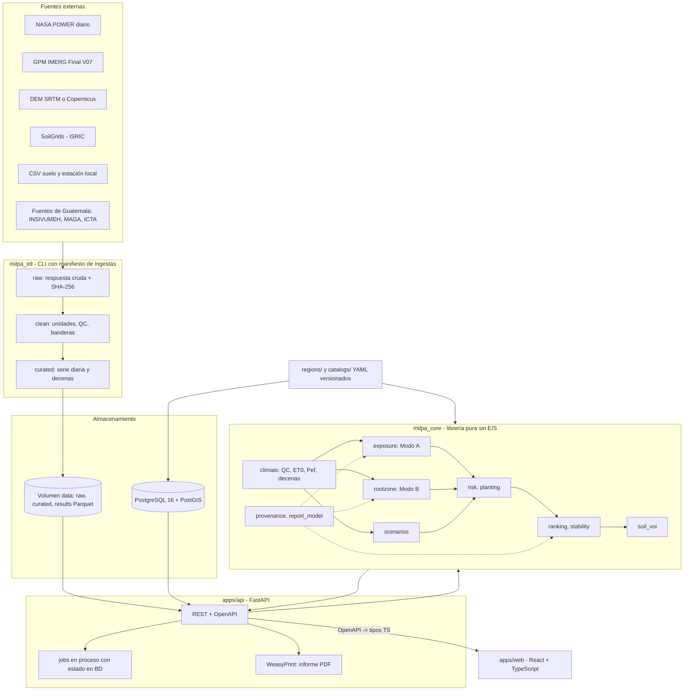
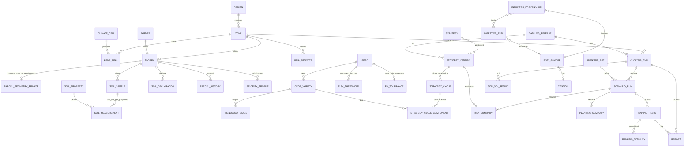
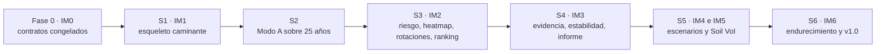
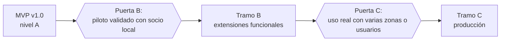

# MILPA RESILIENTE 3.3 — Arquitectura técnica integral del MVP

Nov 14, 2026 · @Brandon

## 1. Resumen ejecutivo y auditoría de 3.2

MILPA RESILIENTE 3.3 conserva el sistema de comparación de estrategias de 3.2 (25 años de clima, estrés en etapas críticas, ranking multicriterio, escenarios, valor de la información del suelo, procedencia en cada cifra) y corrige 25 hallazgos de la auditoría, listados al final de este apartado con su corrección y el apartado donde se resuelve.

**Convención de estado.** Nada en este documento está validado: todo es diseño. Cada elemento lleva una de tres marcas cuando importa: **\[Propuesto\]** (diseñado, sin implementar ni probar), **\[Pendiente\]** (falta una decisión, un dato o una cita; no se inventa) y **\[Verificar\]** (dato externo que el equipo debe confirmar en la fuente antes de congelar).

**Decisiones centrales de 3.3**

- **Dos modelos, no uno.** La *exposición climática* (Modo A, siempre disponible) y el *balance hídrico de la zona radicular* (Modo B, solo con datos de suelo suficientes) son módulos, DTOs y etiquetas distintos.
- **La unidad de análisis de una rotación es la cohorte de inicio.** Una estrategia de varios años se evalúa desde cada año de inicio posible; los resultados se muestran por ciclo y por estrategia completa.
- **Los datos faltantes no ganan.** Un criterio sin evidencia queda *no evaluable*; el ranking usa solo criterios comunes a todas las estrategias elegibles o se declara *insuficiente*.
- **Los escenarios tienen una definición única:** 27 combinaciones con un supuesto primario de humedad, más 18 corridas de sensibilidad al supuesto alternativo (45 corridas en total), y dos lecturas: sin y con regla de adaptación.
- **Monolito modular simple:** Python + FastAPI + PostgreSQL/PostGIS + Parquet + React. Se descartan Dagster, TimescaleDB, Redis, Celery, MinIO, Dask, Sentry y Prometheus para el MVP (apartado 7).
- **Privacidad por minimización:** el MVP no almacena la geometría exacta de las parcelas; el clima de 10–50 km no la necesita.

**Qué se conserva, corrige, simplifica y amplía**

| Acción | Elementos |  |
| --- | --- | --- |
| Se conserva | Principios de diseño; núcleo `milpa_core` sin E/S; procedencia A/B/C por indicador; cuatro pantallas; ET0 FAO-56 PM; análisis por decena; CVaR90, P90 y peor año; estabilidad por muestreo de pesos; 4 roles |  |
| Se corrige | Modos hídricos; precipitación efectiva; humedad en ET0; temporalidad de rotaciones; Soil VoI; disponibilidad de suelo por propiedad; privacidad; escenarios; heatmap; ranking con faltantes; enums y DTOs; claves de resultados; informe |  |
| Se simplifica | Orquestador, base de series, caché, cola, almacenamiento de objetos, observabilidad (apartado 7) |  |
| Se amplía | Piloto Corredor Seco (Jocotán/Camotán), fuentes guatemaltecas, requisitos mínimos económicos y alimentarios, anexo técnico del informe, matriz de trazabilidad completa |  |

**Hallazgos de la auditoría de 3.2 y su corrección**

| ID | Hallazgo en 3.2 | Corrección en 3.3 | § |
| --- | --- | --- | --- |
| A01 | Exposición y balance se calculaban en la misma función `evaluate_season`; el DTO admitía `kind: 'otro'` | Módulos `exposure` y `rootzone` separados, DTOs y etiquetas distintos, requisitos de activación | 11.1 |
| A02 | USDA-SCS y FAO-AGLW, de escala mensual, se aplicaban a decenas sin demostrar validez | Métodos con escala nativa, desagregación documentada, cotas inferior y superior, pruebas de propiedades | 11.4 |
| A03 | `ea` derivada de RH2M sin declararlo; no se aprovechaba T2MDEW | `ea` por punto de rocío (preferente) o RH2M (FAO-56 ec. 19), etiquetada *modelado* y con sensibilidad | 11.3 |
| A04 | Rotaciones iteradas como estrategia × fecha × año; sin año agrícola, cosecha ni descanso | Modelo temporal con cohorte de inicio, año agrícola, ventanas y relaciones entre ciclos | 11.6 |
| A05 | Fecha de siembra mezclada con rotación (`kind='planting_date'` junto a `rotation`) | Ejes de cambio explícitos (`changes_from_reference`) | 11.6, 13 |
| A06 | `soil_voi` devolvía `ranking_stable` si el pH ya estaba medido | Aplicabilidad separada del resultado de estabilidad (`already_measured`, `not_applicable`) | 20 |
| A07 | `soil.availability` marcaba todas las propiedades como medidas si existía cualquier muestra; unión por nombres inconsistentes | Tabla de mediciones por propiedad y vista de estado por propiedad | 13.5 |
| A08 | `location_precision_m` no anonimiza una geometría exacta almacenada | Geometría privada separada, generalizada para vista, minimización, RLS, borrado | 22 |
| A09 | 27 combinaciones sin definir cómo entran los dos supuestos de humedad | 27 + 18 corridas; gramática de identificadores | 19 |
| A10 | Retraso de lluvias sin definición del inicio ni tratamiento de la masa que sale de la ventana | Especificación por tramos, invariantes, definición de inicio con cita o escenario deshabilitado | 19 |
| A11 | Heatmap mezclaba ciclo, cultivo y estrategia en una celda | Vista por ciclo y vista por estrategia con regla de agregación; cuatro estados de celda | 11.9, 18 |
| A12 | `Σ f_i·Kc_i` presentada como demanda del sistema | Aproximación exploratoria con limitaciones; sin órdenes universales | 11.5 |
| A13 | Min–max sin casos degenerados; nulos ambiguos; una estrategia podía ganar por tener menos datos | Soporte común de criterios, estados por criterio, ranking parcial o insuficiente | 11.11 |
| A14 | El algoritmo devolvía `moderate`; el enum SQL y el DTO lo rechazaban; `cfg` indefinido | Enum único de cuatro estados, `StabilityConfig` explícito, prueba de paridad | 11.12, 15 |
| A15 | Calorías, ingresos y márgenes sin requisitos de datos | Requisitos mínimos, referencias distintas de predicciones, margen bruto ≠ beneficio neto | 11.10 |
| A16 | Fuentes guatemaltecas ausentes; riesgo de atribuir a NASA lo que no lo es | Tabla de fuentes con institución, cobertura real y rol | 8 |
| A17 | Reglas A/B/C con umbrales de años de registro sin respaldo | Reglas por indicador; parámetros marcados como propuestos | 21 |
| A18 | Dagster, TimescaleDB, Redis, Celery, MinIO, Sentry y Prometheus para unas 9 000 filas diarias por celda | Monolito modular con CLI de ingesta y Parquet | 7 |
| A19 | `season_result` sin versión de estrategia, humedad, adaptación ni catálogo | Claves completas y tabla `scenario_run` | 13 |
| A20 | `risk_summary` sin nivel ciclo/estrategia | Columnas `level` y `cycle_idx` | 13 |
| A21 | Informe de una página con diez secciones | Página principal más anexo técnico | 18 |
| A22 | Objetivo «p95 < 2 s» presentado como si fuera un hecho | Hipótesis a medir con *benchmark* | 24 |
| A23 | `farm.parcel_history` referenciaba `ref.crop_variety` antes de crearla | Orden de migraciones definido | 13 |
| A24 | Piloto sin valores: riesgo de rellenar con datos inventados | *Region pack* con campos `pending` y modo sandbox rotulado | 11.1, 25 |
| A25 | `year_is_evaluable` mezclaba huecos de variables con `any(axis=1)` | Regla por variable y por ventana del ciclo | 11.2 |

## 2. Definición del producto

MILPA RESILIENTE es un sistema explicable que compara estrategias agrícolas (asociaciones, rotaciones, fechas de siembra, variedades) frente a 25 años de clima observado y a escenarios sintéticos, y muestra qué tan consistente es cada una ante condiciones desfavorables según las prioridades de quien cultiva. No es un visor de datos satelitales, un pronóstico, un simulador de rendimiento ni un sistema de recomendación automática.

**Principio rector.** La mejor estrategia no es la que rinde más en un año promedio, sino la que se comporta de forma más consistente ante condiciones adversas y ante las prioridades reales de los agricultores. Por eso el producto muestra frecuencia, severidad, cola de la distribución y peor año, y muestra los conflictos entre objetivos en lugar de forzar un ganador.

**Usuarios y preguntas que responde**

| Usuario | Pregunta | Pantalla |
| --- | --- | --- |
| Técnico agrícola, cooperativa | ¿Cómo cambió el calendario de lluvias y la exposición al déficit en mi zona en 25 años? | 2 |
| Técnico, agricultor | ¿Qué fechas de siembra evitan que la floración caiga en decenas secas? | 2 |
| Técnico, agricultor | ¿Qué estrategia es más consistente en los años malos, y cambia eso si priorizo alimento sobre ingreso? | 3 |
| Técnico, organización | ¿Qué pasaría con +2 °C, −20 % de lluvia y 20 días de retraso (escenario sintético)? | 3 |
| Técnico | ¿Vale la pena un análisis de laboratorio de pH antes de decidir? | 1 |
| Técnico, financiador | ¿Qué evidencia respalda cada cifra y qué falta verificar en campo? | 4 |

**Lo que el producto afirma y lo que no**

| El sistema puede afirmar | El sistema no puede afirmar |
| --- | --- |
| «En X de los N años evaluables, la decena de floración quedó por encima del umbral de exposición» (solo el formato de la frase: X y N los calcula el motor) | «Esta estrategia dará X quintales» |
| «Con el suelo desconocido, esto es un indicador de exposición climática, no agua en la raíz» | «Esta es la mejor estrategia para su parcela» |
| «Si el pH fuera 5.0 en lugar de 6.5, el primer lugar cambia (valor hipotético)» | «El pH de su parcela es 5.0» |
| «Bajo este escenario sintético, el orden cambia respecto a la línea base» | «Así será el clima en 2040» |

**Glosario obligatorio (se aplica en motor, API, UI e informe)**

- **Exposición climática al déficit (Modo A):** `max(0, ETc − Pef)` por decena en etapas críticas. Compara demanda atmosférica con lluvia efectiva calculada. No es déficit real del suelo.
- **Balance hídrico de la zona radicular (Modo B):** cubeta diaria con capacidad de agua disponible, profundidad de raíces y condición inicial. Solo con datos suficientes. No es predicción de rendimiento.
- **Estrategia:** conjunto versionado de ciclos (asociación o cultivo, temporada, ventana de siembra, relación con el ciclo siguiente). Se distingue de *cambio de fecha de siembra* y *cambio de variedad*.
- **Cohorte de inicio:** instancia de una estrategia que arranca en un año dado y recorre todos sus ciclos.
- **Estabilidad del ranking:** sensibilidad del orden a variaciones de los pesos. No es la probabilidad de que una estrategia sea la mejor.
- **Escenario sintético:** perturbación determinista de la serie histórica. No es pronóstico ni proyección oficial.
- **Valor hipotético:** valor supuesto para explorar si una variable no medida cambiaría el ranking. Nunca se presenta como medición.

## 3. Alcance del MVP

El MVP incluye las 15 funcionalidades diferenciadoras con una sola zona piloto y una infraestructura mínima; lo que no demuestra el núcleo de la propuesta pasa a extensiones (B) o a producción (C). Las tres listas no se mezclan: solo el nivel A es obligatorio para entregar.

| Nivel | Contenido | Obligatorio para el MVP |
| --- | --- | --- |
| **A. MVP implementable** | Ingesta de POWER, IMERG, DEM y SoilGrids; CSV de suelo y de estación; ET0 FAO-56; precipitación efectiva con 3 métodos; calendario fenológico; Modo A y Modo B; cohortes de rotación; riesgo robusto a 25 años; gráfico por decena; heatmap por ciclo y por estrategia; ranking con datos faltantes; estabilidad; 27 + 18 escenarios con dos lecturas; Soil VoI de pH; procedencia A/B/C; informe PDF con anexo; auth con roles; datos de demostración congelados; repositorio reproducible | Sí |
| **B. Extensiones** | MODIS y HLS para validar fenología; SMAP para validar el indicador hídrico (2015+); ajuste de sesgo con estación (*quantile mapping*); NEX-GDDP-CMIP6; Soil VoI de materia orgánica, textura, profundidad y AWC; geometría exacta de parcela con consentimiento reforzado; PWA con caché sin conexión; beneficio neto; segunda región; refresh de tokens | No (se integran si el calendario lo permite, sin bloquear el hito integrado) |
| **C. Producción** | Multiusuario a escala, cola distribuida, almacenamiento de objetos, base de series, caché compartida, observabilidad (métricas y trazas), TLS gestionado, copias de seguridad y recuperación, Terraform, SSO | No |

**Qué significa «MVP completo» (definición de terminado)**

1. Las cuatro pantallas operan sobre la zona piloto con datos reales congelados (`data_hash` fijo) y sobre una zona sintética rotulada.
2. Los 15 requisitos de la idea tienen módulo, endpoint, pantalla y prueba de aceptación (apartado 28).
3. Toda cifra mostrada lleva procedencia y nivel de evidencia; sin cita no hay umbral; sin dato de suelo no hay Modo B.
4. Un tercero ejecuta `make demo` desde un clon limpio y ve las cuatro pantallas sin acceso a las APIs de NASA.
5. Las decisiones **\[Pendiente\]** están listadas (apartado 30) y el sistema degrada de forma rotulada cuando faltan, en lugar de inventar valores.

**Criterio para mover algo de B a A:** solo si sin eso una de las 15 funcionalidades deja de poder demostrarse. Ejemplo: SMAP no entra en A porque no aporta a ninguna funcionalidad de la lista; la validación cruzada IMERG–POWER sí entra, porque sustenta el nivel de evidencia de la lluvia.

## 4. Funcionalidades incluidas y extensiones futuras

Las 15 funcionalidades de la idea se conservan todas en el nivel A; lo que cambia es cómo se construyen. Los identificadores F01–F15 se usan en la matriz de trazabilidad (apartado 28).

| ID | Funcionalidad | Qué se entrega en el MVP | Qué queda fuera (B/C) |
| --- | --- | --- | --- |
| F01 | Historial de unos 25 años | Serie diaria 2001–2025 de la zona, resumen climático, cobertura por variable y año | Tendencias con pruebas estadísticas formales |
| F02 | Comparación robusta de estrategias | Frecuencia, severidad, P90, CVaR90, peor año, años válidos, por ciclo y por estrategia | Intervalos de confianza para cada indicador (en el MVP el remuestreo de años solo se usa para el margen del ranking) |
| F03 | Estrés en floración y llenado de grano | Etapas críticas por variedad según catálogo con cita; si no hay cita, resultado provisional rotulado | Etapas adicionales por cultivo |
| F04 | Análisis por decena | Unidad de cálculo en Modo A; acumulado como vista secundaria | Paso diario en el gráfico |
| F05 | Gráfico Pef vs. ETc | Por estrategia, año y fecha; bandas de etapa; decenas en exceso marcadas | Comparación de dos años lado a lado |
| F06 | Heatmap fecha de siembra × año | Vista por ciclo y vista por estrategia; cuatro estados de celda; fila de porcentaje crítico | Mapa por polígono de zona |
| F07 | Asociaciones y rotaciones | Estructura multianual con cohortes; Kc ponderado como aproximación exploratoria | Modelo de competencia entre cultivos |
| F08 | Ranking multicriterio | Cuatro criterios con estados `evaluable/parcial/no_evaluable`; soporte común | Más criterios (mano de obra, riesgo de mercado) |
| F09 | Sensibilidad a prioridades | Sliders de pesos; reranking en la petición | Perfiles guardados por agricultor con historial |
| F10 | Estabilidad del ranking | Muestreo Dirichlet o bola; 4 estados; conflicto explicado | Arrepentimiento minimax como vista principal |
| F11 | Escenarios sintéticos | 27 + 18 corridas; lectura sin y con adaptación | NEX-GDDP-CMIP6 |
| F12 | Valor de la información del suelo | pH hipotético con matriz documentada | MO, textura, profundidad efectiva, AWC |
| F13 | Procedencia y evidencia | `Indicator` en todo DTO; panel de detalle; reglas A/B/C por indicador | Firma criptográfica de corridas |
| F14 | Informe de decisión | Página principal + anexo técnico, PDF, resumen en inglés | Plantillas por organización |
| F15 | Reproducibilidad | `make demo`, `make reproduce`, hashes, *region pack* alterno | DOI y publicación formal de la versión |

**Extensiones posteriores con valor propio (nivel B):** validación fenológica con NDVI de MODIS y HLS; validación del indicador hídrico con SMAP; ajuste de sesgo de lluvia con estación local; escenarios derivados de NEX-GDDP-CMIP6 con las mismas interfaces que el simulador sintético; geometría exacta de parcela con consentimiento reforzado; PWA para uso sin conexión; beneficio neto con costos de mano de obra familiar; segunda región.

## 5. Principios de arquitectura

Diez principios gobiernan el diseño; los siete primeros vienen de 3.2 y los tres últimos son nuevos. Cada uno tiene una forma de verificarse.

| # | Principio | Cómo se verifica |
| --- | --- | --- |
| P1 | **Núcleo puro.** `milpa_core` no hace E/S, no importa FastAPI, SQLAlchemy ni `requests` | Prueba de importaciones en CI; el núcleo corre en un notebook |
| P2 | **Procedencia primero.** Ningún número sale del núcleo sin `Provenance` y nivel de evidencia | Constructor de `Indicator` rechaza procedencia nula; prueba sobre todos los DTOs |
| P3 | **Gating científico en código.** El motor decide la etiqueta (`exposure` o `root_zone`) según los datos | Pruebas de aceptación A y B del apartado 29 |
| P4 | **Configuración sobre código.** Zona, cultivos, Kc, fenología, umbrales, métodos y prioridades viven en el *region pack* y en catálogos versionados | Añadir una región alterna sin tocar `packages/` (prueba G) |
| P5 | **Reproducibilidad.** Cada corrida registra `code_version`, `config_hash`, `catalog_hash`, `data_hash`, semilla | Misma entrada, mismos bytes de resultado |
| P6 | **Degradación explícita.** Si falta un dato, baja la evidencia, cambia el modo o el criterio queda *no evaluable*, y la salida lo dice | Pruebas de propiedades de faltantes |
| P7 | **Separar lo pesado de lo ligero.** Se precalcula la matriz base; se recalculan en la petición ranking, estabilidad y vistas | Medición con *benchmark* (hipótesis, no resultado) |
| P8 | **Un contrato, una definición.** Enums, estados y etiquetas se definen una vez en `milpa_core.enums` y se exportan a OpenAPI, SQL y TypeScript | Prueba de paridad enum Python ↔ enum SQL ↔ esquema OpenAPI |
| P9 | **Ningún valor agronómico inventado.** Un parámetro sin cita queda `pending` y activa el modo sandbox rotulado | Validador de catálogos; el linter de textos de la UI |
| P10 | **Infraestructura proporcional.** Se añade un componente solo si una función del MVP lo exige; cada descarte queda justificado | Tabla del apartado 7 |

**Fronteras entre módulos (una dirección de dependencia):**

`milpa_core` ← `milpa_etl` (escribe datos curados) · `milpa_core` ← `apps/api` (adaptador) · `apps/api` → `apps/web` (por OpenAPI, nunca por importación). El núcleo no conoce a nadie; la API no conoce al ETL más que por el contrato de archivos curados y por el registro de ingestas.

## 6. Diagrama general

El sistema es un monolito modular en un solo `docker compose`: una imagen web (API + frontend estático + worker en proceso), una base PostgreSQL/PostGIS y un volumen de archivos. El núcleo científico queda en el centro y no depende de nada.



**Tres flujos principales**

1. **Alta de zona (asíncrono).** El técnico define la zona → `POST /zones` crea un trabajo → el ETL descarga, valida y cura 2001–2025 → se calcula ET0 y decenas → se ejecuta la corrida base (matriz estrategia × fecha × cohorte × escenario) → se registra `analysis_run` con hashes → la zona queda `ready`. En la demostración, este flujo se sustituye por el paquete congelado `data/demo/`.
2. **Exploración (síncrono, ligero).** Cambiar pesos, activar un escenario ya calculado o ingresar un pH hipotético recalcula ranking, estabilidad o Soil VoI en memoria sobre resultados ya existentes. Ejecutar escenarios nuevos fuera de la grilla es un trabajo.
3. **Informe.** `POST /reports` ensambla `report_model` → plantilla Jinja2 → WeasyPrint → PDF con hash y `run_id`.

## 7. Stack tecnológico definitivo

El MVP usa un lenguaje (Python) en el backend, un motor de base de datos (PostgreSQL con PostGIS), archivos Parquet para series y resultados, y una SPA React. Las versiones exactas se fijan en `uv.lock` y `package-lock.json`; las menciones de versión de abajo son mínimas **\[Verificar\]** en Fase 0.

| Capa | Elección | Justificación |
| --- | --- | --- |
| Núcleo y ETL | Python 3.12; NumPy, pandas, pyarrow; xarray y rioxarray solo en la lectura de rásteres (DEM, SoilGrids); `earthaccess` para Earthdata | Ecosistema científico estándar; xarray solo donde hay rejillas |
| Validación de datos | pydantic v2 (contratos) y pandera (tablas) | Un solo estilo de validación; errores por fila en CSV |
| Series y resultados | **Parquet** en `data/` (curated y results), particionado por año o por `run_id/scenario_id` | 25 años × \~10 variables × pocas celdas son del orden de 10⁵ filas; no justifican una base de series |
| Base relacional | **PostgreSQL 16 + PostGIS** | Auth, RBAC, RLS para privacidad, registro de procedencia, corridas, catálogos y resúmenes; PostGIS para zonas, generalización de geometrías y pertenencia a celdas |
| Backend | FastAPI, SQLAlchemy 2, Alembic, GeoAlchemy2, argon2-cffi, PyJWT | OpenAPI automático; migraciones versionadas |
| Trabajos | Tabla `engine.job` + pool de procesos en la API (`concurrent.futures`) | Suficiente para 1–2 trabajos concurrentes; el estado vive en la BD |
| Informe | Jinja2 + WeasyPrint | PDF determinista desde HTML/CSS; la misma plantilla sirve de vista previa |
| Frontend | React 18 + TypeScript + Vite; TanStack Query; `openapi-typescript` + `openapi-fetch`; react-i18next (es/en) | Tipos derivados del backend; sin duplicación manual |
| Mapa | **Leaflet** (react-leaflet) | Solo hay polígonos, celdas y un marcador; menos peso que MapLibre; la capa base es configurable |
| Gráficos | Apache ECharts | Heatmap, barras por decena con `markArea` y exportación a imagen para el PDF |
| UI | CSS modules o Tailwind + Radix | Accesibilidad básica con componentes probados |
| Pruebas | pytest, Hypothesis, Schemathesis; Vitest; Playwright; golden files | Apartado 24 |
| Calidad | ruff, mypy (estricto en `milpa_core`), eslint, pre-commit, `pip-audit`, `npm audit` | Apartado 24 |
| Contenedores | Docker Compose con 2 servicios: `db` y `app` (API + estáticos + worker) | Un `docker compose up` |
| CI | GitHub Actions | Pruebas, lint, build de imagen, escaneo de secretos |

**Componentes de 3.2 evaluados y descartados del MVP**

| Componente | Decisión | Razón | Cuándo reconsiderarlo |
| --- | --- | --- | --- |
| Dagster | Descartado | Una CLI con manifiesto SHA-256 por partición anual da el mismo linaje para 5–6 fuentes | Más de 5 zonas o dependencias entre assets complejas (C) |
| TimescaleDB | Descartado | Sin compresión ni agregados continuos útiles a este volumen; Parquet cubre la lectura | Series sub-diarias de muchas celdas (C) |
| Redis | Descartado | No hay cola distribuida; caché con LRU en proceso y `ETag` | Varias instancias de la API (C) |
| Celery / ARQ | Descartado | Un worker en proceso con estado en BD; trabajos idempotentes | Trabajos de más de unos minutos o concurrencia alta (C) |
| MinIO / S3 | Descartado | Un volumen local con interfaz `ObjectStore` (implementación local); la interfaz permite S3 después | Multiusuario con datos compartidos (C) |
| Dask | Descartado | La matriz completa cabe en memoria (apartado 12) | Muchas zonas simultáneas (C) |
| Zustand | Descartado | TanStack Query y estado de URL bastan | — |
| Caddy | Descartado del compose | TLS lo da el host o plataforma; la app sirve HTTP detrás | Despliegue propio (C) |
| Sentry, Prometheus, OpenTelemetry | Descartados | Registros JSON estructurados con redacción de coordenadas y `/healthz` | Operación real (C) |
| Terraform, ECS, Cloud Run | Descartados | Demostración en un VPS o en local | Despliegue en nube (C) |
| **PostGIS** | **Conservado** | Se usa para generalización de geometrías, pertenencia a celdas y tipos espaciales; si el equipo carece de experiencia, ADR de respaldo: GeoJSON en `jsonb` y `shapely` | — |
| **WeasyPrint** | **Conservado** | El informe debe ser un PDF reproducible con hash; necesita bibliotecas Pango en la imagen | — |

**Regla de reevaluación.** Un componente descartado vuelve solo con una medición (latencia, memoria o fallo) que lo justifique, registrada en un ADR.

## 8. Fuentes de datos y cobertura real

Solo POWER e IMERG cubren la ventana 2001–2025 como entradas del historial; todo lo demás es contexto, validación o entrada puntual. Las coberturas y resoluciones de la tabla son las que el diseño asume y cada una debe confirmarse en la ficha oficial del producto en la Fase 0 **\[Verificar\]**. La columna *Institución* evita atribuir a NASA lo que no lo es.

| Fuente | Institución | Cobertura y resolución asumidas | Rol en el sistema | ¿Entra al historial 2001–2025? | Evidencia típica | Alcance (A: MVP, B: extensión) |
| --- | --- | --- | --- | --- | --- | --- |
| NASA POWER diario (comunidad AG) | NASA (reanálisis MERRA-2 y datos CERES) | Desde 1981; meteorología ≈0.5° × 0.625°; radiación en rejilla más gruesa | `T2M_MAX`, `T2M_MIN`, `T2MDEW`, `RH2M`, `WS2M`, `ALLSKY_SFC_SW_DWN` para ET0; `PRECTOTCORR` como respaldo y contraste | Sí | B regional; C para valor de parcela | A |
| GPM IMERG Final V07 | NASA (GES DISC) | Desde junio de 2000; 0.1°; 30 min, agregado a diario | **Precipitación primaria** | Sí | B | A |
| DEM SRTM (30 m) o Copernicus GLO-30 | NASA/USGS o ESA (Copernicus: **no es NASA**) | 30 m | Elevación para presión atmosférica y ET0; pendiente | Contexto fijo | B | A |
| SoilGrids 2.0 | ISRIC (**no es NASA**) | 250 m; incluye cuantiles de incertidumbre | pH, textura, carbono orgánico como suelo *estimado* | Contexto fijo | C | A |
| CSV de suelo de laboratorio | Laboratorio o agricultor | Puntual | Suelo *medido* por propiedad | Contexto fijo | A si el método está documentado | A |
| CSV de estación local | INSIVUMEH, municipalidad, organización | Puntual; registro variable | Contraste y, en B, ajuste de sesgo | Solo si el registro cubre años | A o B según reglas (apartado 21) | A (contraste) |
| MODIS MOD13Q1 v061 | NASA (LP DAAC) | Desde febrero de 2000; 250 m; 16 días | Validar el calendario fenológico observado; máscara agrícola | Sí, como validación | B | B |
| NASA HLS L30/S30 | NASA (con USGS y ESA) | Desde ≈2013; 30 m; 2–3 días | NDVI de parcela en años recientes | No (no cubre 25 años) | B | B |
| SMAP L3/L4 | NASA | Desde 2015; ≈9 km | Validación independiente del indicador hídrico 2015–2025 | **No** como entrada | B/C | B |
| NEX-GDDP-CMIP6 | NASA (NCCS) | 0.25°; 1950–2100 | Escenarios climáticos con modelos; mismas interfaces que el simulador sintético | No | B/C | B |
| FAO-56 (Cap. 6 y Tablas) y literatura agronómica | FAO y publicaciones | — | Kc, duraciones de etapa, profundidad radicular, fracción de agotamiento, umbrales | — | Según la cita | A |

**Fuentes de Guatemala (candidatas; ninguna entra en el cálculo hasta verificar disponibilidad, formato, licencia y representatividad con el socio local)**

| Institución | Posible aporte | Estado |
| --- | --- | --- |
| INSIVUMEH | Series de estaciones meteorológicas para contraste y sesgo | **\[Verificar\]** disponibilidad, longitud y metadatos |
| MAGA | Estadísticas agropecuarias, calendarios de extensión, prácticas reportadas | **\[Verificar\]**; calendarios locales **\[Pendiente\]** de validar con técnicos |
| ICTA | Fichas de variedades de maíz y frijol (ciclo, adaptación) | **\[Verificar\]**; sin ficha no hay variedad en el catálogo |
| INAB | Cobertura y uso de la tierra como contexto | Solo contexto; sin impacto en el ranking |
| SEGEPLAN | Capas territoriales y divisiones administrativas | Solo contexto y límites de zona |

**Decisiones de uso de las fuentes**

1. **Lluvia.** IMERG es la serie primaria; POWER `PRECTOTCORR` se descarga completa como serie paralela de contraste. Se permite sustituir un día faltante de IMERG por POWER solo con bandera `fallback_source`; esos días cuentan como faltantes de la fuente primaria y degradan la evidencia (regla en el apartado 21). No se interpola precipitación.
2. **ET0.** Las variables meteorológicas vienen de POWER. El punto de rocío (`T2MDEW`) es la fuente preferente de `ea`; `RH2M` se usa como alternativa documentada (apartado 11.3).
3. **Elevación.** POWER usa la altitud de su rejilla; la presión atmosférica se calcula con el DEM de 30 m del sitio y se registra la diferencia. Corregir la temperatura por gradiente vertical es opcional, etiquetado *modelado* (C).
4. **Resolución.** Un píxel o una celda no es una parcela. Toda salida declara la resolución de cada insumo; el nivel de evidencia nunca supera B sin verificación local.
5. **Cambios de versión.** El manifiesto de ingesta guarda producto, versión y fecha de consulta; cambiar de versión crea una ingesta nueva y un `data_hash` nuevo, y los resultados antiguos no se reutilizan.
6. **Validación cruzada del MVP.** IMERG vs. POWER vs. estación (si existe) para sesgo y correlación; comparación de ET0 con `T2MDEW` y con `RH2M`. SMAP, MODIS y HLS quedan para el nivel B.

## 9. Arquitectura de ingesta

La ingesta es una CLI (`milpa-etl`, Typer) que convierte respuestas externas en series curadas con linaje verificable; no hay orquestador. Cada paso es idempotente: si el hash de entrada no cambió, no recalcula. Tres capas en disco y un registro en la base.

| Capa | Ruta | Contenido | Regla |
| --- | --- | --- | --- |
| raw | `data/raw/<fuente>/<sha256>` | Respuesta cruda (JSON, NetCDF, GeoTIFF) | Inmutable; direccionada por hash |
| clean | `data/clean/<fuente>/<zona>/<año>.parquet` | Unidades normalizadas, centinelas a nulo, banderas QC | Una partición por año; se regenera desde raw |
| curated | `data/curated/<zona>/daily.parquet`, `dekad.parquet` | Serie diaria lista para el motor, ET0 diaria, agregados por decena, cobertura | Escrita solo por `milpa-etl curate`; lleva `data_hash` |

Cada descarga crea una fila en `prov.ingestion_run` y una línea en `data/manifest/ingestions.jsonl` (fuente, producto, versión, parámetros de consulta, fecha, URI raw, SHA-256, número de registros, estado). Si la validación falla, no se escribe nada en curated y el estado queda `failed` con el informe de errores.

**Comandos**

```bash
milpa-etl fetch power   --zone ZONA --start 2001-01-01 --end 2025-12-31
milpa-etl fetch imerg   --zone ZONA --start 2001-01-01 --end 2025-12-31
milpa-etl fetch dem     --region REGION
milpa-etl fetch soilgrids --zone ZONA
milpa-etl ingest soil-csv  --parcel P-014 --file suelo.csv
milpa-etl ingest station-csv --station EST-01 --file est01.csv --meta station.yaml
milpa-etl curate   --zone ZONA          # QC, ET0, decenas, cobertura
milpa-etl validate --zone ZONA          # IMERG vs POWER vs estación; ET0 con T2MDEW vs RH2M
milpa-etl build-demo                    # congela data/demo/ con hashes
```

**Conectores del MVP**

| Conector | Método | Reglas específicas |
| --- | --- | --- |
| POWER | `GET` a la API diaria por punto; una consulta por zona y conjunto de variables | Reintentos con *backoff*; el valor de relleno (`-999`) pasa a nulo con bit 1; unidades leídas del encabezado de la respuesta, no supuestas; se guarda el JSON completo |
| IMERG | `earthaccess` con recorte espacial en origen; producto diario Final V07 **\[Verificar\]** el nombre exacto del producto y de la variable | Valores de relleno a nulo; se guarda versión del producto; la celda de 0.1° se asigna a la zona con pesos |
| DEM | Descarga única de teselas | Elevación y pendiente por zona; registro de la diferencia con la altitud de la rejilla de POWER |
| SoilGrids | WCS o REST por punto o tesela de la zona | Conversión de unidades del producto (por ejemplo, pH almacenado multiplicado por 10 **\[Verificar\]**); cuantiles p05 y p95 guardados como incertidumbre; siempre `estimado` |
| CSV de suelo | Validación pandera; formato ancho que se descompone en filas por propiedad | Apartado siguiente |
| CSV de estación | Validación pandera + `station.yaml` | Sin `station.yaml` el nivel máximo de evidencia es B |

**Husos horarios.** IMERG diario se agrega por día UTC y los productos de POWER usan su propia convención de día **\[Verificar\]**; Guatemala está en UTC−6. El desfase puede mover un evento a un día contiguo. Se documenta como limitación de los indicadores de lluvia y se mitiga porque el cálculo opera por decena.

**Controles de calidad físicos (no agronómicos)**

| Variable | Condición de rechazo | Acción |
| --- | --- | --- |
| `tmax`, `tmin` | Fuera de \[−60, 60\] °C, o `tmax < tmin` | Nulo con bit 2 |
| `rh` | Fuera de \[0, 100\] % | Nulo con bit 2 |
| `tdew` | Mayor que `tmean` en más de la tolerancia configurada | Bandera; se usa la ruta de `RH2M` ese día |
| `wind2m` | Negativo | Nulo con bit 2 |
| `srad` | Negativa, o mayor que la radiación extraterrestre `Ra` del día | Nulo con bit 2 |
| `precip` | Negativa | Nulo con bit 2 |

**Faltantes (política única)**

- La **precipitación nunca se interpola.** Un hueco de lluvia es información desconocida y reduce `n_valid_days`.
- Temperatura, `tdew`/`rh`, viento y radiación: relleno lineal de huecos de hasta 3 días, con bit 4 (valor de 3.2 que se conserva como parámetro configurable). Si falta la radiación, se estima con Hargreaves–Samani, bit 16, marcada *modelado* y evidencia C.
- Un **ciclo** es evaluable si, dentro de su ventana de siembra a cosecha, el porcentaje de días faltantes de precipitación y de cada variable de ET0 no supera los máximos del *region pack* (`max_missing_precip_pct`, `max_missing_met_pct`). Los valores por defecto son **\[Pendiente\]** de decisión metodológica; no se publican resultados para la zona piloto hasta fijarlos.
- Un año o ciclo no evaluable queda registrado (`not_evaluable`), nunca se rellena ni se descarta en silencio.

**CSV de suelo.** Una fila por muestra; cada propiedad es opcional y una celda vacía significa «no medido», nunca cero. Cada propiedad con valor exige su método.

```csv
parcel_code,sample_date,depth_from_cm,depth_to_cm,lab,ph,ph_method,om_pct,om_method,sand_pct,silt_pct,clay_pct,texture_method,cec_cmol_kg,cec_method,effective_root_depth_cm,awc_mm_per_m,awc_method
P-014,2025-03-12,0,20,Laboratorio X,5.8,H2O_1:2.5,,,42,31,27,hidrometro,,,60,,
```

Ejemplo de formato, no de datos reales. Reglas: UTF-8, punto decimal; `ph` en \[3.0, 10.0\] con `ph_method` obligatorio (el pH en agua y en CaCl₂ no son equivalentes); `sand + silt + clay = 100 ± 2`; fecha no futura; `effective_root_depth_cm` y `awc_mm_per_m` son opcionales y solo activan el Modo B si cumplen los requisitos del apartado 11.1. La fila del ejemplo deja materia orgánica y CIC vacías: tras la ingesta, esas dos propiedades quedan `desconocido`, no `medido`.

**Paquete de demostración congelado.** `milpa-etl build-demo` empaqueta en `data/demo/` las series curadas de la zona piloto 2001–2025, el manifiesto con SHA-256 y una zona sintética con suelo **sintético rotulado** («fixture de prueba, no representa un suelo real»). Los datos de demostración no incluyen coordenadas exactas de parcelas. Se redistribuyen solo las fuentes con `redistributable = true`; para las demás se publican los scripts de descarga y el hash esperado.

## 10. Núcleo científico `milpa_core`

`milpa_core` es una librería Python pura: recibe estructuras de datos inmutables y devuelve resultados con procedencia. No lee archivos, no abre conexiones y no conoce FastAPI. La separación de los dos modelos hídricos es física: viven en paquetes distintos y devuelven tipos distintos, de modo que ningún resultado de exposición puede etiquetarse como balance de suelo por error de código.

```
packages/milpa_core/src/milpa_core/
├─ enums.py            # única definición de estados, modos, etiquetas (P8)
├─ units.py            # convenciones: sufijos _mm, _c, _ms, _mj_m2; sin objetos de unidad en caliente
├─ provenance/         # Indicator, ProvenanceInfo, reglas de evidencia, propagación
├─ climate/            # qc, gapfill, et0_fao56, vapor_pressure, peff/, dekad, evaluability
├─ crops/              # catálogo tipado, calendar, kc_curve, association (aproximación exploratoria)
├─ strategy/           # modelo temporal: cycle, cohort, agri_year, validación de estrategias
├─ exposure/           # Modo A: evalúa ciclos -> CycleExposure
├─ rootzone/           # Modo B: cubeta diaria -> CycleRootZone
├─ gating/             # decide qué modo y qué etiqueta; requisitos de activación
├─ risk/               # agregación por ciclo y por estrategia, umbrales, sensibilidad, consistencia
├─ planting/           # matriz fecha x cohorte y resúmenes, ventanas consistentes
├─ scenarios/          # perturbaciones, onset, adaptación, grilla
├─ criteria/           # agua, suelo, alimento, ingreso con estados y requisitos
├─ ranking/            # normalización, soporte común, pesos, estabilidad, conflictos
├─ soil/               # disponibilidad por propiedad, soil_voi
└─ report_model/       # ensamblado del modelo del informe
```

**Responsabilidad de cada módulo**

| Módulo | Entrada | Salida | Nota de diseño |
| --- | --- | --- | --- |
| `climate` | Serie diaria cruda con banderas | Serie curada, ET0 diaria, decenas, cobertura | Implementa FAO-56 PM; `ea` con dos rutas; Pef como método registrado |
| `crops` | Variedad del catálogo y fecha de siembra | Calendario por etapa y curva Kc diaria | Fenología en días o en GDD; solo con cita |
| `strategy` | Definición versionada de estrategia y año de inicio | Instancia de cohorte con fechas por ciclo | Resuelve año agrícola y relaciones entre ciclos |
| `gating` | Contexto de suelo por propiedad y catálogos | `ModeDecision(mode, label, reasons)` | Nunca inventa datos; devuelve las razones |
| `exposure` | Clima, calendario, umbrales | `CycleExposure` con severidad por etapa | Indicador de exposición; no usa suelo |
| `rootzone` | Clima, calendario, AWC, raíz, condición inicial | `CycleRootZone` con estrés por etapa | Solo si `gating` lo autoriza |
| `risk` | Resultados por ciclo | `CycleRisk` y `StrategyRisk` | Agregación con unidad de análisis explícita |
| `scenarios` | Serie curada, definición de escenario | Serie perturbada con etiqueta | Orden fijo; invariantes testeadas |
| `criteria` | Riesgo, catálogo, perfil del hogar | Criterios con estado y evidencia | Valores desconocidos nunca son cero |
| `ranking` | Criterios, pesos, configuración | Ranking, estabilidad, conflictos | Soporte común de criterios |
| `soil` | Mediciones por propiedad, estimaciones | Estado por propiedad; resultado de VoI | Disponibilidad independiente de la estabilidad |
| `report_model` | Todo lo anterior | Estructura del informe y anexo | Sin formato; la plantilla lo presenta |

**Convenciones del núcleo**

- **Inmutabilidad y determinismo.** `@dataclass(frozen=True)` para entradas y salidas; la aleatoriedad solo con `numpy.random.Generator` sembrado desde un parámetro explícito.
- **Unidades en el nombre** de cada campo (`et0_mm`, `tmax_c`, `srad_mj_m2`); una prueba de contrato revisa que los campos de `Indicator` declaren su unidad.
- **Faltantes como `NaN` más máscara de validez**, nunca cero. Toda función de agregación recibe la máscara y devuelve `n_valid`.
- **Errores tipados**: `MixedCycleLengthError`, `MissingThresholdCitation`, `InsufficientSoilData`, `NotComparable`. La API los traduce a respuestas de error (apartado 16).
- **Sin estado global:** configuración y catálogos entran por parámetro (`RunContext`).

**Fachada pública (estable desde la Fase 0)**

```python
run_analysis(ctx: RunContext, scenario: ScenarioDef, adaptation: AdaptationMode) -> ScenarioRunResult
rank(ctx: RunContext, results: list[StrategyRisk], weights: Weights, cfg: RankingConfig) -> RankingResult
rank_stability(ctx: RunContext, inputs: RankingInputs, cfg: StabilityConfig) -> StabilityResult
soil_voi(ctx: RunContext, parcel: SoilContext, strategies: list[Strategy], cfg: VoiConfig) -> VoiResult
build_report(ctx: RunContext, bundle: AnalysisBundle, locale: Locale) -> ReportModel
```

`RunContext` agrupa `RegionConfig`, `Catalogs`, `ClimateSeries`, `SoilContext`, `PriorityProfile`, semilla y los hashes que se registran en la corrida.

## 11. Modelos matemáticos y algoritmos

La cadena de cálculo es determinista y sin aprendizaje automático: clima curado → ET0 y lluvia efectiva por decena → calendario por ciclo → exposición (Modo A) o balance (Modo B) → agregación → criterios → ranking → escenarios y VoI. Todo parámetro con efecto agronómico viene de un catálogo con cita; los que no la tienen quedan `pending`.

### 11.1 Gating: modos de cálculo y requisitos de activación

El modo lo decide el motor, nunca la interfaz, y es único por corrida: **un ranking nunca mezcla estrategias evaluadas en modos distintos**. Si cualquier estrategia elegible no cumple los requisitos del Modo B, la corrida completa queda en Modo A y la salida lista qué faltó. Un análisis de Modo B en las estrategias que sí cumplen puede mostrarse aparte, rotulado como complementario.

|  | **Modo A — exposición climática** | **Modo B — balance hídrico de la zona radicular** |
| --- | --- | --- |
| Etiqueta (`label`) | `indicador_exposicion_climatica` | `balance_hidrico_zona_radicular` |
| Qué calcula | `max(0, ETc − Pef)` por decena en etapas críticas | Cubeta diaria `Dr` con estrés `1 − Ks` en etapas críticas |
| Qué no es | Déficit real de agua del suelo, humedad real, agua disponible para las raíces | Predicción de rendimiento ni de cosecha |
| Requisitos de activación | Clima evaluable en la ventana del ciclo; calendario con fenología y Kc con cita; umbral con cita (o sandbox rotulado) | Todos los de A, más: (1) **AWC** `medido`, o `estimado` solo mediante una función de pedotransferencia documentada aplicada a textura y materia orgánica `medidas`; (2) **profundidad efectiva** del suelo medida o declarada; (3) **profundidad radicular** y **fracción de agotamiento** por cultivo en el catálogo con cita; (4) **condición inicial** `Dr0` declarada explícitamente como supuesto o medida |
| Datos de suelo ausentes | Funciona | No se activa; no se rellena con valores por defecto del código |
| Evidencia máxima | La menor entre lluvia, ET0, Kc y umbral | La menor entre las anteriores y las de AWC y profundidad |
| Tipo de salida | `ExposureIndicator` | `RootZoneIndicator` |
| Supuestos declarados | Pef método X; `ea` ruta Y | Sin escorrentía (RO = 0) salvo parámetro citado; sin ascenso capilar; Kc único (sin doble coeficiente); `Dr0` |

```python
def decide_mode(soil: SoilContext, strategies: list[Strategy], cfg: GatingConfig) -> ModeDecision:
    missing: list[str] = []
    awc = soil.property('awc')                      # PropertyStatus: valor, estado, método, evidencia
    depth = soil.property('effective_depth')
    if not (awc.status == 'medido' or (awc.status == 'estimado' and awc.method in cfg.accepted_awc_ptf)):
        missing.append('awc')
    if depth.status not in ('medido', 'declarado'):
        missing.append('effective_depth')
    if soil.initial_condition is None:              # debe ser un supuesto declarado, no un valor por defecto
        missing.append('initial_condition')
    for s in strategies:
        for crop in s.crops():
            if crop.root_depth_cited is False or crop.depletion_fraction_cited is False:
                missing.append(f'catalog:{crop.code}')
    if missing:
        return ModeDecision(Mode.EXPOSURE, Label.EXPOSURE_INDICATOR, reasons=missing)
    return ModeDecision(Mode.ROOT_ZONE, Label.ROOT_ZONE_BALANCE, reasons=[])
```

El resultado se guarda en `engine.analysis_run.mode` con `mode_reasons`.

### 11.2 Evaluabilidad de ciclos

Se evalúa **por ciclo y por variable** dentro de la ventana del ciclo (de siembra a cosecha, más el *spin-up* si aplica):

```python
def cycle_evaluable(win: DailyWindow, cfg: RegionConfig) -> Evaluability:
    miss_p = pct_missing(win.precip_mm)
    miss_met = max(pct_missing(win[v]) for v in ET0_INPUTS)    # cada variable por separado, no `any`
    ok = miss_p <= cfg.max_missing_precip_pct and miss_met <= cfg.max_missing_met_pct
    return Evaluability(ok, miss_p, miss_met)
```

Un ciclo no evaluable produce el estado `not_evaluable` y no entra en percentiles ni frecuencias; reduce `n_valid`. Los máximos son **\[Pendiente\]** (apartado 30).

### 11.3 ET0 FAO-56 Penman–Monteith y presión real de vapor

```latex
ET_0=\frac{0.408\,\Delta\,(R_n-G)+\gamma\,\frac{900}{T+273}\,u_2\,(e_s-e_a)}{\Delta+\gamma\,(1+0.34\,u_2)}
```

- Unidades: `T` en °C (media de `Tmax` y `Tmin`), `u2` en m/s a 2 m, `Rn` y `G` en MJ m⁻² día⁻¹, presiones en kPa, ET0 en mm/día. `G = 0` en paso diario.
- `WS2M` de POWER ya está a 2 m; si una estación mide a otra altura, se convierte con el perfil logarítmico de FAO-56 y se registra.
- Presión atmosférica con la elevación del DEM, no con la de la rejilla de POWER: `P = 101.3 · ((293 − 0.0065 z)/293)^5.26`; `γ = 0.665·10⁻³ · P`.
- `e°(T) = 0.6108 · exp(17.27·T/(T + 237.3))`; `es = (e°(Tmax) + e°(Tmin))/2`.
- `Rn = 0.77·Rs − Rnl`, con `Rnl` por Stefan–Boltzmann y el cociente `Rs/Rso` acotado a 1; `Rso = (0.75 + 2·10⁻⁵ z)·Ra`.
- Resultado acotado a `max(0, ET0)` con bandera si el valor sin acotar fue negativo.

**Presión real de vapor `ea`: dos rutas, registradas por día.** `RH2M` de POWER es humedad relativa media a 2 m; no es `RHmax`, `RHmin` ni un punto de rocío medido en campo.

| Ruta | Fórmula | Cuándo se usa | Etiqueta |
| --- | --- | --- | --- |
| **R1 (preferente)** | `ea = e°(Tdew)` con `T2MDEW` | Si `T2MDEW` está presente y pasa QC | `modelado` (reanálisis) |
| **R2 (alternativa)** | `ea = (RH2M/100) · es` (FAO-56, caso de solo `RHmean`) | Si falta `T2MDEW` o falla QC | `modelado` (aproximación) |

La ruta se guarda como `ea_method` en cada día de `climate_daily` y en `ProvenanceInfo.processing_method`. `milpa-etl validate` calcula ET0 con ambas rutas sobre toda la ventana y registra la diferencia estacional; si supera la tolerancia de `region.et0.ea_sensitivity_tol` **\[Pendiente\]**, el indicador lleva la limitación `ea_sensible_a_la_ruta`. Si además `Rs` es modelada por Hargreaves–Samani, la evidencia de ET0 baja a C. ET0 nunca se describe como medición.

**Pruebas de referencia numérica.** Reproducir los ejemplos de ET0 diarios y mensuales de FAO-56 (capítulos 3 y 4) dentro de la tolerancia que fije el ADR de pruebas **\[Verificar\]**; casos límite: `ea > es`, `Rs/Rso > 1`, ET0 sin acotar negativa, elevación 0 y alta, año bisiesto, `T2MDEW` ausente, `Tmax = Tmin`.

### 11.4 Precipitación efectiva por decena

Las fórmulas clásicas de lluvia efectiva se definieron para totales **mensuales**. Aplicarlas a un total de diez días no tiene respaldo. 3.3 aplica cada método en su escala nativa y desagrega a decenas con una regla explícita; la desagregación es una asignación, no un proceso físico.

| Método (`peff_method`) | Fuente | Escala nativa | Adaptación a decenas | Limitaciones |
| --- | --- | --- | --- | --- |
| `usda_scs_fao` | Fórmula simplificada USDA-SCS tal como la presenta FAO: `Pef = P·(125 − 0.2P)/125` si `P ≤ 250 mm/mes`; `Pef = 125 + 0.1P` si `P > 250` **\[Verificar\]** | Mes | Se aplica al total mensual (suma de días con dato completo) y se reparte por decena proporcional a `P` de cada decena: `Pef_d = Pef_mes · P_d / P_mes` | Ignora intensidad, suelo y evapotranspiración; el reparto puede ocultar una racha seca dentro del mes |
| `fao_dependable` | Fórmulas FAO de lluvia dependable: `0.6P − 10` si `P ≤ 70`; `0.8P − 24` si `P > 70`; mínimo 0 **\[Verificar\]** | Mes | Igual al anterior | Definidas para lluvia con probabilidad de excedencia dada, no para totales observados: aproximación conceptual |
| `fixed_fraction` | Parámetro `phi` del *region pack*, con cita | Sin escala | `Pef_d = phi · P_d` | Ignora la no linealidad; línea base de contraste. `phi` es **\[Pendiente\]** |
| `upper_bound` | `Pef = P` | Sin escala | Directa | Cota inferior de la exposición (sin pérdidas); no es una estimación |

- El método primario lo declara el *region pack* con una justificación; en modo sandbox el valor por defecto es `usda_scs_fao`, rotulado **provisional**.
- Si un mes tiene algún día de precipitación faltante, el método mensual devuelve `NaN` para ese mes y sus decenas; no se rellena.
- **Propiedades que se prueban:** `0 ≤ Pef ≤ P`; `Pef = 0` si `P = 0`; `Pef` mensual no decrece al aumentar `P`; la suma de `Pef` de las decenas de un mes es igual a `Pef` del mes.
- **Sensibilidad:** cada corrida recalcula la frecuencia crítica con todos los métodos habilitados; si la frecuencia o el orden del ranking cambian más que la tolerancia de comunicación, el informe declara `peff_sensible_al_metodo` y muestra el rango.
- Se mantienen separados y etiquetados: precipitación observada (`satelital`), precipitación efectiva (`modelado`), ETc (`modelado`) y el indicador de exposición (`modelado`).

**Monotonicidad de la precipitación efectiva (límite declarado).** Con los métodos mensuales, más lluvia en una decena puede reducir la `Pef` asignada a otra decena del mismo mes, porque la fórmula es cóncava: la lluvia temprana del mes baja la eficiencia de la posterior. Por eso la propiedad «más lluvia no aumenta la exposición» se exige para aumentos **uniformes** de lluvia y para el total mensual; con `fixed_fraction` y `upper_bound` vale también para cualquier aumento puntual (`T-P01`, `T-P02`).

### 11.5 Fenología, Kc y asociaciones

- **Catálogo por variedad.** Cada etapa lleva `kc_start`, `kc_end`, duración (en días o en grados-día), marca de etapa crítica y cita. FAO-56: Kc constante en inicial, lineal en desarrollo, constante en media y lineal en final. Un valor sin cita queda `pending` y la variedad solo corre en sandbox.
- **Etapas críticas** (por ejemplo floración y llenado de grano en maíz) son ventanas con cita propia dentro de las etapas de FAO-56; si el catálogo no define una ventana crítica con cita para una variedad, el ciclo no produce indicador de exposición crítica: `queda marcado como provisional (razón provisional_sin_cita)` y no entra en el ranking de producción.
- **Ajuste climático de Kc.** FAO-56 ajusta `Kc_mid` y `Kc_end` con la humedad relativa mínima y el viento. POWER no entrega `RHmin`; **el ajuste queda desactivado en el MVP** y el catálogo usa los valores estándar (limitación declarada).
- **Base fenológica.** Si la fenología está en días, el ciclo dura lo mismo bajo cualquier escenario de temperatura; si está en grados-día (temperatura base y total con cita), el calendario se acorta al calentar. Cada resultado declara cuál usó (`phenology_basis`).
- **Una variedad por mapa.** El motor rechaza (`MixedCycleLengthError`) comparar en una misma vista variedades de duración distinta sin alinear etapas.

**Asociaciones (milpa).** La demanda de un sistema con varios cultivos se aproxima como `ETc_sistema(t) = Σ f_i · Kc_i(t) · ET0(t)`, con `f_i` la fracción declarada de cada componente. Es una **aproximación exploratoria** (evidencia C) que no representa competencia, densidad, arquitectura del dosel, fechas de establecimiento diferentes ni distribución de raíces.

- **El indicador de exposición de una asociación no usa esa suma.** Cada componente se evalúa con su propio Kc, su ventana crítica y su umbral, como si estuviera solo; el ciclo es crítico si algún componente lo es y se reportan las severidades por componente. Como todos comparten la misma lluvia, esta lectura puede subestimar la exposición real de la asociación; se declara.
- La suma ponderada solo se dibuja como línea secundaria exploratoria en el gráfico por decena.
- **No se asume** un orden universal de demanda o de tolerancia entre maíz, frijol y sorgo: la tolerancia se trata por cultivo, variedad y etapa, con cita.
- Una leguminosa **no** se considera por sí misma una mejora de fertilidad. El beneficio depende de la nodulación, la biomasa, la fijación efectiva de nitrógeno, la cosecha y el manejo de residuos; el criterio de suelo lo trata como subindicador con condiciones y evidencia (apartado 11.10).

### 11.6 Modelo temporal de estrategias, rotaciones y cohortes

Este es el cambio estructural más importante de 3.3. Una estrategia es una secuencia ordenada de ciclos con relaciones temporales explícitas; la unidad de análisis es la **cohorte de inicio**.

**Qué distingue cada tipo de estrategia**

| Eje | Qué cambia | Cómo se codifica | Ejemplo conceptual |
| --- | --- | --- | --- |
| Asociación | Componentes dentro de un ciclo | `strategy_cycle_component` con `area_fraction` y `plant_offset_days` | Maíz y frijol en el mismo ciclo |
| Rotación | La secuencia de ciclos en uno o más años agrícolas | Varios `strategy_cycle` con `agri_year_offset` y `season` | Primera: maíz–frijol; postrera: cobertura; año siguiente: otro cultivo |
| Cambio de fecha de siembra | Solo la ventana de siembra | `window_mode` y `plant_window` del ciclo; no crea otra rotación | Sembrar 15 días después |
| Cambio de variedad | Solo `variety_id` del componente | Versión de estrategia distinta con los mismos ciclos | Ciclo corto vs. intermedio |
| Estrategia compuesta | Más de un eje | `changes_from_reference` con varios ejes | Rotación y fecha distinta |

Cada estrategia declara `changes_from_reference` (subconjunto de `association`, `rotation`, `planting_date`, `variety`, `cover_crop`); `kind` se deriva de él. Una modificación de fecha de siembra **nunca** se etiqueta como rotación.

**Estructura de un ciclo (`StrategyCycle`)**

| Campo | Significado |
| --- | --- |
| `cycle_idx` | Orden estricto (1…n) dentro de la estrategia |
| `agri_year_offset` | Año agrícola relativo al año de inicio de la cohorte (0, 1, …) |
| `season` | Temporada del *region pack* (por ejemplo primera, postrera) |
| `components[]` | Variedades, rol (`principal`, `acompanante`, `cobertura`), fracción de área y desfase de siembra |
| `window_mode` | `candidate_dates` (se barren fechas candidatas), `fixed_season_window` (fecha fija de la temporada) o `relative_to_previous_harvest` (cosecha anterior + `rel_lag_days`) |
| `plant_window` | Inicio y fin de la ventana (MM-DD) cuando aplica |
| `harvest_date` | **Derivada** de la fenología y la fecha de siembra, nunca declarada |
| `fallow_after_days` | Reposo entre la cosecha y el siguiente ciclo; puede ser 0 |
| `soil_carryover` | Si el estado hídrico del suelo continúa al siguiente ciclo (solo Modo B) |

**Año agrícola.** Se define en el *region pack* con `agri_year_start` (MM-DD) **\[Pendiente\]** y con un `calendar_year_shift` (0 o 1) por temporada para las que se siembran después del cambio de año calendario. Un ciclo puede cosecharse en el año calendario siguiente; la evaluación exige datos hasta su fecha de cosecha.

**Cohorte.** Una cohorte con año de inicio `Y` instancia todos los ciclos de la estrategia a partir del año `Y`. Es evaluable si todas las fechas de cosecha caen dentro de la ventana de datos. Con ventana 2001–2025, una estrategia de un solo año agrícola tiene hasta 25 cohortes; una de dos años tiene hasta 24, y menos si la cosecha del último ciclo cruza el fin de 2025.

**Resultados por ciclo y por estrategia**

- **Por ciclo-instancia** `(estrategia, cohorte Y, cycle_idx)`: estado, severidad por etapa, faltantes.
- **Por cohorte** `(estrategia, Y)`, con lógica trivalente: `critical` si algún ciclo evaluable es crítico (aunque otros no sean evaluables); `non_critical` solo si todos los ciclos son evaluables y ninguno es crítico; `insufficient_data` en otro caso.
- **Frecuencias.** La frecuencia por cohorte se calcula sobre cohortes decididas (`critical` o `non_critical`) y se reporta con `n_decided` y `n_undecided`. Las estadísticas de severidad usan solo cohortes con todos los ciclos evaluables.
- **Comparabilidad entre horizontes.** Como una estrategia con más ciclos tiene más oportunidades de ser crítica, el criterio hídrico del ranking no usa la frecuencia por cohorte sino medidas invariantes al horizonte: (a) proporción de ciclos-instancia críticos, agrupando todos los ciclos de la estrategia; (b) P90 de severidad por año agrícola; (c) cociente de cola. La frecuencia por cohorte se muestra rotulada como dependiente del horizonte.
- **Cohortes solapadas.** Con horizonte mayor que 1, cohortes consecutivas comparten años de clima: no son muestras independientes. Se reporta el número aproximado de cohortes independientes (`⌊N_años / H⌋`) y no se calculan intervalos de confianza como si lo fueran.

### 11.7 Modo A: exposición climática por ciclo

```python
def evaluate_cycle_exposure(ci: CycleInstance, clim: CuratedClimate, ctx: RunContext) -> CycleExposure:
    ev = cycle_evaluable(clim.window(ci.plant_date, ci.harvest_date), ctx.region)
    if not ev.ok:
        return CycleExposure(state=State.NOT_EVALUABLE, evaluability=ev)
    out = []
    for comp in ci.components:                                   # cada componente por separado
        cal = build_calendar(comp.variety, ci.plant_date, clim.tmean if comp.variety.basis == 'gdd' else None)
        thr = ctx.catalogs.thresholds.get(comp.variety.crop, comp.variety.stage_codes)   # None si no hay cita
        segs = []
        for seg in dekad_stage_segments(cal, only_critical=True):  # decena ∩ etapa crítica
            etc = sum(kc_daily(cal, d) * clim.et0[d] for d in seg.days)
            pef = sum(clim.pef_day[d] for d in seg.days)           # Pef de la decena asignada a días por P_d / P_decena
            e   = max(0.0, etc - pef)
            limit = None if thr is None else thr.for_stage(seg.stage).scaled(seg.n_days / seg.dekad_days)
            segs.append(Segment(seg, etc, pef, e, over=None if limit is None else e > limit))
        out.append(ComponentExposure(comp, segs))
    return CycleExposure.from_components(out, provisional=any(s.over is None for c in out for s in c.segments))
```

- La decena es la unidad de cálculo; una decena seca en floración marca el ciclo aunque el acumulado sea suficiente. El acumulado del ciclo es una vista secundaria.
- Las decenas parciales (la siembra o una etapa empiezan a mitad de decena) se prorratean por días de solapamiento, y el umbral se escala proporcionalmente; es una aproximación declarada.
- Métricas de umbral admitidas en el catálogo (`metric`): `dekad_exposure_mm`, `stage_cum_exposure_mm`, `pef_over_etc_ratio`. Cada una con método de Pef, unidad y cita; un umbral definido con un método de Pef solo se usa con ese método.
- `severity_mm = Σ e` en segmentos críticos; `critical = any(over)`; si algún umbral falta, el estado es `insufficient_data con razón provisional_sin_cita; si existe un umbral provisional sin cita (solo sandbox), el ciclo se calcula con provisional = true`.

### 11.8 Modo B: balance hídrico de la zona radicular

Solo se ejecuta si `decide_mode` lo autoriza. **El Modo B usa la precipitación diaria que llega al suelo, no la lluvia efectiva por decena** (aplicar ambas duplicaría las pérdidas).

```latex
TAW_t = AWC \cdot Z_{r,t}, \qquad Z_{r,t} \le z_{\mathrm{suelo}}, \qquad RAW_t = p \cdot TAW_t
```

```latex
K_{s,t}=\begin{cases}1 & D_{r,t-1}\le RAW_t\\ \max\!\left(0,\ \dfrac{TAW_t-D_{r,t-1}}{(1-p)\,TAW_t}\right) & D_{r,t-1}> RAW_t\end{cases}
```

```latex
D_{r,t}=\mathrm{clip}\big(D_{r,t-1}-(P_t-RO_t)+K_{s,t}K_{c,t}ET_{0,t}+DP_t,\ 0,\ TAW_t\big),\quad DP_t=\max\big(P_t-RO_t-K_{s,t}K_{c,t}ET_{0,t}-D_{r,t-1},0\big)
```

- `AWC` en mm de agua por metro de suelo; `Zr` crece por etapa según el catálogo (con cita) y se limita por la profundidad efectiva del suelo; `p` es la fracción de agotamiento del cultivo (FAO-56, Tabla 22 **\[Verificar\]**).
- Supuestos declarados: `RO = 0` salvo parámetro citado; sin ascenso capilar; Kc único (el doble coeficiente es extensión B); cuando la raíz profundiza, la lámina de agotamiento absoluta se conserva (agua nueva a capacidad de campo).
- **Condición inicial `Dr0`:** supuesto o medición declarados. Se corre con la condición declarada y con capacidad de campo (`Dr0 = 0`); si el resultado cambia más que la tolerancia de comunicación, se declara `sensible_a_condicion_inicial`. Se simula un periodo de calentamiento (`spinup_days`, **\[Pendiente\]**) antes de la siembra.
- **Continuidad entre ciclos.** Con `soil_carryover = true` el estado `Dr` continúa durante el reposo con `fallow_kc` del *region pack* (con cita). Si no existe `fallow_kc`, `soil_carryover` se fuerza a `false`, `Dr` se reinicia con `Dr0` en cada ciclo y el resultado lleva la limitación `sin_continuidad_de_suelo`.
- **Severidad:** `Σ (1 − Ks)` en días de etapas críticas (días-equivalentes de estrés) y días con `Dr > RAW`. El umbral (`stress_days_equiv`) necesita cita; sin ella, `provisional_sin_cita`.

### 11.9 Agregación robusta, heatmap y ventanas de siembra

**Indicadores por ciclo (`CycleRisk`) sobre ciclos-instancia válidos**

| Indicador | Definición | Nota |
| --- | --- | --- |
| `freq_critical_pct` | Críticos / decididos × 100 | `n_valid` y `n_expected` siempre visibles |
| `severity_median_mm`, `severity_p90_mm` | Mediana y percentil 90 de la severidad (percentil con interpolación lineal) | Año no evaluable no entra |
| `severity_cvar90_mm` | Media de las severidades ≥ P90 | Con 25 años son unas 3 observaciones: descriptivo, no estimación estable |
| `worst_year`, `worst_year_severity_mm` | Año y valor de la mayor severidad | — |
| `tail_ratio` | `P90 / max(mediana, ε)` | Dispersión de la cola |
| `threshold_sensitivity` | Frecuencia con umbral bajo, central y alto (`sens_low`, `sens_high`) | Si cambia mucho, la UI lo muestra |
| `peff_sensitivity` | Frecuencia con cada método de Pef habilitado | Declara `peff_sensible_al_metodo` |

Si `n_valid < min_valid_years`, el resumen es `datos_insuficientes`. La etiqueta de consistencia (`consistente`, `variable`, `fallos_en_años_desfavorables`) se asigna **relativa** entre las estrategias comparadas (terciles de `tail_ratio` y de frecuencia crítica) y solo si hay al menos 3 estrategias comparables; no se usan umbrales absolutos.

**Indicadores por estrategia (`StrategyRisk`)**: frecuencia y severidad por cohorte con lógica trivalente (apartado 11.6), más las tres medidas invariantes al horizonte que usa el ranking. Siempre se acompañan de la tabla por ciclo.

**Mapa de calor: dos vistas con semántica distinta**

|  | Vista por ciclo (`view=cycle`) | Vista por estrategia (`view=strategy`) |
| --- | --- | --- |
| Selección | Estrategia, `cycle_idx`, variedad | Estrategia |
| Eje X | Fecha de siembra candidata del ciclo (solo `window_mode = candidate_dates`) | Fecha de siembra candidata del **ciclo ancla** (`anchor_cycle_idx`, por defecto 1) |
| Eje Y | Año calendario de siembra | Año de inicio de la cohorte |
| Celda | Estado del ciclo-instancia y severidad | Estado trivalente de la cohorte y suma de severidades |
| Regla de agregación | No agrega | `any` para el estado, `sum` de mm para la severidad, ambas declaradas en la leyenda |
| Fila inferior | % de años críticos por fecha, sobre decididos | % de cohortes críticas por fecha, sobre decididas |

Los demás ciclos de una estrategia derivan sus fechas del ancla (`fixed_season_window` o `relative_to_previous_harvest`). Solo un ciclo por estrategia puede barrer fechas candidatas; si no, el validador devuelve `MULTIPLE_SWEEP_CYCLES`. Los cultivos no se mezclan en una celda en la vista por ciclo.

**Estados de celda** (los cuatro, con patrón visual distinto y no solo color): `critical`, `non_critical`, `insufficient_data` (hay datos, pero un umbral falta o la lógica trivalente no decide) y `not_evaluable` (cobertura de datos insuficiente). Además se muestran el escenario y la lectura de adaptación aplicados.

**Ventana de siembra consistente (regla descriptiva, configurable):** al menos 3 fechas candidatas contiguas con frecuencia crítica en el primer cuartil entre todas las fechas y P90 de severidad por debajo de la mediana. Sirve para no recomendar «un solo día bueno»; no es una prueba estadística.

### 11.10 Elegibilidad y criterios no hídricos

**Elegibilidad (filtros duros, siempre con motivo registrado)**

- Cultivo o variedad no habilitados en el *region pack* o fuera de su temporada.
- pH fuera del rango absoluto del cultivo **solo si** el pH es `medido` o `estimado` y existe matriz documentada (`ref.ph_tolerance`). Con pH desconocido no se excluye nada; se marca la dependencia.
- Restricciones declaradas por el agricultor (semilla, mano de obra, mercado, riego), tal como las declaró.

**Criterios**

| Criterio | Subindicadores | Requisitos mínimos | Si faltan | Evidencia típica |
| --- | --- | --- | --- | --- |
| **Seguridad hídrica** | Proporción de ciclos críticos agrupada; P90 de severidad por año agrícola; cociente de cola | Riesgo con `n_valid ≥ min_valid_years`; umbrales con cita | `provisional` si hay umbral provisional; `not_evaluable` si hay datos insuficientes | Hereda la del clima (B o menor) |
| **Salud del suelo** | Potencial de aporte de N (marca `fixes_n` **más sus condiciones** en el catálogo); meses de cobertura (derivados del calendario); diversidad de familias; retorno de residuos (catálogo con cita); penalización por repetir familia del cultivo previo (requiere historial declarado); compatibilidad de pH (solo con pH conocido y matriz) | Cada subindicador evaluable solo con sus entradas | Criterio = media de los subindicadores disponibles **comunes a todas las estrategias**; `coverage` visible; bajo `min_subindicator_coverage` **\[Pendiente\]** → `not_evaluable` | C |
| **Alimentación familiar** | kcal y proteína por hectárea | Rendimientos **de referencia** con cita, región y nivel de manejo (rotulados como referencia, no predicción); tabla de composición de alimentos con cita (candidata: tabla INCAP de Centroamérica **\[Verificar\]**) | `not_evaluable`; el tamaño del hogar y el requerimiento (declarados por el usuario, con norma citada) solo habilitan mostrar cobertura del hogar | C |
| **Ingresos y viabilidad** | Ingreso bruto; margen bruto | Precios con unidad, moneda, mercado, **fecha y fuente**; costos variables con fecha y fuente | Con precios pero sin costos: `ingreso_bruto` rotulado, no margen; sin precios: `not_evaluable` y comparación cualitativa; precios más viejos que `price_max_age_days` **\[Pendiente\]** → `desactualizado` | C |

**Definiciones económicas.** *Ingreso bruto* = rendimiento de referencia × precio. *Margen bruto* = ingreso bruto − costos variables. *Beneficio neto* = margen bruto − costos fijos y valoración de la mano de obra familiar; **no se calcula en el MVP** (nivel B). No se inventan rendimientos, precios, costos, tamaño de hogar ni disponibilidad de semilla; el piloto los recoge con el socio local o los deja vacíos.

**Propagación de evidencia.** La evidencia de un criterio es la mínima de sus subindicadores usados; la del ranking es la mínima de los criterios con peso mayor que cero.

### 11.11 Ranking multicriterio con datos faltantes

Los pesos los modifica el usuario. El ranking solo compara lo comparable y registra en un `decision_log` cada decisión de tratamiento de faltantes, visible en la UI y en el informe.

**Reglas**

1. **Conjunto elegible `E`** (apartado 11.10). Con menos de 2 estrategias el resultado es `insufficient`.
2. **Estado por criterio y estrategia:** `evaluable`, `provisional` (umbral o parámetro sin cita) o `not_evaluable`. Un valor desconocido nunca se convierte en cero.
3. **Soporte común.** `C = {criterios evaluables o provisionales para todas las estrategias de E}`. Un criterio que falta en alguna estrategia sale del total para todas, de modo que **ninguna estrategia gana por tener menos datos**. Política alternativa configurable: `exclude_incomplete` (se retiran de `E` las estrategias incompletas, con motivo).
4. **Pesos efectivos:** `w'_c = w_c / Σ_{k∈C} w_k`. `weight_coverage = Σ_{k∈C} w_k`. Si `C` queda vacío o `weight_coverage < min_weight_coverage` (configuración; valor por defecto propuesto 0.5, **\[Pendiente\]** de consenso), el resultado es `insufficient`: se muestra solo la comparación parcial criterio por criterio.
5. **Normalización por criterio en `C`**, con orientación «mayor es mejor» (los criterios de costo se invierten): escala de referencia absoluta del catálogo si existe; si no, min–max sobre `E`. Si `max = min`, el criterio es `non_discriminating`: todas reciben 0.5, se marca y no desempata.
6. **Total** `T_s = Σ w'_c · s_sc`. El desempate es estable y declarado: mayor puntuación hídrica y luego el código de estrategia; los empates (`|ΔT| < ε`) se señalan.
7. **Margen.** Se calcula `top_margin` entre el primero y el segundo; se compara con la incertidumbre del criterio hídrico estimada por *bootstrap* de años (`n_boot` en configuración). Si el margen es menor, `margin_within_uncertainty = true`.
8. **Evidencia** del ranking: mínima entre los criterios con `w'_c > 0`; `provisional` si alguno lo es.
9. **Explicación del orden.** Para cada par de estrategias adyacentes, contribución por criterio `w'_c · (s_Ac − s_Bc)`: «A supera a B en seguridad hídrica (+0.21); B supera a A en alimentación (+0.18)».

```python
def rank(S: Mapping[StrategyId, Mapping[Criterion, CriterionValue]], w: Weights, cfg: RankingConfig) -> RankingResult:
    E = eligible_ids(S)
    if len(E) < 2:
        return RankingResult.insufficient('menos de dos estrategias elegibles')
    C = [c for c in CRITERIA if all(S[s][c].status != Status.NOT_EVALUABLE for s in E) and w[c] > 0]
    cov = sum(w[c] for c in C)
    if not C or cov < cfg.min_weight_coverage:
        return RankingResult.insufficient('criterios comunes insuficientes', partial=partial_table(S, E))
    w_eff = {c: w[c] / cov for c in C}
    scores = {c: normalise(values={s: S[s][c].value for s in E}, scale=cfg.reference_scales.get(c)) for c in C}
    total = {s: sum(w_eff[c] * scores[c][s] for c in C) for s in E}
    order = sorted(E, key=lambda s: (-total[s], -scores[Criterion.WATER].get(s, 0.0), s))
    return RankingResult(order, total, scores, w_eff, cov, evidence=min_evidence(S, E, C),
                         decision_log=build_log(S, E, C, w, cfg))
```

### 11.12 Estabilidad del ranking

La estabilidad mide la **sensibilidad del orden a variaciones de los pesos**, no la probabilidad de que una estrategia sea la mejor. El texto que lo declara es obligatorio en el DTO (`interpretation_es`).

```python
@dataclass(frozen=True)
class StabilityConfig:
    n_samples: int = 2000
    mode: Literal['dirichlet', 'ball'] = 'dirichlet'
    concentration: float = 50.0        # alrededor de los pesos elegidos
    radius: float = 0.10               # modo 'ball'
    stable_share: float = 0.80         # umbral de comunicación, no estadístico
    unstable_share: float = 0.50       # umbral de comunicación, no estadístico
    min_samples: int = 500
    seed: int = 0

def rank_stability(S, w, base: RankingResult, cfg: StabilityConfig) -> StabilityResult:
    if base.status == 'insufficient' or cfg.n_samples < cfg.min_samples:
        return StabilityResult(flag=StabilityFlag.INSUFFICIENT)
    rng = np.random.default_rng(cfg.seed)
    C = list(base.weights.keys()); w0 = np.array([base.weights[c] for c in C])
    if cfg.mode == 'dirichlet':
        Ws = rng.dirichlet(cfg.concentration * np.maximum(w0, 1e-6), size=cfg.n_samples)
    else:
        Ws = project_simplex(w0 + rng.uniform(-cfg.radius, cfg.radius, size=(cfg.n_samples, len(C))))
    orders = [order_for(S, C, w) for w in Ws]
    share = Counter(o[0] for o in orders)
    top_share = {s: n / cfg.n_samples for s, n in share.items()}
    base_share = top_share.get(base.order[0], 0.0)
    tau = float(np.mean([kendall_tau(base.order, o) for o in orders]))
    flag = (StabilityFlag.STABLE if base_share >= cfg.stable_share else
            StabilityFlag.UNSTABLE if base_share < cfg.unstable_share else StabilityFlag.MODERATE)
    return StabilityResult(flag, top_share, tau, conflicts=explain_conflicts(S, C, base, top_share))
```

- **Un solo enum** `StabilityFlag = stable | moderate | unstable | insufficient` en `milpa_core.enums`, usado por el algoritmo, el DTO, el tipo SQL y la UI; una prueba de paridad falla si difieren.
- Los umbrales de comunicación (0.80 y 0.50) son **propuestas de diseño \[Pendiente\]** de consenso del equipo, documentadas como tales. La distribución completa de `top1_share` siempre se muestra.
- Solo participan los criterios de `C`; los pesos de criterios no evaluables no se vuelven a muestrear.
- `explain_conflicts` identifica los pares que se alternan en el primer lugar y el criterio que lo explica, para mostrar la compensación entre objetivos en lugar de forzar un ganador.
- El número de muestras y la semilla se guardan en `engine.ranking_stability`.

### 11.13 Orquestación de una corrida

```python
def run_analysis(ctx: RunContext, scenario: ScenarioDef, adaptation: AdaptationMode) -> ScenarioRunResult:
    decision = decide_mode(ctx.soil, ctx.strategies, ctx.cfg.gating)                       # 11.1
    clim = apply_scenario(ctx.climate, scenario, ctx.region, adaptation)                   # 19 (ET0 y Pef recalculados)
    results = []
    for strat in ctx.strategies:
        for inst in enumerate_cohorts(strat, ctx.region):                                  # 11.6
            for cyc in inst.cycles(ctx.region, clim, adaptation):                          # fechas por ciclo
                fn = evaluate_cycle_exposure if decision.mode is Mode.EXPOSURE else evaluate_cycle_rootzone
                results.append(fn(cyc, clim, ctx))
    cycle_risk = aggregate_cycle(results, ctx.cfg.risk)                                    # 11.9
    strat_risk = aggregate_strategy(results, ctx.cfg.risk)
    return ScenarioRunResult(scenario, adaptation, decision, results, cycle_risk, strat_risk,
                             provenance=collect_provenance(ctx, scenario))
```

La matriz base y los escenarios se ejecutan con esta función y se guardan en Parquet; `rank`, `rank_stability` y `soil_voi` se calculan sobre `strat_risk` y los criterios ya persistidos.

### 11.14 Region pack y catálogos (formato)

Una región nueva se agrega con archivos, sin tocar `packages/`. Todo campo con efecto agronómico es obligatorio en modo producción y admite `pending` solo en sandbox. Los valores de abajo son marcadores: **no son datos agronómicos**.

```yaml
# regions/pilot_corredor_seco.yaml
region: pilot_corredor_seco
status: sandbox                      # production exige que ningún campo requerido esté en pending
pilot_candidates: [jocotan, camotan] # municipios vecinos de Chiquimula; la elección es [Pendiente]
zone:
  name: pending
  polygon_file: pending              # polígono o punto aproximado; sin coordenadas de parcelas
window: { start: 2001-01-01, end: 2025-12-31, min_valid_years: pending }
agri_year_start: pending             # MM-DD
seasons:
  - { code: primera, calendar_year_shift: 0, plant_window: [pending, pending] }
  - { code: postrera, calendar_year_shift: 0, plant_window: [pending, pending] }
planting_candidates: { step_days: pending }
precip: { primary: IMERG_FINAL_V07, fallback: POWER_DAILY, primary_peff: usda_scs_fao,
          peff_justification: pending, peff_enabled: [usda_scs_fao, fao_dependable, fixed_fraction, upper_bound] }
et0: { method: FAO56_PM, ea_primary: dewpoint_T2MDEW, ea_fallback: rh_mean_RH2M,
       elevation_source: DEM, ea_sensitivity_tol: pending }
qc: { max_missing_precip_pct: pending, max_missing_met_pct: pending, max_gap_fill_days: 3 }
onset: { definition: pending, citation: pending }       # sin definición con cita, los escenarios de retraso quedan deshabilitados en producción
adaptation: { lag_days: pending, citation: pending }
scenarios: { grid: standard_27, humidity_primary: constant_rh, humidity_sensitivity: constant_ea }
crops_enabled: [pending]
strategies_file: regions/pilot_corredor_seco.strategies.yaml
priorities_default: { water: 0.25, soil: 0.25, food: 0.25, income: 0.25 }   # neutro; el piloto lo fija con el socio
ranking: { min_weight_coverage: 0.5, missing_policy: common_support }
stability: { n_samples: 2000, mode: dirichlet, concentration: 50, stable_share: 0.80, unstable_share: 0.50 }
locales: [es, en]
```

```yaml
# catalogs/crops.yaml (formato; sin valores)
- code: maiz
  varieties:
    - name: pending
      phenology_basis: days            # o gdd (con gdd_base_c y gdd_total citados)
      stages:
        - { code: INI,  length_days: pending, kc_start: pending, kc_end: pending, critical: false, citation: pending }
        - { code: FLOWERING, length_days: pending, kc_start: pending, kc_end: pending, critical: true, citation: pending }
      root_depth: { z_min_m: pending, z_max_m: pending, citation: pending }       # solo Modo B
      depletion_fraction_p: { value: pending, citation: pending }                 # solo Modo B
  risk_thresholds:
    - { stage: FLOWERING, metric: dekad_exposure_mm, peff_method: usda_scs_fao, value: pending,
        sens_low: pending, sens_high: pending, evidence: pending, citation: pending }
```

**Regla de carga.** Un umbral con `value: pending` o sin `citation` hace fallar la validación en producción. En sandbox el motor corre y marca cada resultado **«umbral provisional — no usar para decisión»**, con evidencia máxima C. Los pesos de prioridad por defecto son neutros (0.25 cada uno) hasta acordar otros con el socio local.

## 12. Gestión de incertidumbre

El sistema no oculta la incertidumbre: la cuantifica donde puede, la rotula donde no, y baja el nivel de evidencia o declara «no evaluable» en lugar de producir un número que parezca más firme de lo que es.

| Fuente de incertidumbre | Tratamiento | Dónde se ve |
| --- | --- | --- |
| Resolución espacial (celdas de 10–50 km frente a una parcela) | Se declara en cada indicador; la evidencia no pasa de B sin verificación local | `ProvenancePanel`, informe |
| Sesgo de lluvia satelital | Contraste IMERG vs. POWER vs. estación; sesgo reportado; ajuste con estación en nivel B | Pantalla 1 (calidad de datos), anexo |
| Humedad en ET0 (`T2MDEW` frente a `RH2M`) | Dos rutas y diferencia estacional; limitación `ea_sensible_a_la_ruta` | Indicador de ET0 |
| Radiación modelada | Hargreaves–Samani solo si falta `Rs`; evidencia C | Indicador de ET0 |
| Método de precipitación efectiva | Todos los métodos habilitados; rango y `peff_sensible_al_metodo` | Tarjeta de riesgo |
| Umbrales de estrés | Bajo, central y alto con cita; sin cita, provisional | Tarjeta de riesgo, heatmap |
| Años no evaluables y faltantes | `n_valid`, `n_expected`, celdas `not_evaluable`; nunca relleno silencioso de lluvia | Cobertura en toda cifra |
| Muestra de 25 años | CVaR90 y P90 declarados como descriptivos; sin intervalos de confianza engañosos en cohortes solapadas | Nota bajo la tabla de riesgo |
| Condición inicial del suelo (Modo B) | Corrida con la declarada y con capacidad de campo | Etiqueta `sensible_a_condicion_inicial` |
| Suelo desconocido o estimado | Estados por propiedad; VoI con valores hipotéticos rotulados | Pantalla 1 |
| Pesos de prioridad | Estabilidad por muestreo de pesos | Pantalla 3 |
| Margen entre primero y segundo | *Bootstrap* de años sobre el criterio hídrico | Alerta `margin_within_uncertainty` |
| Supuestos de escenario (humedad, adaptación, fenología en días) | Dos supuestos de humedad y dos lecturas; limitación de fenología fija | Etiqueta del escenario |
| Rendimientos, precios y costos | Referencias rotuladas; criterio `not_evaluable` si faltan | Criterios y informe |

**Presupuesto de cómputo (hipótesis a medir con *benchmark*, no resultado).** Con hasta 60 estrategias, 25 fechas candidatas, 25 cohortes, unos 2 ciclos por estrategia, 45 corridas de escenario y 2 lecturas de adaptación, la matriz completa es del orden de 10⁶–10⁷ filas de ciclo-instancia. Debería caber en memoria con NumPy/pandas vectorizado y en Parquet comprimido. Si el *benchmark* de la Fase 0 lo contradice, se reabre la decisión de procesar por lotes por escenario.

**Cómo se comunica.** Frecuencia y severidad siempre con `n_valid`; rango de sensibilidad junto al valor central cuando cambia de forma notable; estabilidad con su texto de interpretación; evidencia mínima propagada; supuestos y limitaciones en el panel de detalle y en el anexo del informe.

## 13. Modelo de datos

PostgreSQL guarda entidades, procedencia, corridas y resúmenes; Parquet guarda series y matrices de resultados. El DDL de abajo es **\[Propuesto\]** y es compacto: omite columnas de auditoría repetidas (`created_at`, `updated_at`). Los *enums* se generan desde `milpa_core.enums` y una prueba compara etiquetas Python, SQL y OpenAPI.

**Orden de migraciones (corrige A23):** `auth` → `prov` → `ref` → `geo` → `farm` → `private` → `soil` → `econ` → `engine` → `report`. Convenciones: claves `uuid` salvo catálogos pequeños; `timestamptz`; geometrías en SRID 4326; **todo resultado referencia `run_id`, `scenario_id` y `adaptation_mode`**; todo indicador referencia `prov.indicator_provenance`.

### 13.1 Tipos

```sql
CREATE TYPE provenance_t        AS ENUM ('medido','satelital','estimado','modelado','declarado','desconocido');
CREATE TYPE evidence_t          AS ENUM ('A','B','C');
CREATE TYPE property_status_t   AS ENUM ('medido','estimado','declarado','desconocido','desactualizado','no_representativo','no_disponible');
CREATE TYPE mode_t              AS ENUM ('exposure','root_zone');
CREATE TYPE label_t             AS ENUM ('indicador_exposicion_climatica','balance_hidrico_zona_radicular');
CREATE TYPE cell_state_t        AS ENUM ('critical','non_critical','insufficient_data','not_evaluable');
CREATE TYPE criterion_status_t  AS ENUM ('evaluable','provisional','not_evaluable');
CREATE TYPE ranking_status_t    AS ENUM ('ok','insufficient');
CREATE TYPE stability_flag_t    AS ENUM ('stable','moderate','unstable','insufficient');   -- los 4 estados del algoritmo
CREATE TYPE voi_applicability_t AS ENUM ('evaluable','already_measured','not_applicable');
CREATE TYPE voi_outcome_t       AS ENUM ('ranking_stable','ranking_sensitive','insufficient_info');
CREATE TYPE adaptation_t        AS ENUM ('none','onset_rule');
CREATE TYPE humidity_t          AS ENUM ('not_applicable','constant_rh','constant_ea');
CREATE TYPE strategy_axis_t     AS ENUM ('association','rotation','planting_date','variety','cover_crop');
CREATE TYPE window_mode_t       AS ENUM ('candidate_dates','fixed_season_window','relative_to_previous_harvest');
CREATE TYPE user_role_t         AS ENUM ('tecnico','agricultor','admin');
CREATE TYPE job_status_t        AS ENUM ('queued','running','ok','failed','cancelled');
```

### 13.2 Procedencia (`prov`)

```sql
CREATE TABLE prov.citation (
  citation_id serial PRIMARY KEY, bibkey text UNIQUE NOT NULL, full_text text NOT NULL, doi text, url text);

CREATE TABLE prov.data_source (
  source_id smallint PRIMARY KEY, code text UNIQUE NOT NULL,      -- POWER_DAILY, IMERG_FINAL_V07, DEM_30M, SOILGRIDS_250, STATION_LOCAL, LAB_CSV
  product_name text NOT NULL, institution text NOT NULL,          -- NASA LaRC, NASA GES DISC, ISRIC, INSIVUMEH, ...
  is_nasa boolean NOT NULL, version text, spatial_res_m integer, temporal_res interval,
  license text, redistributable boolean NOT NULL DEFAULT false, access_url text,
  citation_id integer REFERENCES prov.citation);

CREATE TABLE prov.ingestion_run (
  ingestion_id uuid PRIMARY KEY DEFAULT gen_random_uuid(),
  source_id smallint NOT NULL REFERENCES prov.data_source,
  query_params jsonb NOT NULL, queried_at timestamptz NOT NULL DEFAULT now(),
  period_start date, period_end date,
  raw_uri text NOT NULL, raw_sha256 char(64) NOT NULL, n_records bigint,
  status text NOT NULL CHECK (status IN ('ok','partial','failed')), report jsonb);

CREATE TABLE prov.indicator_provenance (
  ip_id uuid PRIMARY KEY DEFAULT gen_random_uuid(),
  run_id uuid,                                    -- FK a engine.analysis_run (se agrega al final); NULL para insumos previos a una corrida
  indicator_code text NOT NULL, unit text NOT NULL,
  provenance provenance_t NOT NULL, evidence_level evidence_t,
  source_ids smallint[] NOT NULL, ingestion_ids uuid[], dataset_version text,
  period_start date, period_end date, spatial_res_m integer, temporal_res interval,
  processing_method text NOT NULL, retrieved_at timestamptz, missing_pct real CHECK (missing_pct BETWEEN 0 AND 100),
  assumptions text[] NOT NULL DEFAULT '{}', limitations text[] NOT NULL DEFAULT '{}',
  evidence_rule_id text NOT NULL,
  CHECK ((provenance = 'desconocido') = (evidence_level IS NULL)));
```

### 13.3 Geografía, usuarios y parcelas (`geo`, `auth`, `farm`, `private`)

```sql
CREATE TABLE geo.region (
  region_id uuid PRIMARY KEY DEFAULT gen_random_uuid(), code text UNIQUE NOT NULL, name text NOT NULL,
  config_uri text NOT NULL, config_hash char(64) NOT NULL, bbox geometry(Polygon,4326) NOT NULL);

CREATE TABLE geo.zone (                          -- unidad de análisis climático; nunca es una parcela
  zone_id uuid PRIMARY KEY DEFAULT gen_random_uuid(), region_id uuid NOT NULL REFERENCES geo.region,
  name text NOT NULL, geom geometry(MultiPolygon,4326) NOT NULL,
  elevation_m real, slope_pct real, ip_elevation uuid REFERENCES prov.indicator_provenance, ready_at timestamptz);
CREATE INDEX ON geo.zone USING gist (geom);

CREATE TABLE geo.climate_cell (
  cell_id serial PRIMARY KEY, source_id smallint NOT NULL REFERENCES prov.data_source,
  centroid geometry(Point,4326) NOT NULL, footprint geometry(Polygon,4326) NOT NULL, UNIQUE (source_id, centroid));
CREATE TABLE geo.zone_cell (
  zone_id uuid REFERENCES geo.zone, cell_id int REFERENCES geo.climate_cell,
  weight real NOT NULL CHECK (weight > 0 AND weight <= 1), PRIMARY KEY (zone_id, cell_id));

CREATE TABLE auth.app_user (
  user_id uuid PRIMARY KEY DEFAULT gen_random_uuid(), email text UNIQUE NOT NULL, password_hash text NOT NULL,
  role user_role_t NOT NULL, disabled_at timestamptz);

CREATE TABLE auth.consent (                      -- consentimiento por propósito y versión del texto
  consent_id uuid PRIMARY KEY DEFAULT gen_random_uuid(), subject_user_id uuid NOT NULL REFERENCES auth.app_user,
  purpose text NOT NULL CHECK (purpose IN ('analysis','report_sharing','exact_geometry')),
  text_version text NOT NULL, granted_at timestamptz NOT NULL, withdrawn_at timestamptz);

CREATE TABLE farm.farmer (
  farmer_id uuid PRIMARY KEY DEFAULT gen_random_uuid(), user_id uuid REFERENCES auth.app_user,
  display_name text NOT NULL, community text, language text NOT NULL DEFAULT 'es', household_size smallint);

CREATE TABLE farm.parcel (                       -- SIN geometría exacta
  parcel_id uuid PRIMARY KEY DEFAULT gen_random_uuid(), zone_id uuid NOT NULL REFERENCES geo.zone,
  farmer_id uuid REFERENCES farm.farmer, code text, area_ha numeric(8,2),
  display_geom geometry(Point,4326),             -- generalizada: centro de una celda de rejilla de G metros (G [Pendiente]; nunca menor a 1 km)
  display_grid_m integer CHECK (display_grid_m >= 1000));

CREATE TABLE private.parcel_geometry (           -- opt-in (nivel B), desactivada por defecto (ENABLE_EXACT_GEOMETRY=false)
  parcel_id uuid PRIMARY KEY REFERENCES farm.parcel, exact_geom geometry(Polygon,4326) NOT NULL,
  consent_id uuid NOT NULL REFERENCES auth.consent);
ALTER TABLE private.parcel_geometry ENABLE ROW LEVEL SECURITY;   -- política: solo el dueño y el rol app_private

CREATE TABLE farm.parcel_history (
  parcel_id uuid REFERENCES farm.parcel, cycle_year smallint, season text, variety_id uuid REFERENCES ref.crop_variety,
  planting_date date, harvest_date date, source text NOT NULL CHECK (source IN ('declarado','detectado_satelite')),
  ip_id uuid REFERENCES prov.indicator_provenance,
  PRIMARY KEY (parcel_id, cycle_year, season, variety_id));

CREATE TABLE farm.priority_profile (
  profile_id uuid PRIMARY KEY DEFAULT gen_random_uuid(), parcel_id uuid REFERENCES farm.parcel,
  w_water numeric(4,3) NOT NULL, w_soil numeric(4,3) NOT NULL, w_food numeric(4,3) NOT NULL, w_income numeric(4,3) NOT NULL,
  constraints jsonb NOT NULL DEFAULT '{}',       -- semilla, mano de obra, mercado, riego: tal como los declaró
  CHECK (abs(w_water + w_soil + w_food + w_income - 1) < 0.001));
```

`farm.parcel_history` referencia `ref.crop_variety`: por eso `ref` se migra antes que `farm` (corrección A23).

```sql
CREATE TABLE farm.technician_assignment (        -- quién puede ver qué agricultor; requiere consentimiento
  technician_id uuid REFERENCES auth.app_user, farmer_id uuid REFERENCES farm.farmer,
  consent_id uuid NOT NULL REFERENCES auth.consent, assigned_at timestamptz NOT NULL DEFAULT now(), revoked_at timestamptz,
  PRIMARY KEY (technician_id, farmer_id));
```

### 13.4 Suelo por propiedad (`soil`, `econ`)

Cada propiedad tiene su propia fila, método, profundidad, fecha, procedencia y vigencia. Una muestra con pH y sin materia orgánica genera una fila de pH y ninguna de materia orgánica.

```sql
CREATE TABLE ref.soil_property (                 -- catálogo: ph, organic_matter, sand, silt, clay, cec, effective_depth, awc
  code text PRIMARY KEY, unit text NOT NULL, valid_min real, valid_max real,
  accepted_methods text[] NOT NULL, max_age_years smallint);   -- NULL = vigencia no definida [Pendiente]; no se marca desactualizado

CREATE TABLE soil.sample (
  sample_id uuid PRIMARY KEY DEFAULT gen_random_uuid(), parcel_id uuid NOT NULL REFERENCES farm.parcel,
  sampled_at date NOT NULL CHECK (sampled_at <= current_date), lab text,
  depth_from_cm smallint NOT NULL, depth_to_cm smallint NOT NULL CHECK (depth_to_cm > depth_from_cm),
  ingestion_id uuid REFERENCES prov.ingestion_run);

CREATE TABLE soil.measurement (
  measurement_id uuid PRIMARY KEY DEFAULT gen_random_uuid(),
  sample_id uuid NOT NULL REFERENCES soil.sample, property_code text NOT NULL REFERENCES ref.soil_property,
  value real NOT NULL,                           -- vacío en el CSV = no hay fila (nunca 0)
  unit text NOT NULL, method text NOT NULL,
  representativeness text NOT NULL CHECK (representativeness IN ('parcela','zona','otra_parcela','desconocida')),
  ip_id uuid NOT NULL REFERENCES prov.indicator_provenance,    -- siempre 'medido'
  UNIQUE (sample_id, property_code));

CREATE TABLE soil.declaration (                  -- valores declarados (p. ej., profundidad efectiva) con su base
  parcel_id uuid REFERENCES farm.parcel, property_code text REFERENCES ref.soil_property,
  value real NOT NULL, unit text NOT NULL, basis text NOT NULL, declared_by uuid REFERENCES auth.app_user,
  declared_at timestamptz NOT NULL DEFAULT now(), ip_id uuid NOT NULL REFERENCES prov.indicator_provenance,
  PRIMARY KEY (parcel_id, property_code));

CREATE TABLE soil.estimate (                     -- productos espaciales; value NULL = la fuente no entrega la propiedad
  zone_id uuid REFERENCES geo.zone, property_code text REFERENCES ref.soil_property, depth_label text,
  value real, p05 real, p95 real, source_id smallint NOT NULL REFERENCES prov.data_source,
  ip_id uuid REFERENCES prov.indicator_provenance, reason text,
  PRIMARY KEY (zone_id, property_code, depth_label));

CREATE VIEW soil.property_status AS               -- una fila por parcela y propiedad (corrige A07)
WITH latest AS (
  SELECT DISTINCT ON (s.parcel_id, m.property_code) s.parcel_id, m.property_code, s.sampled_at, m.representativeness
  FROM soil.measurement m JOIN soil.sample s USING (sample_id)
  ORDER BY s.parcel_id, m.property_code, s.sampled_at DESC)
SELECT p.parcel_id, sp.code AS property_code,
  CASE
    WHEN l.property_code IS NOT NULL AND l.representativeness IN ('otra_parcela','desconocida') THEN 'no_representativo'
    WHEN l.property_code IS NOT NULL AND sp.max_age_years IS NOT NULL
         AND l.sampled_at < current_date - make_interval(years => sp.max_age_years)            THEN 'desactualizado'
    WHEN l.property_code IS NOT NULL                                                           THEN 'medido'
    WHEN d.property_code IS NOT NULL                                                           THEN 'declarado'
    WHEN e.value IS NOT NULL                                                                   THEN 'estimado'
    WHEN e.property_code IS NOT NULL                                                           THEN 'no_disponible'
    ELSE 'desconocido'
  END::property_status_t AS status
FROM farm.parcel p CROSS JOIN ref.soil_property sp
LEFT JOIN latest l ON l.parcel_id = p.parcel_id AND l.property_code = sp.code
LEFT JOIN soil.declaration d ON d.parcel_id = p.parcel_id AND d.property_code = sp.code
LEFT JOIN soil.estimate e ON e.zone_id = p.zone_id AND e.property_code = sp.code;
```

La propiedad derivada `texture` es `medido` solo si `sand`, `silt` y `clay` lo son en la misma muestra; lo calcula `milpa_core.soil` y la vista se usa para el resto. La profundidad de la muestra respecto de la profundidad relevante del cultivo se evalúa en `milpa_core` (una muestra de 0–20 cm no representa el perfil radicular completo).

```sql
CREATE TABLE econ.price_record (
  price_id uuid PRIMARY KEY DEFAULT gen_random_uuid(), crop_id uuid NOT NULL REFERENCES ref.crop, zone_id uuid REFERENCES geo.zone,
  value numeric NOT NULL, unit text NOT NULL, currency char(3) NOT NULL, market text NOT NULL,
  observed_on date NOT NULL, source text NOT NULL, ip_id uuid REFERENCES prov.indicator_provenance);
CREATE TABLE econ.cost_record (
  cost_id uuid PRIMARY KEY DEFAULT gen_random_uuid(), strategy_id uuid, item text NOT NULL, kind text CHECK (kind IN ('variable','fixed')),
  value numeric NOT NULL, unit text NOT NULL, currency char(3) NOT NULL, observed_on date NOT NULL, source text NOT NULL);
```

### 13.5 Catálogos y estrategias (`ref`)

Los YAML son la fuente de verdad; `milpa-etl seed` los carga de forma idempotente y registra `ref.catalog_release`. El motor lee los YAML; la base conserva una copia para las claves foráneas y la API.

```sql
CREATE TABLE ref.catalog_release (
  catalog_release_id uuid PRIMARY KEY DEFAULT gen_random_uuid(), catalog_hash char(64) UNIQUE NOT NULL, git_sha text NOT NULL, loaded_at timestamptz DEFAULT now());

CREATE TABLE ref.crop (
  crop_id uuid PRIMARY KEY DEFAULT gen_random_uuid(), code text UNIQUE NOT NULL, name_es text NOT NULL, name_en text NOT NULL,
  scientific_name text, family text NOT NULL, is_legume boolean, fixes_n_conditions text);   -- la fijación de N es condicional, no un booleano
CREATE TABLE ref.crop_variety (
  variety_id uuid PRIMARY KEY DEFAULT gen_random_uuid(), crop_id uuid NOT NULL REFERENCES ref.crop, name text NOT NULL,
  phenology_basis text NOT NULL CHECK (phenology_basis IN ('days','gdd')), cycle_days int, gdd_base_c real, gdd_total real,
  fallow_kc real, citation_id int REFERENCES prov.citation, UNIQUE (crop_id, name));
CREATE TABLE ref.phenology_stage (
  variety_id uuid REFERENCES ref.crop_variety, stage_code text, seq smallint NOT NULL,
  length_days int, gdd_start real, gdd_end real, is_critical boolean NOT NULL DEFAULT false,
  kc_start real NOT NULL, kc_end real NOT NULL, citation_id int REFERENCES prov.citation,     -- sin cita = pending, solo sandbox
  PRIMARY KEY (variety_id, stage_code));
CREATE TABLE ref.crop_root_param (               -- solo Modo B
  variety_id uuid PRIMARY KEY REFERENCES ref.crop_variety, z_min_m real NOT NULL, z_max_m real NOT NULL,
  depletion_fraction_p real NOT NULL CHECK (depletion_fraction_p > 0 AND depletion_fraction_p < 1), citation_id int NOT NULL REFERENCES prov.citation);
CREATE TABLE ref.risk_threshold (
  threshold_id uuid PRIMARY KEY DEFAULT gen_random_uuid(), crop_id uuid NOT NULL REFERENCES ref.crop, stage_code text NOT NULL,
  metric text NOT NULL CHECK (metric IN ('dekad_exposure_mm','stage_cum_exposure_mm','pef_over_etc_ratio','stress_days_equiv')),
  mode mode_t NOT NULL, peff_method text, value real NOT NULL, unit text NOT NULL, sens_low real NOT NULL, sens_high real NOT NULL,
  evidence_level evidence_t NOT NULL, citation_id int NOT NULL REFERENCES prov.citation);    -- sin cita no hay fila en producción
CREATE TABLE ref.ph_tolerance (
  crop_id uuid PRIMARY KEY REFERENCES ref.crop, ph_abs_min real, ph_opt_min real, ph_opt_max real, ph_abs_max real,
  ph_method text NOT NULL, evidence_level evidence_t NOT NULL, citation_id int NOT NULL REFERENCES prov.citation);
CREATE TABLE ref.reference_yield (               -- REFERENCIA, no predicción
  variety_id uuid REFERENCES ref.crop_variety, region_code text, management_level text, kg_per_ha real NOT NULL,
  evidence_level evidence_t NOT NULL, citation_id int NOT NULL REFERENCES prov.citation, PRIMARY KEY (variety_id, region_code, management_level));
CREATE TABLE ref.food_composition (
  crop_id uuid PRIMARY KEY REFERENCES ref.crop, kcal_per_kg real NOT NULL, protein_g_per_kg real NOT NULL, citation_id int NOT NULL REFERENCES prov.citation);

CREATE TABLE ref.strategy (
  strategy_id uuid PRIMARY KEY DEFAULT gen_random_uuid(), region_id uuid REFERENCES geo.region, code text UNIQUE NOT NULL, name text NOT NULL,
  is_reference boolean NOT NULL DEFAULT false, changes_from_reference strategy_axis_t[] NOT NULL DEFAULT '{}');
CREATE TABLE ref.strategy_version (               -- inmutable una vez publicada
  strategy_version_id uuid PRIMARY KEY DEFAULT gen_random_uuid(), strategy_id uuid NOT NULL REFERENCES ref.strategy, version int NOT NULL,
  catalog_release_id uuid NOT NULL REFERENCES ref.catalog_release, horizon_years smallint NOT NULL CHECK (horizon_years >= 1),
  anchor_cycle_idx smallint NOT NULL DEFAULT 1, UNIQUE (strategy_id, version));
CREATE TABLE ref.strategy_cycle (
  strategy_version_id uuid REFERENCES ref.strategy_version, cycle_idx smallint CHECK (cycle_idx >= 1),
  agri_year_offset smallint NOT NULL CHECK (agri_year_offset >= 0), season text NOT NULL, window_mode window_mode_t NOT NULL,
  plant_window_start char(5), plant_window_end char(5), rel_lag_days smallint, fallow_after_days smallint NOT NULL DEFAULT 0,
  soil_carryover boolean NOT NULL DEFAULT false,
  PRIMARY KEY (strategy_version_id, cycle_idx));
CREATE TABLE ref.strategy_cycle_component (
  strategy_version_id uuid, cycle_idx smallint, variety_id uuid REFERENCES ref.crop_variety,
  role text NOT NULL CHECK (role IN ('principal','acompanante','cobertura')), area_fraction real NOT NULL CHECK (area_fraction > 0 AND area_fraction <= 1),
  plant_offset_days smallint NOT NULL DEFAULT 0, PRIMARY KEY (strategy_version_id, cycle_idx, variety_id),
  FOREIGN KEY (strategy_version_id, cycle_idx) REFERENCES ref.strategy_cycle);
-- invariantes validadas en el cargador: suma de area_fraction por ciclo = 1; ciclos consecutivos sin solape; un solo ciclo con candidate_dates
CREATE TABLE ref.strategy_criteria (
  strategy_version_id uuid REFERENCES ref.strategy_version, criterion text CHECK (criterion IN ('soil','food','income')),
  sub_indicator text, value real, unit text, evidence_level evidence_t NOT NULL, citation_id int REFERENCES prov.citation,
  PRIMARY KEY (strategy_version_id, criterion, sub_indicator));
```

### 13.6 Corridas, escenarios y resultados (`engine`, `report`)

```sql
CREATE TABLE engine.analysis_run (
  run_id uuid PRIMARY KEY DEFAULT gen_random_uuid(), zone_id uuid NOT NULL REFERENCES geo.zone, parcel_id uuid REFERENCES farm.parcel,
  period_start date NOT NULL, period_end date NOT NULL,
  mode mode_t NOT NULL, mode_reasons text[] NOT NULL DEFAULT '{}',          -- decidido por gating
  params jsonb NOT NULL, params_hash char(64) NOT NULL,                       -- peff_method, ea_method, humedad primaria, tolerancias
  region_config_hash char(64) NOT NULL, catalog_release_id uuid NOT NULL REFERENCES ref.catalog_release,
  data_hash char(64) NOT NULL, code_version text NOT NULL, seed bigint NOT NULL,
  created_by uuid REFERENCES auth.app_user, created_at timestamptz DEFAULT now(),
  status text NOT NULL CHECK (status IN ('queued','running','ok','failed')));
ALTER TABLE prov.indicator_provenance ADD FOREIGN KEY (run_id) REFERENCES engine.analysis_run;

CREATE TABLE engine.scenario_def (
  scenario_id text PRIMARY KEY,                    -- BASE | T{+0|+1|+2}_P{+0|-10|-20}_D{+0|+10|+20}_H{na|rh|ea}
  delta_t_c real NOT NULL, precip_factor real NOT NULL, onset_delay_days smallint NOT NULL,
  humidity_assumption humidity_t NOT NULL,
  grid_role text NOT NULL CHECK (grid_role IN ('baseline','primary_grid','humidity_sensitivity')),
  method_doc text NOT NULL, label text NOT NULL DEFAULT 'escenario sintético',
  CHECK ((delta_t_c = 0) = (humidity_assumption = 'not_applicable')));

CREATE TABLE engine.scenario_run (               -- identifica sin ambigüedad qué se calculó
  run_id uuid REFERENCES engine.analysis_run, scenario_id text REFERENCES engine.scenario_def, adaptation_mode adaptation_t,
  status text NOT NULL, results_uri text NOT NULL, results_sha256 char(64), n_rows bigint,
  engine_version text NOT NULL, executed_at timestamptz NOT NULL DEFAULT now(),
  PRIMARY KEY (run_id, scenario_id, adaptation_mode));

CREATE TABLE engine.risk_summary (
  run_id uuid, scenario_id text, adaptation_mode adaptation_t, strategy_version_id uuid REFERENCES ref.strategy_version,
  level text NOT NULL CHECK (level IN ('cycle','strategy')), cycle_idx smallint NOT NULL,        -- 0 = estrategia completa
  n_valid smallint NOT NULL, n_expected smallint NOT NULL, n_decided smallint NOT NULL, coverage_pct real,
  freq_critical_pct real, severity_median real, severity_p90 real, severity_cvar90 real,
  worst_year smallint, worst_year_severity real, tail_ratio real, horizon_years smallint NOT NULL, overlapping_cohorts boolean NOT NULL,
  threshold_sensitivity jsonb, peff_sensitivity jsonb, consistency text, unit text NOT NULL,
  label label_t NOT NULL, provisional boolean NOT NULL, reason text, ip_id uuid REFERENCES prov.indicator_provenance,
  PRIMARY KEY (run_id, scenario_id, adaptation_mode, strategy_version_id, level, cycle_idx),
  FOREIGN KEY (run_id, scenario_id, adaptation_mode) REFERENCES engine.scenario_run,
  CHECK ((level = 'strategy') = (cycle_idx = 0)));

CREATE TABLE engine.planting_summary (
  run_id uuid, scenario_id text, adaptation_mode adaptation_t, strategy_version_id uuid,
  view text CHECK (view IN ('cycle','strategy')), cycle_idx smallint, plant_md char(5),          -- fecha candidata 'MM-DD'
  n_decided smallint, n_valid smallint, pct_critical real, severity_median real, severity_p90 real,
  PRIMARY KEY (run_id, scenario_id, adaptation_mode, strategy_version_id, view, cycle_idx, plant_md),
  FOREIGN KEY (run_id, scenario_id, adaptation_mode) REFERENCES engine.scenario_run);

CREATE TABLE engine.ranking_result (
  ranking_id uuid PRIMARY KEY DEFAULT gen_random_uuid(), run_id uuid NOT NULL, scenario_id text NOT NULL, adaptation_mode adaptation_t NOT NULL,
  status ranking_status_t NOT NULL, missing_policy text NOT NULL, criteria_used text[] NOT NULL,
  weights jsonb NOT NULL, weights_effective jsonb, weight_coverage real,
  scores jsonb, total jsonb, order_ids uuid[], top_margin real, margin_within_uncertainty boolean,
  evidence evidence_t, provisional boolean NOT NULL, decision_log jsonb NOT NULL, eligibility jsonb NOT NULL,
  FOREIGN KEY (run_id, scenario_id, adaptation_mode) REFERENCES engine.scenario_run);

CREATE TABLE engine.ranking_stability (
  stability_id uuid PRIMARY KEY DEFAULT gen_random_uuid(), ranking_id uuid NOT NULL REFERENCES engine.ranking_result,
  n_samples int NOT NULL, mode text NOT NULL, concentration real, radius real, seed bigint NOT NULL,
  stable_share real NOT NULL, unstable_share real NOT NULL,
  top1_share jsonb, rank_corr_mean real, flag stability_flag_t NOT NULL, conflict jsonb);

CREATE TABLE engine.soil_voi_result (
  voi_id uuid PRIMARY KEY DEFAULT gen_random_uuid(), run_id uuid REFERENCES engine.analysis_run, parcel_id uuid REFERENCES farm.parcel,
  property_code text NOT NULL REFERENCES ref.soil_property, property_status property_status_t NOT NULL,   -- disponibilidad: independiente del resultado
  applicability voi_applicability_t NOT NULL, outcome voi_outcome_t, lab_recommended boolean NOT NULL,
  hypotheticals jsonb, top_by_hypothetical jsonb, eligibility_changes jsonb, range_citation_id int REFERENCES prov.citation, rationale text NOT NULL,
  CHECK ((applicability = 'evaluable') = (outcome IS NOT NULL)));

CREATE TABLE engine.job (
  job_id uuid PRIMARY KEY DEFAULT gen_random_uuid(), kind text NOT NULL CHECK (kind IN ('zone_ingest','analysis_run','scenario_run','report')),
  status job_status_t NOT NULL DEFAULT 'queued', progress real, payload jsonb NOT NULL, result jsonb, error jsonb,
  idempotency_key text UNIQUE, attempts smallint NOT NULL DEFAULT 0, created_by uuid REFERENCES auth.app_user,
  created_at timestamptz DEFAULT now(), started_at timestamptz, finished_at timestamptz);

CREATE TABLE report.report (
  report_id uuid PRIMARY KEY DEFAULT gen_random_uuid(), run_id uuid REFERENCES engine.analysis_run, ranking_id uuid REFERENCES engine.ranking_result,
  locale text CHECK (locale IN ('es','es+en')), template_version text, privacy_level text NOT NULL CHECK (privacy_level IN ('internal','public')),
  content_json jsonb NOT NULL, pdf_uri text, pdf_sha256 char(64), generated_by uuid REFERENCES auth.app_user, generated_at timestamptz DEFAULT now());
```

### 13.7 Parquet: series y matrices

| Archivo | Clave | Columnas principales |
| --- | --- | --- |
| `curated/<zona>/daily.parquet` | `(cell_id, obs_date)` | `tmax_c`, `tmin_c`, `tmean_c`, `tdew_c`, `rh_pct`, `wind2m_ms`, `srad_mj_m2`, `precip_mm`, `precip_source`, `ea_method`, `et0_mm`, `qc_flags` |
| `curated/<zona>/dekad.parquet` | `(cell_id, year, dekad)` | `p_mm`, `pef_mm_<método>`, `et0_mm`, `n_days`, `n_valid_days` |
| `curated/<zona>/coverage.parquet` | `(cell_id, variable, year)` | `n_expected`, `n_valid`, `pct_missing` |
| `results/<run_id>/<scenario_id>/<adaptation>/cycle_result.parquet` | `(strategy_version_id, cohort_year, cycle_idx, variety_id, plant_date)` | `harvest_date`, `agri_year`, `state`, `provisional`, `reason`, `exposure_mm` o `stress_days`, `by_stage` (JSON), `n_over_threshold`, `missing_pct` |
| `results/<run_id>/<scenario_id>/<adaptation>/cohort_result.parquet` | `(strategy_version_id, cohort_year, anchor_plant_md)` | `state` (trivalente), `severity_sum`, `n_cycles_decided`, `states_by_cycle` |

`qc_flags` es un entero de bits: 1 faltante, 2 fuera de rango, 4 relleno lineal, 8 sesgo corregido, 16 radiación modelada, 32 fuente de respaldo. La ruta del archivo de resultados contiene `run_id`, `scenario_id` y `adaptation`, de modo que dos escenarios o dos versiones nunca comparten archivo (corrige A19).

## 14. Esquema entidad-relación

El diagrama muestra las relaciones que importan para no mezclar resultados: una estrategia versionada, una corrida, un escenario y una lectura de adaptación identifican siempre el mismo conjunto de filas.



**Cómo leerlo.** `SCENARIO_RUN` (clave `run_id + scenario_id + adaptation_mode`) es el eje de todos los resultados: `RISK_SUMMARY`, `PLANTING_SUMMARY`, `RANKING_RESULT` y los archivos Parquet cuelgan de él. `INDICATOR_PROVENANCE` no aparece enlazado a cada tabla para no saturar el diagrama: toda tabla con cifras la referencia mediante `ip_id`.

## 15. Contratos y DTOs

Los DTOs se definen una sola vez en pydantic v2 (`apps/api/schemas/` sobre los tipos de `milpa_core`). FastAPI publica el OpenAPI; `openapi-typescript` genera los tipos del frontend en cada *build*, de modo que nadie escribe un tipo a mano. Los enums salen de `milpa_core.enums` y se verifican contra SQL.

**Enums compartidos (única definición)**

| Enum | Valores |
| --- | --- |
| `Provenance` | `medido`, `satelital`, `estimado`, `modelado`, `declarado`, `desconocido` |
| `Evidence` | `A`, `B`, `C` (nulo solo con `desconocido`) |
| `PropertyStatus` | `medido`, `estimado`, `declarado`, `desconocido`, `desactualizado`, `no_representativo`, `no_disponible` |
| `Mode` / `Label` | `exposure` ↔ `indicador_exposicion_climatica`; `root_zone` ↔ `balance_hidrico_zona_radicular` |
| `CellState` | `critical`, `non_critical`, `insufficient_data`, `not_evaluable` |
| `CriterionStatus` | `evaluable`, `provisional`, `not_evaluable` |
| `RankingStatus` | `ok`, `insufficient` |
| `StabilityFlag` | `stable`, `moderate`, `unstable`, `insufficient` |
| `VoiApplicability` / `VoiOutcome` | `evaluable`, `already_measured`, `not_applicable` / `ranking_stable`, `ranking_sensitive`, `insufficient_info` |
| `AdaptationMode` | `none`, `onset_rule` |
| `HumidityAssumption` | `not_applicable`, `constant_rh`, `constant_ea` |
| `StrategyAxis` | `association`, `rotation`, `planting_date`, `variety`, `cover_crop` |

**Contratos base**

```python
class ProvenanceInfo(BaseModel):
    provenance: Provenance
    evidence: Evidence | None
    evidence_rule: str                      # id de la regla (auditable)
    sources: list[SourceRef]                # code, product_name, institution, is_nasa, version, citation, url
    dataset_version: str | None
    period: Period | None
    spatial_res: str | None; temporal_res: str | None
    method: str                             # p. ej. 'FAO56-PM; ea=dewpoint; Pef=usda_scs_fao'
    retrieved_at: datetime | None
    missing_pct: float | None
    assumptions: list[str]; limitations: list[str]
    run_id: UUID | None

class ScenarioTag(BaseModel):
    scenario_id: str                        # 'BASE' | 'T+2_P-20_D+20_Hrh'
    label: Literal['escenario sintético']
    delta_t_c: float; precip_factor: float; onset_delay_days: int
    humidity_assumption: HumidityAssumption
    adaptation_mode: AdaptationMode
    method_doc: str; engine_version: str; executed_at: datetime

class Indicator(BaseModel, Generic[T]):    # todo número visible viaja aquí
    code: str; label_es: str; label_en: str
    value: T | None; unit: str
    kind: IndicatorKind                     # exposure | root_zone | climate_input | soil_property | criterion | ranking | economic
    label: Label | None                     # solo para kind exposure/root_zone; el motor lo fija
    provisional: bool = False; reason: str | None = None
    provenance: ProvenanceInfo              # obligatorio
    scenario: ScenarioTag | None = None
```

No existe `kind = 'otro'` (corrige A01). El constructor rechaza un `Indicator` sin `provenance`, con `kind = exposure` y etiqueta de balance (o al revés) y con `provisional = true` sin `reason`.

**Contratos de resultados**

```python
class CycleRiskDTO(BaseModel):
    strategy_version_id: UUID; cycle_idx: int; variety_id: UUID
    freq_critical: Indicator[float]; severity_median: Indicator[float]
    severity_p90: Indicator[float]; severity_cvar90: Indicator[float]
    worst_year: Indicator[int]; worst_year_severity: Indicator[float]
    coverage: Coverage                      # n_valid, n_expected, n_decided, missing_pct
    threshold_sensitivity: Sensitivity      # low, central, high (frecuencias)
    peff_sensitivity: dict[str, float]; flags: list[str]    # 'peff_sensible_al_metodo', ...

class StrategyRiskDTO(BaseModel):
    strategy_version_id: UUID; name: str; changes_from_reference: list[StrategyAxis]
    horizon_years: int; overlapping_cohorts: bool
    cohort_freq_critical: Indicator[float]  # dependiente del horizonte; rotulada
    water_inputs: WaterInputs               # proporción pooled, P90 por año agrícola, cola: lo que usa el ranking
    by_cycle: list[CycleRiskDTO]
    consistency: Literal['consistente','variable','fallos_en_años_desfavorables','no_comparable']

class HeatmapDTO(BaseModel):
    view: Literal['cycle','strategy']; strategy_version_id: UUID; cycle_idx: int | None; variety_id: UUID | None
    scenario: ScenarioTag; mode: Mode; label: Label
    plant_md: list[str]; years: list[int]               # ejes
    state: list[list[CellState]]                          # [año][fecha]
    severity: list[list[float | None]]
    pct_critical_by_date: list[float | None]; n_decided_by_date: list[int]
    aggregation_rule: str | None                          # solo view='strategy': 'any/sum'
    thresholds_used: list[ThresholdUsed]                  # etapa, valor, unidad, método de Pef, cita, provisional
    provenance: ProvenanceInfo

class DekadChartDTO(BaseModel):
    strategy_version_id: UUID; cohort_year: int; cycle_idx: int; plant_date: date; scenario: ScenarioTag
    dekads: list[DekadPoint]        # idx, start, end, pef_mm, etc_mm, exposure_mm (Indicators), critical_stage, over_threshold
    stage_bands: list[StageBand]
    etc_system_exploratory: list[float | None] | None     # solo asociaciones; rotulada 'aproximación exploratoria'
    cumulative: list[CumPoint]
    provenance: DekadProvenance     # pef, etc, p_observed por separado

class RankRequest(BaseModel):
    scenario_id: str; adaptation_mode: AdaptationMode = AdaptationMode.none
    weights: Weights                # water, soil, food, income; suma 1 ± 1e-6
    missing_policy: Literal['common_support','exclude_incomplete'] = 'common_support'
    stability: StabilityRequest     # n_samples, mode, concentration | radius, seed

class RankResponse(BaseModel):
    ranking_id: UUID; status: RankingStatus; criteria_used: list[Criterion]
    weights: Weights; weights_effective: Weights | None; weight_coverage: float | None
    ranking: list[RankedStrategy]   # rank, total, criteria: dict[Criterion, CriterionCell(status, Indicator, normalised)]
    partial_table: list[PartialRow] | None                # si status = insufficient
    top_margin: float | None; margin_within_uncertainty: bool | None
    evidence: Evidence | None; provisional: bool
    decision_log: list[Decision]
    stability: StabilityDTO         # flag: StabilityFlag, top1_share, rank_corr_mean, conflicts, interpretation_es (obligatorio)
    explanations: list[PairExplanation]

class SoilPropertyStatusDTO(BaseModel):
    property_code: str; status: PropertyStatus; value: Indicator | None
    method: str | None; depth_cm: tuple[int, int] | None; sampled_at: date | None
    representativeness: str | None; age_years: float | None; max_age_years: int | None

class SoilVoiResponse(BaseModel):
    property_code: Literal['ph']; property_status: PropertyStatus     # disponibilidad
    applicability: VoiApplicability                                    # independiente del resultado
    outcome: VoiOutcome | None                                         # nulo si applicability != evaluable
    hypotheticals: list[Hypothetical] | None          # value, label='valor hipotético, no medido', top_strategy_id, excluded[]
    lab_recommended: bool; rationale_es: str; range_citation: str | None

class ReportDTO(BaseModel):
    report_id: UUID; run_id: UUID; locale: Literal['es','es+en']; privacy_level: Literal['internal','public']
    pdf_url: str; sha256: str; sections: list[ReportSection]; annex: list[ReportSection]
```

**Errores (un solo formato, RFC 7807 ampliado)**

```json
{ "type": "https://milpa.local/errors/mixed-cycle-length", "title": "Ciclos de distinta duración", "status": 422,
  "code": "MIXED_CYCLE_LENGTH", "detail": "Las variedades A y B tienen etapas distintas; elija una por mapa.",
  "request_id": "...", "errors": [{ "loc": ["body", "variety_id"], "msg": "..." }], "hint": "..." }
```

Códigos: `MIXED_CYCLE_LENGTH`, `MULTIPLE_SWEEP_CYCLES`, `MISSING_THRESHOLD_CITATION`, `INSUFFICIENT_SOIL_DATA`, `NOT_COMPARABLE`, `RUN_NOT_READY`, `SCENARIO_NOT_COMPUTED`, `CSV_VALIDATION_FAILED`, `VALIDATION_ERROR`, `UNAUTHENTICATED`, `FORBIDDEN`, `NOT_FOUND`, `RATE_LIMITED`. Las listas (`/strategies`, `/runs`) usan `Page[T] = {items, next_cursor}` con `limit` máximo configurable.

**Pruebas de contrato.** (1) Paridad de enums Python ↔ SQL ↔ OpenAPI. (2) Un recorrido del JSON Schema de las respuestas que falla si hay un número de presentación fuera de `Indicator`. (3) Schemathesis contra el OpenAPI. (4) `openapi-typescript` en CI: un cambio de DTO que rompe el frontend rompe el *build*.

## 16. API

La API es REST bajo `/v1`, documentada en OpenAPI y servida por FastAPI. **Criterio sync vs. trabajo:** es síncrono lo que lee resultados ya calculados o recalcula sobre resúmenes en memoria (ranking, estabilidad, VoI, heatmap, gráfico de una cohorte); es un trabajo (`202 Accepted` + `job_id`) lo que ejecuta ingesta, el motor sobre una grilla de escenarios o la generación de PDF. Ningún tiempo de respuesta está medido todavía: los objetivos se fijan tras el *benchmark* de la Fase 0.

| Método y ruta | Función | Modo | Roles |
| --- | --- | --- | --- |
| `POST /v1/auth/login`, `GET /v1/auth/me` | Sesión y perfil | Sync | todos |
| `GET /v1/zones`, `GET /v1/zones/{id}` | Contexto de zona: territorio, fuentes disponibles, procedencia, estado de datos de suelo | Sync | todos |
| `POST /v1/zones` | Crear zona; dispara ingesta y curación | **Trabajo** | tecnico, admin |
| `GET /v1/zones/{id}/data-quality` | Cobertura por variable y año; sesgos IMERG/POWER/estación; sensibilidad `T2MDEW` vs `RH2M` | Sync | todos |
| `POST /v1/parcels`, `GET /v1/parcels/{id}` | Alta y lectura (sin geometría exacta) | Sync | agricultor, tecnico |
| `DELETE /v1/parcels/{id}` | Borrado definitivo de la parcela y sus datos | **Trabajo** | dueño, admin |
| `GET /v1/parcels/{id}/soil` | `SoilPropertyStatusDTO[]` por propiedad | Sync | dueño, tecnico asignado |
| `POST /v1/parcels/{id}/soil-samples` | Subir CSV; validación por fila; devuelve errores o filas aceptadas por propiedad | Sync (límite de tamaño) | dueño, tecnico asignado |
| `PUT /v1/parcels/{id}/soil-declarations/{property}` | Declarar un valor con su base (por ejemplo, profundidad efectiva) | Sync | dueño, tecnico asignado |
| `PUT /v1/parcels/{id}/priority-profile` | Pesos y restricciones declaradas | Sync | dueño, tecnico asignado |
| `GET /v1/catalog/crops`, `/strategies`, `/strategies/{id}/versions/{v}`, `/references` | Catálogos con citas | Sync | todos |
| `POST /v1/zones/{id}/runs` | Corrida base: gating, matriz estrategia × cohorte × fecha, escenario `BASE` | **Trabajo** | tecnico, admin |
| `GET /v1/runs/{id}` | Estado, modo, `mode_reasons`, hashes | Sync | todos |
| `GET /v1/runs/{id}/scenarios` | Escenarios y lecturas ya calculados | Sync | todos |
| `POST /v1/runs/{id}/scenarios` | Ejecutar la grilla o combinaciones nuevas | **Trabajo** | tecnico, admin |
| `GET /v1/runs/{id}/climate-history` | Resumen de 25 años y tendencias descriptivas | Sync | todos |
| `GET /v1/runs/{id}/summary?scenario=&adaptation=` | `StrategyRiskDTO[]` paginado | Sync | todos |
| `GET /v1/runs/{id}/heatmap?view=&strategy=&cycle=&variety=&scenario=&adaptation=` | `HeatmapDTO` | Sync | todos |
| `GET /v1/runs/{id}/dekad-chart?strategy=&cohort_year=&cycle=&plant_date=&scenario=` | `DekadChartDTO` (recalcula una cohorte) | Sync | todos |
| `POST /v1/runs/{id}/rank` | `RankRequest` → `RankResponse` con estabilidad | Sync | todos |
| `POST /v1/runs/{id}/soil-voi` | `SoilVoiResponse` | Sync | dueño, tecnico asignado |
| `GET /v1/provenance/{ip_id}` | Detalle completo de procedencia | Sync | todos |
| `POST /v1/reports`, `GET /v1/reports/{id}`, `GET /v1/reports/{id}/pdf` | Informe (generación como trabajo) y descarga | **Trabajo** + Sync | tecnico, dueño |
| `GET /v1/jobs/{id}`, `DELETE /v1/jobs/{id}` | Estado, progreso, resultado o error; cancelación | Sync | creador, admin |
| `GET /healthz` | Salud de la app y de la base | Sync | público (sin datos) |

**Convenciones**

- **Autenticación:** `Authorization: Bearer <JWT>` de vida corta; el *refresh* es nivel B. La demostración pública usa un modo de solo lectura sobre datos congelados y sin parcelas reales.
- **Autorización:** el agricultor solo ve sus parcelas; el técnico solo las de los agricultores que lo asignaron con consentimiento (`farm.technician_assignment`); el administrador no ve contenido privado sin solicitud registrada. Cada endpoint comprueba pertenencia, no solo rol.
- **Trabajos:** `202` + `Location: /v1/jobs/{id}`; la cabecera `Idempotency-Key` evita duplicados; estados `queued|running|ok|failed|cancelled` con `progress`; al arrancar, los trabajos `running` huérfanos se reencolan si son idempotentes o pasan a `failed` con motivo.
- **Caché:** `ETag` por `(run_id, endpoint, parámetros)` y caché LRU en proceso invalidada cuando cambian `data_hash` o `catalog_hash`.
- **Límites:** tamaño máximo de CSV, `limit` máximo de listas y límite de tasa por IP y usuario, todos configurables.
- **Parámetros inválidos:** un escenario o lectura no calculado devuelve `409 SCENARIO_NOT_COMPUTED` con enlace al trabajo que lo calcula; nunca se calcula en silencio dentro de una petición de lectura.
- **Servidor *mock*:** el OpenAPI v0 de la Fase 0 se sirve con un *mock* (por ejemplo, Prism) con respuestas de ejemplo generadas por `milpa_core`, para que el frontend avance sin el motor.

## 17. Arquitectura frontend

El frontend es una SPA React + TypeScript sin lógica científica: pinta lo que el motor entrega y nunca calcula etiquetas, estados ni conclusiones. Los tipos se generan desde el OpenAPI; el cliente es `openapi-fetch`; los datos de servidor viven en TanStack Query y el estado de filtros vive en la URL (compartible y reproducible).

```
apps/web/src/
├─ api/                 # cliente generado (types.gen.ts) + hooks por endpoint
├─ components/
│   ├─ indicator/       # Indicator, EvidenceBadge, ProvenancePanel, ProvisionalBanner
│   ├─ scenario/        # ScenarioBadge, ScenarioPicker, AdaptationToggle
│   ├─ charts/          # DekadChart, Heatmap, RiskCards, StabilityMeter, TradeoffChart
│   ├─ soil/            # SoilStatusTable, SoilUpload, VoiPanel
│   └─ common/          # Loading, Empty, ErrorState, InsufficientData
├─ screens/             # MyZone, CalendarChange, RotationLab, DecisionReport
├─ i18n/                # es.json, en.json (glosario controlado)
├─ lint/copy-linter.ts  # prueba de textos prohibidos
└─ main.tsx
```

**Reglas de la capa de presentación**

1. **Ningún número desnudo.** Toda cifra se pinta con `<Indicator>`: valor, unidad, `EvidenceBadge` (A/B/C), marca de procedencia (`medido`, `satelital`, `estimado`, `modelado`, `declarado`) y acceso al `ProvenancePanel` (fuente, versión, periodo, resolución, método, fecha de descarga, faltantes, supuestos, limitaciones, `run_id`). El panel es operable con teclado.
2. **Etiqueta del motor.** El texto «indicador de exposición climática» o «balance hídrico de la zona radicular» sale del campo `label` del DTO; la UI no lo decide.
3. **Escenario siempre visible.** Si hay `ScenarioTag`, el `ScenarioBadge` «escenario sintético» con parámetros, supuesto de humedad y lectura de adaptación aparece en cada gráfico y tarjeta afectados, y no se puede ocultar.
4. **Estados completos.** Cada pantalla implementa carga, vacío, error (`ErrorState` con `code` y `hint`), `InsufficientData` (explica qué falta y cómo obtenerlo) y `Provisional` (banner «umbral provisional — no usar para decisión»).
5. **Estados de celda sin depender del color:** `critical`, `non_critical`, `insufficient_data` y `not_evaluable` usan patrones y texto alternativo distintos; la leyenda siempre visible.
6. **Valores hipotéticos** se muestran con la etiqueta «valor hipotético, no medido» en el mismo componente que los pinta.
7. **Linter de textos** (`copy-linter`): una prueba falla si aparecen «predicción», «pronóstico», «rendimiento esperado», «garantiza», «mejor estrategia» o «déficit real» fuera de una lista de contextos permitidos (por ejemplo, la frase «no es una predicción»).

**Visualizaciones (ECharts)**

| Vista | Implementación | Detalle |
| --- | --- | --- |
| Gráfico por decena | Barras de `Pef` y `ETc` por decena; `markArea` para floración y llenado de grano; decenas sobre umbral marcadas; conmutador a vista acumulada | Línea secundaria punteada `ETc` del sistema solo en asociaciones, rotulada «aproximación exploratoria» |
| Heatmap | Rejilla fecha × año con patrón por estado; fila inferior de % crítico; filtros de estrategia, ciclo, variedad y escenario | `view=cycle` o `view=strategy`; en esta última la leyenda muestra la regla `any/sum` |
| Tarjetas de riesgo | Frecuencia, severidad, P90, CVaR90, peor año, sensibilidad de umbral, `n_valid` | Rango de sensibilidad junto al valor central |
| Estabilidad | Distribución de `top1_share` por estrategia y bandera de cuatro estados | Texto «mide sensibilidad a los pesos, no la probabilidad de ser la mejor» siempre presente |
| Compensaciones | Barras por criterio para las estrategias que se alternan | Muestra el conflicto explicado por el motor |

**Mapa.** Leaflet con la zona, las celdas climáticas usadas y la ubicación generalizada de la parcela; sin teselas fijas: el proveedor y su atribución se configuran por variable de entorno. No se dibuja nunca geometría exacta de parcelas en el MVP.

**Internacionalización y accesibilidad.** `react-i18next` (es/en) con glosario controlado; contraste y navegación por teclado conforme a WCAG 2.1 AA como objetivo (se verifica con pruebas automáticas y revisión manual, no se declara cumplido); descripciones textuales de gráficos; diseño adaptable. La PWA con caché sin conexión es nivel B.

**Construcción.** `npm run build` produce estáticos que la imagen `app` sirve con FastAPI (`StaticFiles`); en desarrollo, Vite con *proxy* a la API o al *mock*.

## 18. Las cuatro pantallas

Cada pantalla responde una pregunta del apartado 2 y consume endpoints concretos del apartado 16. Lo que sigue define contenido, comportamiento obligatorio y estados especiales.

### Pantalla 1 — Mi zona

*Pregunta:* ¿qué sabemos de este lugar y qué falta saber?

| Bloque | Contenido | Endpoint |
| --- | --- | --- |
| Ubicación y territorio | Zona piloto, celdas climáticas usadas con sus pesos, elevación y pendiente con procedencia, ubicación generalizada de la parcela | `GET /zones/{id}` |
| Contexto agrícola | Cultivos habilitados y temporadas del *region pack*; marcas **\[Pendiente\]** visibles cuando un calendario no está validado | `GET /zones/{id}`, `/catalog/*` |
| Fuentes y calidad | Tabla de fuentes con institución (NASA o no), versión y cobertura; cobertura por variable y año; sesgos IMERG/POWER/estación | `GET /zones/{id}/data-quality` |
| Suelo por propiedad | `SoilStatusTable` con estado, método, profundidad, fecha, representatividad y vigencia de cada propiedad; una propiedad vacía aparece `desconocido` | `GET /parcels/{id}/soil` |
| Subida de análisis | Carga de CSV con errores por fila; declaración de valores (profundidad efectiva) con su base | `POST …/soil-samples`, `PUT …/soil-declarations` |
| Valor de la información | `VoiPanel` del pH: disponibilidad, aplicabilidad, resultado, valores hipotéticos rotulados y recomendación de laboratorio | `POST /runs/{id}/soil-voi` |

*Estados especiales:* si el pH ya está medido, el panel muestra «pH medido» y no un veredicto de estabilidad; sin matriz de tolerancia documentada, muestra «información insuficiente» y qué cita falta.

### Pantalla 2 — Cómo cambió el calendario

*Pregunta:* ¿cómo cambió el clima y cuándo conviene sembrar?

| Bloque | Contenido | Endpoint |
| --- | --- | --- |
| Historial de 25 años | Lluvia y demanda por decena y por año, tendencias descriptivas, cobertura de datos | `GET /runs/{id}/climate-history` |
| Exposición en etapas críticas | Frecuencia de años críticos, severidad, peores años por cultivo, ciclo y variedad | `GET /runs/{id}/summary` |
| Gráfico por decena | `Pef` frente a `ETc`; floración y llenado destacados; decenas en exceso marcadas; conmutador al acumulado | `GET /runs/{id}/dekad-chart` |
| Mapa de calor | Fecha de siembra × año; vista por ciclo o por estrategia; fila inferior de % crítico; ventana consistente destacada | `GET /runs/{id}/heatmap` |

*Estados especiales:* etiqueta de modo siempre visible («indicador de exposición climática» salvo Modo B); banner de umbral provisional en sandbox; celdas `not_evaluable` e `insufficient_data` con patrón propio; si hay `peff_sensible_al_metodo`, el rango entre métodos aparece junto al valor.

### Pantalla 3 — Laboratorio de rotaciones

*Pregunta:* ¿qué estrategia es más consistente y qué cambia si cambian mis prioridades?

| Bloque | Contenido | Endpoint |
| --- | --- | --- |
| Estrategias | Referencia, asociación tradicional de milpa, alternativas, rotaciones y coberturas; cada una con `changes_from_reference` y sus ciclos | `GET /catalog/strategies` |
| Comparación robusta | Tarjetas por estrategia y tabla por ciclo: frecuencia, severidad, P90, CVaR90, peor año, `n_valid`, sensibilidad de umbral y de Pef | `GET /runs/{id}/summary` |
| Escenarios sintéticos | Selector de ΔT, factor de lluvia, retraso, supuesto de humedad y lectura de adaptación; solo combinaciones calculadas; el resto ofrece lanzar el trabajo | `GET/POST /runs/{id}/scenarios` |
| Prioridades | Sliders de los cuatro pesos con suma 1 y estado por criterio (`evaluable`, `provisional`, `no evaluable`) | `POST /runs/{id}/rank` |
| Ranking y por qué | Orden, puntuación por criterio, `weight_coverage`, `decision_log`, explicación por pares | `POST /runs/{id}/rank` |
| Estabilidad | `StabilityMeter` de cuatro estados, `top1_share`, conflicto explicado, texto de interpretación | `POST /runs/{id}/rank` |
| Inversiones de posición | Cambios de orden entre la línea base y el escenario elegido | Calculado en cliente desde dos `RankResponse` |

*Estados especiales:* ranking `insufficient` muestra la tabla parcial y la causa; criterios excluidos por soporte común aparecen con su motivo; una estrategia nunca aparece primera por tener menos datos.

### Pantalla 4 — Informe de decisión

*Pregunta:* ¿qué se decide, con qué evidencia y qué falta verificar?

**Página principal (una hoja A4, texto legible):** resumen ejecutivo; estrategias comparadas y resultados principales (tabla corta); ranking con pesos usados y bandera de estabilidad; evidencia mínima y banner de modo y de provisionalidad; incertidumbre y limitaciones principales; datos faltantes y qué información adicional conviene obtener (por ejemplo, análisis de pH); condiciones a validar en campo; resumen ejecutivo en inglés; `run_id` y hashes.

**Anexo técnico (páginas adicionales):** metodología resumida; supuestos y su sensibilidad (Pef, `ea`, humedad de escenarios, `Dr0`); fuentes con institución y versión; procedencia por indicador; definición de escenarios usados; resultados por ciclo; referencias.

**Privacidad del informe:** nivel `internal` (técnico y dueño) o `public`. El nivel `public` omite el nombre del agricultor, el código de parcela y toda ubicación más fina que la zona. Ningún informe contiene coordenadas exactas (apartado 22).

**No es** una recomendación automática: el texto fijo lo dice y el informe lista las decisiones que siguen siendo humanas.

## 19. Escenarios sintéticos

Un escenario sintético es una perturbación determinista de la serie histórica curada. No es pronóstico, proyección oficial ni probabilidad: explora cuánto cambia la exposición y el orden de las estrategias si el clima se desplazara de una forma dada. NEX-GDDP-CMIP6 queda como fuente de ampliación (nivel B) con la misma interfaz `ScenarioDef`.

**Dimensiones (una sola definición para motor, BD, DTO y UI)**

| Dimensión | Valores | Identificador |
| --- | --- | --- |
| Temperatura (ΔT, °C) | 0, +1, +2 | `T+0`, `T+1`, `T+2` |
| Precipitación (factor) | 1.0, 0.9, 0.8 | `P+0`, `P-10`, `P-20` |
| Retraso del inicio de lluvias (días) | 0, +10, +20 | `D+0`, `D+10`, `D+20` |
| Supuesto de humedad (solo si ΔT ≠ 0) | `constant_rh` (primario), `constant_ea` (sensibilidad) | `Hrh`, `Hea`; `Hna` si ΔT = 0 |
| Lectura de adaptación (eje aparte de la corrida) | `none`, `onset_rule` | `adaptation_mode` |

**Decisión sobre la humedad.** Los dos supuestos no multiplican la grilla por dos: la grilla estándar de **27 combinaciones** usa el supuesto primario (`constant_rh`, que sube menos la demanda y por eso es el más conservador), y el supuesto alternativo (`constant_ea`) se ejecuta como **análisis de sensibilidad** solo para las combinaciones con ΔT ≠ 0. Con ΔT = 0 ambos supuestos coinciden con la línea base y no se ejecutan.

| Grupo | Combinaciones | `grid_role` | Corridas |
| --- | --- | --- | --- |
| Línea base `BASE` (T+0, P+0, D+0, Hna) | 1 | `baseline` | 1 |
| ΔT = 0 con lluvia o retraso modificados | 3 × 3 − 1 = 8 | `primary_grid` | 8 |
| ΔT = +1 o +2, supuesto `constant_rh` | 2 × 3 × 3 = 18 | `primary_grid` | 18 |
| ΔT = +1 o +2, supuesto `constant_ea` | 18 | `humidity_sensitivity` | 18 |
| **Total** |  | 27 en la grilla estándar (1 + 8 + 18) | **45** |

El identificador sigue la gramática `T{+0|+1|+2}_P{+0|-10|-20}_D{+0|+10|+20}_H{na|rh|ea}`; `BASE` es el alias canónico de `T+0_P+0_D+0_Hna`. Cada corrida se repite con las dos lecturas de adaptación cuando la definición de inicio de lluvias y la regla de adaptación están citadas (hasta 90 evaluaciones); sin ellas, solo `none` y los escenarios con retraso quedan deshabilitados en producción.

**Cada resultado lleva `ScenarioTag`:** `scenario_id`, parámetros, supuesto de humedad, lectura de adaptación, método, fecha de ejecución, versión del motor y la etiqueta visible «escenario sintético». Los resultados de un escenario nunca se escriben en los archivos de la línea base (ruta con `scenario_id` y `adaptation`).

**Orden fijo de aplicación:** (1) retraso del inicio de lluvias → (2) escalado de precipitación → (3) perturbación de temperatura → (4) recálculo de ET0 y de precipitación efectiva → (5) evaluación de estrategias. Los pasos 1 y 2 conmutan; el 4 siempre va después de modificar `P` porque la lluvia efectiva no es lineal.

**Temperatura.** `Tmax` y `Tmin` suman ΔT; `Rs`, viento, presión y `Ra` no cambian; ET0 se recalcula con Penman–Monteith completo (no se multiplica ET0 por un factor).

```python
def perturb_temperature(d: DailyClimate, dT: float, humidity: HumidityAssumption) -> DailyClimate:
    es0 = es_from(d.tmax, d.tmin)
    rh_implied = d.ea / es0                              # humedad implícita de la ruta de ea usada en la base
    tmax, tmin = d.tmax + dT, d.tmin + dT
    es1 = es_from(tmax, tmin)
    ea1 = d.ea if humidity is HumidityAssumption.CONSTANT_EA else rh_implied * es1
    out = d.replace(tmax=tmax, tmin=tmin, ea=np.minimum(ea1, es1))
    return out.replace(et0=et0_fao56(out))
```

Si la fenología es en grados-día, el calendario se acorta con el calentamiento; si es en días, el ciclo no cambia y el resultado lleva la limitación `fenologia_fija_en_dias`.

**Precipitación.** `P' = factor · P` día a día: conserva la secuencia de días húmedos y secos y su orden; no cambia la frecuencia de eventos. Una variante que elimine eventos pequeños sería otra extensión con otra etiqueta. Los faltantes siguen siendo faltantes.

**Retraso del inicio de lluvias.** Se separa el *retraso climático* de la *decisión de sembrar*. Con `t0` el día de inicio de lluvias del año base y `δ` el retraso, la serie perturbada queda definida por tramos, y cada evento se mueve **una sola vez**:

```latex
P'_t=\begin{cases}P_t & t<t_0\\ 0 & t_0\le t<t_0+\delta\\ P_{t-\delta} & t\ge t_0+\delta\end{cases}
```

```python
def delay_rain_onset(p: np.ndarray, t0: int, delta: int) -> tuple[np.ndarray, float]:
    n = len(p)
    if t0 + delta >= n:
        raise ScenarioNotApplicable('el retraso excede la serie del año agrícola')
    out = np.empty_like(p)
    out[:t0] = p[:t0]
    out[t0:t0 + delta] = 0.0
    out[t0 + delta:] = p[t0:n - delta]                  # los NaN viajan con su evento
    mass_dropped = float(np.nansum(p[n - delta:]))        # lluvia que sale de la serie; se reporta
    return out, mass_dropped
```

- **Invariantes (pruebas):** `P'_t = P_t` antes de `t0`; el tramo `[t0, t0+δ)` es 0; `Σ P' + masa_descartada = Σ P`; `δ = 0` devuelve la serie idéntica; aplicar `δ₁` y luego `δ₂` equivale a una vez `δ₁ + δ₂` (la composición es aditiva con el mismo t0; las corridas de la grilla nunca componen dos retrasos).
- La serie sobre la que se aplica es la del año agrícola extendida con `buffer_days` del *region pack*, para que la lluvia de fin de temporada no se descarte sin necesidad.
- **Inicio de lluvias `t0`.** Definición agroclimática del *region pack* (inicio de búsqueda, acumulado `X` mm en `N` días y ausencia de periodo seco mayor que `Y` días en los siguientes `Z`); todos los parámetros con cita **\[Pendiente\]**. Si un año no tiene inicio detectable, ese año es `not_evaluable` en los escenarios de retraso.
- Las fechas candidatas de siembra del heatmap son **absolutas**: el desplazamiento de lluvias no se confunde con mover la siembra.

**Dos lecturas de adaptación.** `none`: la siembra queda en la fecha candidata original. `onset_rule`: en cada año la siembra ocurre en la primera fecha candidata igual o posterior a `t0' + lag`, con `lag` del *region pack* (cita **\[Pendiente\]**); solo aplica a ciclos con `window_mode = candidate_dates`. Como la fecha varía por año, el heatmap solo existe para `none`; para `onset_rule` la UI muestra la fecha aplicada por año y la diferencia de frecuencia crítica frente a `none` (cuánto del riesgo recupera el manejo, según la regla declarada).

**Comparación con la línea base.** Para cada escenario se calculan las **inversiones de posición** del ranking respecto de `BASE` y el cambio de severidad. Si el orden o la frecuencia difieren entre `Hrh` y `Hea` más que la tolerancia de comunicación, se marca `escenario_sensible_a_humedad`.

## 20. Valor de la información del suelo (Soil VoI)

Soil VoI responde una pregunta concreta: si el pH no se conoce, ¿podría cambiar la estrategia que queda primera, según valores hipotéticos, y por lo tanto vale la pena medirlo? No predice rendimiento ni afirma el pH de la parcela.

**Tres conceptos separados (corrige A06).** La *disponibilidad* de la propiedad (`property_status`) no es lo mismo que la *aplicabilidad* del análisis ni que su *resultado*.

| `property_status` | `applicability` | `outcome` | `lab_recommended` |
| --- | --- | --- | --- |
| `medido` (vigente y representativo) | `already_measured` | nulo | `false`; el panel dice «pH medido» |
| `desactualizado`, `no_representativo`, `estimado`, `declarado`, `desconocido`, `no_disponible` | `evaluable` | `ranking_stable`, `ranking_sensitive` o `insufficient_info` | `true` solo si `ranking_sensitive` |
| Cualquiera, con ranking base `insufficient`, o propiedad no soportada por el VoI del MVP | `not_applicable` | nulo | `false` |

La base de datos lo impone: `outcome` es nulo si y solo si `applicability ≠ evaluable`.

**Valores hipotéticos.** Se toman de (a) el rango p05–p95 del producto espacial cuando el pH es `estimado`, o (b) el rango agronómico de la zona declarado en el *region pack* con cita **\[Pendiente\]**. Si ninguno existe, el resultado es `insufficient_info`. Se generan `n_hyp` valores equiespaciados en el rango (cinco por defecto); no representan una distribución de probabilidad. Cada uno se rotula **«valor hipotético, no medido»** en el DTO, la UI y el informe.

**Matriz de tolerancia.** `ref.ph_tolerance` por cultivo: rango óptimo, rango absoluto, método de pH y cita. La compatibilidad es trapezoidal (1 dentro del óptimo, decrece linealmente hasta 0 en el límite absoluto; fuera del absoluto, exclusión). Solo afecta a la elegibilidad y al subindicador `ph_compat` del criterio de suelo, **nunca a un rendimiento**. Si un cultivo no tiene matriz con cita, su compatibilidad es `UNKNOWN` y no se inventa. El método de pH (agua, CaCl₂) debe coincidir con el de la matriz o el valor no se compara.

```python
def soil_voi(ctx: RunContext, parcel: SoilContext, base: RankingResult, cfg: VoiConfig) -> VoiResult:
    st = parcel.property_status('ph')
    if st.status is PropertyStatus.MEDIDO:
        return VoiResult(st.status, Applicability.ALREADY_MEASURED, outcome=None, lab_recommended=False,
                         rationale='pH medido; el análisis de valor de información no aplica')
    if base.status == 'insufficient':
        return VoiResult(st.status, Applicability.NOT_APPLICABLE, outcome=None, lab_recommended=False,
                         rationale='No hay ranking base sobre el que evaluar sensibilidad')
    values = hypothetical_values(parcel, ctx.region, cfg)               # p05–p95 del producto o rango citado; None si no hay
    if values is None:
        return VoiResult.evaluable(st.status, Outcome.INSUFFICIENT_INFO, 'sin rango documentado para el pH')
    top_k = base.order[:cfg.top_k]                                      # estrategias que podrían ser primeras
    if any(not has_ph_matrix(s, ctx.catalogs.ph_tolerance) for s in top_k):
        return VoiResult.evaluable(st.status, Outcome.INSUFFICIENT_INFO, 'falta matriz de tolerancia con cita para: ' + missing_list(top_k))
    tops, excluded = {}, {}
    for ph in values:
        compat = {s.id: ph_compat(s, ph, ctx.catalogs.ph_tolerance) for s in ctx.strategies}    # (elegible, penalización)
        r = rank_with_soil_adjustment(ctx, base, compat)                # mismos pesos y misma regla de soporte común
        tops[ph], excluded[ph] = r.order[0], excluded_by(compat)
    outcome = Outcome.RANKING_STABLE if len(set(tops.values())) == 1 else Outcome.RANKING_SENSITIVE
    return VoiResult.evaluable(st.status, outcome, hypotheticals=tops, excluded=excluded,
                               lab_recommended=(outcome is Outcome.RANKING_SENSITIVE),
                               evidence=min_evidence(ctx.catalogs.ph_tolerance, top_k))
```

- Con `insufficient_info`, la recomendación de laboratorio es `false` y la explicación dice qué falta: sin la matriz, un análisis de pH no permitiría concluir nada sobre el ranking.
- `top_k` (por defecto 3) evita declarar el ranking «estable» cuando una estrategia de las primeras no se puede evaluar frente al pH.
- La salida nunca afirma cantidad de cosecha, solo qué estrategia queda primera y qué estrategias quedarían excluidas para cada valor hipotético.

**Extensión (nivel B).** La interfaz `VoiProperty{code, hypotheticals, effect_fn, evidence}` admite materia orgánica y textura (efecto sobre el criterio de suelo) y profundidad efectiva y AWC. En estos dos últimos el efecto es doble: cambian el *modo* (de exposición a balance de la zona radicular), de modo que el valor de la información compara el ranking en ambos modos sobre el rango plausible. No entra en el MVP porque requiere rangos documentados que aún no existen.

## 21. Procedencia y evidencia A/B/C

La procedencia y la evidencia se asignan **por indicador**, no por conjunto de datos, mediante reglas explícitas guardadas en `catalogs/evidence_rules.yaml`. Cada indicador registra el `evidence_rule_id` que justifica su nivel, de modo que cualquier A, B o C se puede auditar.

**Procedencia (qué es el dato)**

| Valor | Definición | Ejemplos |
| --- | --- | --- |
| `medido` | Instrumento o laboratorio con método registrado | Análisis de suelo; pluviómetro de estación |
| `satelital` | Producto derivado de observación remota, usado sin transformación sustancial | IMERG, MODIS, HLS, SMAP |
| `modelado` | Reanálisis o cálculo derivado | Variables meteorológicas de POWER, ET0, ETc, Pef, indicadores de exposición, balance |
| `estimado` | Estimación espacial de una propiedad o valor inferido | SoilGrids |
| `declarado` | Dato o supuesto declarado por una persona, con su base | Profundidad efectiva declarada, `Dr0`, restricciones |
| `desconocido` | No hay dato | Propiedad sin fuente |

**Evidencia (cuánto respaldo tiene)**

| Nivel | Criterio general | Reglas específicas (parámetros marcados como propuesta, pendientes de validación metodológica) |
| --- | --- | --- |
| **A** | Medición directa con método documentado, representativa del objeto de análisis y vigente | Suelo `medido` con método aceptado, representatividad de parcela y vigencia; estación con `station.yaml` y longitud ≥ `min_station_years` **\[Pendiente\]** y control de calidad |
| **B** | Producto con caracterización o validación regional documentada, no verificado a escala de parcela | IMERG y POWER validados contra datos independientes de la zona y con sesgo reportado; Kc y etapas de FAO-56 o literatura arbitrada para el cultivo en clima comparable |
| **C** | Estimación o modelado con supuestos fuertes, parámetros provisionales o extrapolación | SoilGrids; radiación por Hargreaves–Samani; `fixed_fraction` sin cita; asociaciones con `Σ f_i·Kc_i`; precios sin fuente local verificable; valores `declarado` sin respaldo; umbrales provisionales |

**Reglas por familia de indicador**

| Indicador | Regla de asignación | Tope |
| --- | --- | --- |
| Precipitación diaria (IMERG) | B; baja a C si la proporción de días de respaldo (`fallback_source`) supera `fallback_share_max` **\[Pendiente\]** o si no hay validación en la zona | B |
| ET0 | B con `ea` por `T2MDEW` y `Rs` de POWER; C si `Rs` es modelada; limitación `ea_sensible_a_la_ruta` si aplica | B |
| Pef, ETc | Mínima de sus insumos y de la cita del método o del Kc | Mínima |
| Exposición, balance, riesgo | Mínima de lluvia, ET0, Kc, umbral y (Modo B) suelo | Mínima |
| Suelo medido | A solo con método aceptado, representativo y vigente; sin método no se acepta el dato | A |
| Suelo estimado o declarado | C | C |
| Rendimientos de referencia, composición, subindicadores de suelo | La del registro del catálogo con su cita | La del registro |
| Precios y costos | B con fuente, fecha y vigencia verificables; sin fuente no se acepta | B |
| Salidas de escenario | Mínima de sus insumos, con tope en C porque la perturbación es un supuesto sin validación empírica | C |
| Ranking | Mínima de los criterios con peso efectivo mayor que cero | Mínima |

**Campos obligatorios de `ProvenanceInfo`** (apartados 13 y 15): fuente(s) con institución, producto, versión, periodo, resolución espacial y temporal, unidad, método de cálculo, fecha de descarga, porcentaje de faltantes, supuestos, limitaciones, nivel de evidencia con su regla e identificador de ejecución.

**Cómo se garantiza**

1. `IndicatorBuilder` en `milpa_core.provenance` es la única forma de crear un `Indicator`; recibe la procedencia de sus entradas y calcula la evidencia como mínimo, nunca como máximo.
2. Pruebas: todo `Indicator` tiene `evidence_rule_id`; la evidencia de salida no supera la mínima de entrada; un dato `desconocido` tiene evidencia nula y bloquea los cálculos que lo necesitan.
3. Pruebas de contrato (apartado 15): un JSON Schema recorre las respuestas y falla si una cifra de presentación está fuera de `Indicator`.
4. En la UI, `ProvenancePanel` muestra todos los campos y el `evidence_rule_id`; el informe los resume en el anexo.

La validación metodológica de estas reglas (en particular de los parámetros marcados como propuesta) es una decisión pendiente (apartado 30): hasta cerrarla, la cuenta de A/B/C es una convención de trabajo del proyecto y no una certificación.

## 22. Seguridad y privacidad

La privacidad de 3.3 se basa en **no tener lo que no se necesita**: el clima disponible tiene resolución de 10 a 50 km, de modo que una geometría exacta de parcela no mejora ningún resultado. El campo `location_precision_m` de 3.2 se elimina porque difuminar al mostrar no protege una coordenada exacta almacenada (corrige A08).

**Cuatro niveles de ubicación, separados**

| Nivel | Qué es | Dónde vive | Quién lo ve | MVP |
| --- | --- | --- | --- | --- |
| Geometría privada exacta | Polígono o punto de la parcela | `private.parcel_geometry` con RLS y consentimiento `exact_geometry` | Dueño y rol interno `app_private` | **Desactivada** por defecto (`ENABLE_EXACT_GEOMETRY=false`); nivel B |
| Geometría generalizada | Centro de una celda de rejilla de al menos 1 km | `farm.parcel.display_geom` | Dueño y técnico asignado | Sí |
| Coordenadas de análisis | Centroide o celdas de la zona | `geo.zone`, `geo.zone_cell` | Todos | Sí |
| Información pública del informe | Nombre de la zona, sin nombre de persona ni código de parcela | `report.report` con `privacy_level = public` | Quien reciba el informe | Sí |

La rejilla de generalización (`display_grid_m`, **\[Pendiente\]** su valor, mínimo 1 km) se calcula con `ST_SnapToGrid` sobre el punto elegido en el mapa en cuanto el servidor lo recibe; el punto original no se persiste ni se registra.

**Minimización y retención**

| Dato | Para qué | Retención | Visible para |
| --- | --- | --- | --- |
| Correo y contraseña (Argon2id) | Acceso | Mientras exista la cuenta | Usuario; administrador solo el correo |
| Nombre o seudónimo del agricultor, comunidad | Informe interno | Mientras haya consentimiento | Dueño y técnico asignado |
| Tamaño del hogar | Mostrar cobertura de alimentación | Mientras haya consentimiento | Dueño y técnico asignado |
| Análisis de suelo, declaraciones, historial de parcela | Modo B, VoI y criterios | Hasta el borrado de la parcela | Dueño y técnico asignado |
| Resultados por parcela y PDF | Decisión | Hasta el borrado o la retirada del consentimiento | Dueño y técnico asignado |
| Registros técnicos | Diagnóstico | Plazo corto configurable **\[Pendiente\]** | Administrador, sin datos personales |

**Control de acceso**

- RBAC (`tecnico`, `agricultor`, `admin`) más comprobación de pertenencia en cada endpoint; el técnico accede solo a parcelas de agricultores que lo asignaron (`farm.technician_assignment`, con `consent_id`).
- **RLS en PostgreSQL** sobre `farm.*`, `soil.*`, `private.*` y `report.*`: la API fija `SET LOCAL app.user_id` por transacción; las políticas comparan con el dueño o la asignación. Así un error en un endpoint no expone filas ajenas.
- El administrador no lee contenido privado salvo con una solicitud registrada en la bitácora de auditoría.

**Consentimiento y derechos.** `auth.consent` registra propósito (`analysis`, `report_sharing`, `exact_geometry`), versión del texto, fecha de concesión y retiro. Retirar un consentimiento bloquea nuevos usos y encola el borrado de lo que dependía de él. **Borrado:** `DELETE /v1/parcels/{id}` es un trabajo que elimina la parcela, sus mediciones, historial, perfiles, corridas específicas, resultados Parquet, informes y PDFs; el rastro de auditoría guarda solo identificadores y fecha, sin datos personales. La eliminación en copias de seguridad sigue la política de retención **\[Pendiente\]**.

**Lo que nunca debe aparecer** (con pruebas automáticas): coordenadas exactas, correos o nombres en registros, informes `public` o datos de demostración. Una prueba escanea los registros de una ejecución de integración, los PDFs y `data/demo/` con expresiones regulares de coordenadas de más de tres decimales y de correos, y falla si encuentra coincidencias.

**Registros.** JSON estructurado con filtro de redacción (coordenadas, correos, tokens, cuerpos de subida de suelo); sin cuerpos de petición por defecto; identificador de petición en todas las respuestas de error.

**Seguridad de la aplicación**

| Control | Detalle |
| --- | --- |
| Credenciales | Token de Earthdata y secretos solo en variables de entorno o gestor de secretos; `.env.example` sin valores; escaneo de secretos en CI y en `pre-commit` |
| Autenticación | Argon2id; JWT de vida corta con clave rotable; bloqueo progresivo ante intentos fallidos |
| Entrada no confiable | CSV con límite de tamaño, tipo y esquema; consultas parametrizadas; validación pydantic estricta; sin ejecución de fórmulas al exportar (prefijo de seguridad en celdas que empiezan con `=`, `+`, `-`, `@`) |
| Red | CORS restringido; TLS y HSTS en el *proxy* del host; CSP en el frontend; límite de tasa por IP y usuario |
| PDF | `url_fetcher` de WeasyPrint restringido a recursos locales (evita SSRF) |
| Contenedores | Usuario sin privilegios, imagen mínima, sin secretos en capas |
| Cadena de suministro | `pip-audit`, `npm audit`, Dependabot, bloqueo de versiones |
| Pruebas | Schemathesis contra OpenAPI; pruebas de autorización por rol y por propietario; pruebas de RLS con usuarios distintos |

Este apartado describe controles **propuestos**; no se afirma que el sistema sea seguro hasta ejecutar las pruebas de autorización y de privacidad del apartado 24.

## 23. Estructura del repositorio

Un monorepo con un espacio de trabajo Python (`uv`) y uno de JavaScript (`npm`). Cada carpeta de primer nivel tiene un dueño de rol (apartado 26) y una responsabilidad única.

```
milpa-resiliente/
├─ README.md  LICENSE  CITATION.cff  Makefile  docker-compose.yml  .env.example  .github/
├─ pyproject.toml  uv.lock                      # espacio de trabajo Python
├─ regions/
│   ├─ pilot_corredor_seco.yaml                 # region pack (con campos pending)
│   ├─ pilot_corredor_seco.strategies.yaml
│   └─ example_alt_region.yaml                  # región alterna para la prueba de reproducibilidad
├─ catalogs/
│   ├─ crops.yaml  phenology.yaml  thresholds.yaml  ph_tolerance.yaml
│   ├─ reference_yields.yaml  food_composition.yaml  soil_properties.yaml
│   ├─ evidence_rules.yaml                      # reglas A/B/C por indicador
│   └─ references.bib                           # cita de cada parámetro
├─ packages/
│   ├─ milpa_core/                              # núcleo científico (sin E/S); ver apartado 10
│   │   ├─ src/milpa_core/…  tests/  golden/    # golden/: casos FAO-56 y salidas de referencia
│   │   └─ pyproject.toml
│   └─ milpa_etl/                               # CLI de ingesta, conectores, validadores
│       ├─ src/milpa_etl/{cli.py, connectors/, qc/, manifest.py, demo.py}
│       └─ tests/  fixtures/                    # respuestas grabadas (sin datos personales)
├─ apps/
│   ├─ api/                                     # FastAPI
│   │   ├─ src/api/{main.py, routers/, schemas/, services/, jobs/, security/, reports/}
│   │   ├─ migrations/                          # Alembic
│   │   ├─ templates/report_{es,es_en}.html.j2  # plantilla del informe + css de impresión
│   │   └─ tests/
│   └─ web/                                     # React + TypeScript (apartado 17)
│       ├─ src/  public/  e2e/                  # e2e/: Playwright
│       └─ package.json
├─ data/                                        # NO versionado, salvo data/demo/ con hashes
│   ├─ raw/  clean/  curated/  results/  manifest/
│   └─ demo/                                    # paquete de demostración congelado
├─ notebooks/                                   # validación cruzada, sensibilidad, reproducción de figuras
├─ tests/                                       # integración y aceptación (apartado 24)
│   ├─ integration/  acceptance/  privacy/  contract/
├─ docs/
│   ├─ METHODS.md  DATA_SOURCES.md  PRIVACY.md  REPRODUCE.md  ADD_A_REGION.md
│   └─ adr/                                     # decisiones de arquitectura numeradas
└─ infra/
    ├─ Dockerfile.app  Dockerfile.db           # app con bibliotecas de WeasyPrint; db con PostGIS
    └─ (sin más archivos en el MVP; los flujos de CI viven en .github/workflows)
```

**Responsabilidades concretas**

| Carpeta | Hace | No hace |
| --- | --- | --- |
| `regions/`, `catalogs/` | Configuración y parámetros con cita; fuente de verdad | Contener lógica; contener valores sin cita fuera de `pending` |
| `milpa_core` | Todo el cálculo científico y la procedencia | Leer archivos, usar la red o conocer la BD |
| `milpa_etl` | Descargar, validar, curar, empaquetar la demostración | Calcular ranking o escenarios |
| `apps/api` | Autenticación, adaptadores BD ↔ núcleo, trabajos, informe PDF | Reimplementar lógica del núcleo |
| `apps/web` | Presentación y interacción | Calcular etiquetas, estados o conclusiones |
| `data/demo/` | Datos congelados reproducibles sin NASA en línea | Contener coordenadas de parcelas ni datos personales |
| `notebooks/` | Validación y figuras reproducibles (se ejecutan en CI) | Servir de lógica de producción |
| `docs/adr/` | Registrar cada decisión técnica y cada componente descartado | — |

**Variables de entorno (`.env.example`)**

| Variable | Uso |
| --- | --- |
| `DATABASE_URL` | Conexión a PostgreSQL |
| `DATA_DIR` | Raíz del volumen de datos (por defecto `./data`) |
| `JWT_SECRET`, `JWT_TTL_MINUTES` | Firma y vida del token |
| `EARTHDATA_TOKEN` | Acceso a NASA Earthdata (solo para ingesta en línea) |
| `ENABLE_EXACT_GEOMETRY` | `false` por defecto |
| `MAP_TILE_URL`, `MAP_ATTRIBUTION` | Proveedor de la capa base |
| `MAX_UPLOAD_MB`, `RATE_LIMIT_PER_MIN` | Límites |
| `MILPA_MODE` | `sandbox` o `production` (activa la validación estricta de catálogos) |
| `DEMO_READONLY` | Activa el modo de demostración de solo lectura |

**Objetivos del `Makefile`:** `setup`, `lint`, `test`, `test-science`, `test-e2e`, `db-up`, `db-migrate`, `seed`, `data` (descarga y cura la zona piloto), `run-base`, `demo` (levanta todo con datos congelados), `reproduce`, `report`, `build`, `openapi`, `types`.

También: `mock` (servidor *mock* del OpenAPI), `scenarios` (grilla de escenarios) y `bench` (`T-B`).

## 24. Plan de pruebas

Este plan define qué se prueba y con qué criterio; **ninguna prueba está implementada ni ejecutada todavía**. Cada prueba tiene un identificador que se cita en la matriz de trazabilidad (apartado 28).

| Nivel | Prefijo | Herramienta | Qué cubre |
| --- | --- | --- | --- |
| Unitarias | `T-U` | pytest | Cada función pura del núcleo y de los adaptadores |
| Propiedades científicas | `T-P` | Hypothesis | Invariantes que deben cumplirse para cualquier entrada válida |
| Casos de referencia | `T-G` | pytest + archivos *golden* | ET0 de FAO-56, casos hechos a mano, regresión de salidas |
| Contrato | `T-C` | Schemathesis, esquemas JSON, paridad de enums | API ↔ BD ↔ TypeScript |
| Integración | `T-I` | pytest con BD real en contenedor | Ingesta → núcleo → API → informe |
| Interfaz y accesibilidad | `T-UI` | Vitest, Playwright, axe | Estados, procedencia, visualizaciones |
| Seguridad y privacidad | `T-S` | pytest, escáneres | Autorización, RLS, registros, coordenadas, secretos |
| Rendimiento | `T-B` | *benchmarks* | Tiempo y memoria; fija los objetivos reales |
| Aceptación | `T-A` | Playwright sobre datos congelados | Escenarios de extremo a extremo (apartado 29) |

**Pruebas unitarias (`T-U`).** ET0 (cada término: `e°`, `Δ`, `γ`, `Ra`, `Rso`, `Rnl`); `ea` por ambas rutas; Kc por etapa y por grados-día; calendario fenológico y fechas de cosecha; precipitación efectiva de los tres métodos y su desagregación; agregación por decena y prorrateo de decenas parciales; exposición (Modo A); balance de cubeta (Modo B); cohortes y año agrícola; escenarios; ranking, normalización y soporte común; estabilidad; disponibilidad de suelo por propiedad; Soil VoI; construcción de procedencia; validadores de CSV y de catálogos («sin cita no hay umbral»).

**Pruebas de propiedades (`T-P`)**

| ID | Propiedad | Nota de alcance |
| --- | --- | --- |
| T-P01 | Un aumento uniforme de la lluvia (factor ≥ 1 en todos los días) no aumenta la exposición, con todo lo demás igual | Vale para todos los métodos de Pef. **No** se exige para aumentos en un solo día con los métodos mensuales: la lluvia temprana de un mes reduce la eficiencia de la del resto del mes por concavidad de la fórmula; se declara como propiedad del método. Con `fixed_fraction` y `upper_bound` vale para cualquier aumento puntual |
| T-P02 | `Pef` mensual no decrece al aumentar `P` y cumple `0 ≤ Pef ≤ P`; la suma de decenas es igual a `Pef` del mes | Todos los métodos mensuales |
| T-P03 | Elevar un umbral no aumenta la frecuencia crítica | Con el mismo método de Pef y las mismas series |
| T-P04 | Un faltante nunca se convierte en cero: precipitación faltante produce `NaN` en Pef mensual y reduce `n_valid_days`; el ciclo afectado es `not_evaluable` o excluido | Incluye el relleno de otras variables: nunca de lluvia |
| T-P05 | En el retraso de lluvias, cada evento se mueve una sola vez y `Σ P' + masa descartada = Σ P`; `δ = 0` es identidad; componer retrasos con el mismo `t0` suma sus `δ` | Apartado 19 |
| T-P06 | Los pesos de entrada y los pesos efectivos suman 1; todas las muestras de estabilidad suman 1 | Dirichlet y bola |
| T-P07 | Un ciclo `not_evaluable` no entra en percentiles: agregar o quitar ciclos no evaluables no cambia `P90` ni `CVaR90` | — |
| T-P08 | En una estrategia multianual el orden de los ciclos se conserva: `siembra_k < cosecha_k ≤ siembra_{k+1} − reposo` | Con ventanas fijas, candidatas y relativas |
| T-P09 | Ningún resultado con pH hipotético lleva estado `medido`; todo valor hipotético lleva su etiqueta | DTO y UI |
| T-P10 | Una propiedad sin valor nunca resulta `medido`: una fila de CSV con pH y sin materia orgánica produce estado `desconocido` para materia orgánica | Vista `soil.property_status` |
| T-P11 | Ejecutar un escenario no modifica los resultados de la línea base (los *hashes* de sus archivos no cambian) | Inmutabilidad por `scenario_id` y `adaptation` |
| T-P12 | Un criterio no evaluable para una estrategia se excluye para todas: el orden es el mismo que si ese criterio no existiera | Soporte común |
| T-P13 | Un criterio constante recibe 0.5 en todas y no altera el orden | Normalización |
| T-P14 | La evidencia de salida no supera la mínima de las entradas | `IndicatorBuilder` |
| T-P15 | En el Modo B, `0 ≤ Dr ≤ TAW`, `0 ≤ Ks ≤ 1` y el balance de masa cierra por día | — |
| T-P16 | Un solo estado de estabilidad por muestra y los cuatro estados del algoritmo existen en el enum SQL y en el DTO | Paridad de enums (`T-C`) |
| T-P17 | Con `ΔT = 0`, `ET0` del escenario coincide con el de la línea base | Verifica el supuesto no aplicable |

```python
@given(series=daily_precip(), k=st.floats(min_value=1.0, max_value=3.0), method=st.sampled_from(PEFF_METHODS))
def test_uniform_rain_increase_does_not_raise_exposure(series, k, method):          # T-P01
    base = exposure(series, method)
    more = exposure(scale_precip(series, k), method)
    assert more.severity_mm <= base.severity_mm + EPS

@given(p=daily_precip_with_gaps())
def test_missing_rain_is_never_zero(p):                                              # T-P04
    out = monthly_peff(p, 'usda_scs_fao')
    assert np.all(np.isnan(out[months_with_missing(p)]))
```

**Casos de referencia (`T-G`).** Reproducir los ejemplos numéricos de ET0 de FAO-56 con la tolerancia fijada en un ADR **\[Verificar\]**; casos hechos a mano de una decena seca en floración con acumulado suficiente (debe marcar crítico); casos de rotación de dos años con fechas conocidas; salida de referencia de la zona sintética, regenerada solo con aprobación explícita del cambio.

**Integración (`T-I`).** Ingesta con respuestas grabadas → curación → corrida base → API → informe; subida de CSV de suelo con errores por fila y con propiedades parciales; ejecución de la grilla de escenarios; ranking con datos faltantes; generación de PDF y verificación de su *hash*; `make reproduce` con igual `data_hash` y `code_version` produce las mismas cifras.

**Interfaz (`T-UI`).** Estados de carga, error, vacío, datos insuficientes y provisional en cada pantalla; ningún número sin `Indicator` ni procedencia; leyenda de estados de celda; banner de escenario; texto de interpretación de estabilidad; linter de textos; contraste y teclado con axe (objetivo WCAG 2.1 AA, verificado en parte de forma automática); diseño adaptable en los anchos definidos.

**Seguridad y privacidad (`T-S`).** Autorización por rol y por propietario; RLS con dos usuarios; exposición cero de coordenadas, correos y nombres en registros, PDFs `public` y `data/demo/`; escaneo de secretos; SSRF en WeasyPrint; CSV malicioso (celdas con fórmula, tamaño, codificación); límites de tasa.

**Rendimiento (`T-B`).** Medir tiempo de la matriz base y de la grilla de 45 corridas, memoria máxima, y latencia de `rank`, `rank_stability` y `heatmap` con carga representativa. Los objetivos numéricos se fijan con esas mediciones en la Fase 0; hasta entonces son hipótesis.

**Integración continua.** En cada *pull request*: lint, tipos, `T-U`, `T-P`, `T-G`, `T-C`, paridad de enums, linter de textos, escaneo de secretos, `pip-audit` y `npm audit`. En cada fusión a la rama principal: `T-I`, `T-S`, `T-UI` y `T-A` sobre datos congelados y ejecución de los notebooks de validación. Nunca se llama a APIs de NASA en CI.

## 25. Reproducibilidad

Reproducir significa que un tercero, desde un clon limpio, obtiene las mismas cifras de la zona piloto y puede ejecutar otra región cambiando solo archivos de configuración. Se declaran tres niveles porque las fuentes externas pueden cambiar o desaparecer.

| Nivel | Qué se reproduce | Entrada | Garantía buscada |
| --- | --- | --- | --- |
| R1 | Resultados a partir de series curadas | `data/demo/` (incluido con hashes) | Mismos hashes de entrada; cifras iguales dentro de la misma imagen de contenedor |
| R2 | Series curadas a partir de respuestas crudas | `data/raw/` con SHA-256 del manifiesto | Archivos curados con el mismo contenido lógico |
| R3 | Todo desde las fuentes en línea | NASA Earthdata y demás | Solo mientras las fuentes mantengan las mismas versiones; si no, se documenta la diferencia |

**Identificadores de cada corrida** (se guardan en `engine.analysis_run` y se imprimen en el informe)

| Identificador | Contenido |
| --- | --- |
| `code_version` | SHA de Git del repositorio y versión del motor |
| `region_config_hash` | SHA-256 del *region pack* normalizado |
| `catalog_hash` | SHA-256 de los catálogos YAML cargados |
| `data_hash` | SHA-256 de la lista ordenada de `raw_sha256` usados más el hash lógico del Parquet curado |
| `params_hash` | Parámetros de la corrida (método de Pef, ruta de `ea`, humedad primaria, tolerancias) |
| `seed` | Semilla de las muestras de estabilidad y *bootstrap* |

**Determinismo.** Lo aleatorio solo usa `numpy.random.Generator` sembrado; los Parquet se escriben con orden fijo de filas y columnas; las dependencias se fijan en `uv.lock` y `package-lock.json`; la imagen de contenedor fija versiones del sistema. La igualdad se verifica por *hash* dentro de la misma imagen y por tolerancia numérica entre plataformas (la tolerancia se fija por ADR); no se promete igualdad bit a bit entre arquitecturas.

**Reproducción desde un clon limpio**

```bash
git clone <repositorio> && cd milpa-resiliente
cp .env.example .env
make setup            # entorno Python y Node
make demo             # BD + app con data/demo/ (sin NASA en línea) -> http://localhost:8000
make reproduce        # recalcula la corrida base desde data/demo/ y compara hashes con data/demo/EXPECTED.json
make data             # opcional (R3): descarga y cura la zona piloto; requiere EARTHDATA_TOKEN
```

**Región alterna.** `regions/example_alt_region.yaml` define una segunda región con datos sintéticos rotulados; la prueba de aceptación G la ejecuta sin modificar nada en `packages/`. `docs/ADD_A_REGION.md` lista qué archivos hay que crear y qué campos `pending` deben resolverse antes de pasar a modo producción.

**Licencias y redistribución**

| Elemento | Licencia propuesta | Nota |
| --- | --- | --- |
| Código | MIT o Apache-2.0 **\[Pendiente\]** | Decisión del equipo |
| Catálogos y documentación | CC-BY-4.0 **\[Pendiente\]** | Con `references.bib` |
| Datos de terceros | La de cada fuente | Tabla `prov.data_source.redistributable`; si es `false`, el repositorio incluye el enlace oficial, el script de descarga y el hash esperado, no los datos |
| Datos de demostración | Solo fuentes redistribuibles y datos sintéticos rotulados | Sin datos personales ni coordenadas de parcelas |

**Documentación de reproducibilidad:** `METHODS.md` (cada decisión, supuesto e hiperparámetro con su sensibilidad), `DATA_SOURCES.md` (fuentes, versiones, licencias, atribución a la institución correcta), `REPRODUCE.md`, `ADD_A_REGION.md`, `PRIVACY.md` y los ADR. `CITATION.cff` permite citar el software; la publicación con DOI es nivel B.

**Congelación para la demostración.** Antes de los ensayos finales se fija el `data_hash` de `data/demo/` y se registra en `EXPECTED.json`; cualquier cambio posterior exige regenerar la demostración y repetir `T-A`.

## 26. Distribución del equipo

Se conservan los cuatro roles de 3.2, cada uno con un dueño claro, y se ajustan al MVP simplificado: desaparecen las tareas de Dagster, Redis, Celery, MinIO y observabilidad, y se agregan las del modelo temporal de estrategias, la privacidad real y el anexo del informe. Las estimaciones de esfuerzo en días-persona de 3.2 se retiran: se fijan tras dimensionar el *backlog* en la Fase 0.

| Rol | Dueño de | Capas y carpetas |
| --- | --- | --- |
| **R1 — Datos y evidencia** | Fuentes, ingesta, curación, catálogos con citas, reglas de evidencia, calidad de datos, paquete de demostración | `milpa_etl`, `catalogs/`, `regions/`, `data/demo/`, migraciones de `prov`, `ref`, `geo`, `notebooks/` de validación |
| **R2 — Motor científico** | `milpa_core` completo, metodología y pruebas científicas | `packages/milpa_core`, `docs/METHODS.md` |
| **R3 — Backend y plataforma** | API, autenticación y privacidad, trabajos, informe PDF, CI/CD, contenedores, reproducibilidad | `apps/api`, `infra/`, `.github/`, `tests/privacy`, `tests/contract` |
| **R4 — Frontend y producto** | Cuatro pantallas, componentes de procedencia, plantilla del informe, lenguaje, aceptación y demostración | `apps/web`, plantilla del informe, `tests/acceptance`, matriz de trazabilidad |

El control de calidad no es un rol aparte: cada dueño prueba su capa y R4 consolida la matriz de aceptación (apartados 28 y 29).

### R1 — Datos y evidencia

| Aspecto | Detalle |
| --- | --- |
| Tareas | **DE-01** Compose, BD y migraciones (`prov`, `ref`, `geo`, `soil`, `econ`). **DE-02** Conector POWER. **DE-03** Conector IMERG. **DE-04** DEM y SoilGrids. **DE-05** CSV de suelo por propiedad y de estación, con validadores pandera. **DE-06** Curación: QC físico, bits `qc_flags`, decenas, cobertura, llamando a `milpa_core.climate`. **DE-07** Manifiesto de ingestas, `prov.ingestion_run` y `evidence_rules.yaml`. **DE-08** Catálogos con citas (cultivos, fenología, umbrales, tolerancia de pH, rendimientos de referencia, composición, propiedades de suelo) con asesor agrónomo. **DE-09** Validación cruzada IMERG/POWER/estación y `T2MDEW` vs `RH2M`. **DE-10** *Region pack* y estrategias del piloto. **DE-11** Fixtures y paquete de demostración. **DE-12** `DATA_SOURCES.md` y tabla de licencias |
| Entregables | Series curadas 2001–2025 de la zona, catálogos y `references.bib`, informe de calidad de datos, `data/demo/` con `EXPECTED.json`, fixtures sintéticos rotulados |
| Recibe | De R2: variables, reglas de QC y funciones de ET0 y Pef. De R3: infraestructura y secretos |
| Entrega | A R2: series curadas, catálogos (*sandbox* en S1, con citas después). A R3: esquema v1 y validadores. A R4: datos de demostración y metadatos de procedencia |
| Aceptación | Todo valor curado tiene fila de procedencia y regla de evidencia; ningún umbral entra en producción sin cita; `milpa-etl validate` produce el informe de sesgos; la demostración corre sin red |
| Riesgos | Falta de umbrales y matrices de pH con cita; APIs lentas; versión de producto que cambia; licencias |

### R2 — Motor científico

| Aspecto | Detalle |
| --- | --- |
| Tareas | **SE-01** Enums, `Indicator`, `IndicatorBuilder` y reglas de evidencia (congelado en Fase 0). **SE-02** `climate`: QC, ET0 con dos rutas de `ea`, cuatro métodos de Pef, decenas. **SE-03** `crops`: calendario en días y grados-día, Kc, asociaciones. **SE-04** `strategy`: ciclos, año agrícola, cohortes, validadores. **SE-05** `gating` y `exposure` (Modo A). **SE-06** `risk` y `planting` (agregación, heatmap, ventanas). **SE-07** `criteria`, `ranking` y estabilidad con soporte común. **SE-08** `scenarios` con onset y adaptación. **SE-09** `soil` (estado por propiedad) y `soil_voi`. **SE-10** `rootzone` (Modo B). **SE-11** `report_model`. **SE-12** `METHODS.md` y notebooks de sensibilidad. **SE-13** Suite `T-P` y `T-G` |
| Entregables | `milpa_core` con API pública estable, salidas JSON de ejemplo por DTO, `METHODS.md`, notebooks |
| Recibe | De R1: series, catálogos, reglas A/B/C. De R4: redacción final de etiquetas y advertencias |
| Entrega | A R3: tipos y firmas en Fase 0, módulos reales desde S2. A R4: payloads de ejemplo y textos metodológicos exactos |
| Aceptación | `T-P` y `T-G` verdes; separación estricta de modos; cada etiqueta calculada por el motor; ningún módulo importa E/S |
| Riesgos | Sobrecarga (es la ruta crítica); complejidad de cohortes y de Modo B; retraso de lluvias |

### R3 — Backend y plataforma

| Aspecto | Detalle |
| --- | --- |
| Tareas | **BE-01** Monorepo, CI, lint y tipos. **BE-02** OpenAPI v0, servidor *mock* y tipos TypeScript (Fase 0). **BE-03** Autenticación, RBAC, RLS, consentimiento y borrado. **BE-04** Trabajos y `engine.job`. **BE-05** Endpoints de zonas, parcelas, suelo y CSV. **BE-06** Endpoints de análisis (runs, summary, heatmap, dekad-chart, rank, scenarios, soil-voi, provenance). **BE-07** Informe PDF con anexo. **BE-08** Pruebas de seguridad y privacidad (`T-S`). **BE-09** Docker, modo de demostración y `Makefile`. **BE-10** Reproducibilidad: `make reproduce`, hashes, documentación. **BE-11** *Benchmarks* (`T-B`) |
| Entregables | `apps/api`, imágenes y compose, OpenAPI público, informe de pruebas de seguridad y de carga, repositorio documentado |
| Recibe | De R2: DTOs y módulos. De R1: esquema y estado de la ingesta. De R4: plantilla del informe |
| Entrega | A R4: OpenAPI, *mock*, entorno integrado desde S2 y tipos. A R1: infraestructura |
| Aceptación | Pruebas de contrato y de autorización verdes; privacidad: cero coordenadas en registros, PDF y demostración; `make demo` y `make reproduce` funcionan desde un clon limpio |
| Riesgos | Bibliotecas de WeasyPrint en la imagen; RLS mal configurada; trabajos huérfanos tras reinicio |

### R4 — Frontend y producto

| Aspecto | Detalle |
| --- | --- |
| Tareas | **UX-01** Producto: personas, historias, glosario y matriz de trazabilidad. **UX-02** Componentes (`Indicator`, `EvidenceBadge`, `ProvenancePanel`, `ScenarioBadge`, `StabilityMeter`, estados). **UX-03** Pantalla 1. **UX-04** Pantalla 2. **UX-05** Pantalla 3. **UX-06** Pantalla 4 y plantilla del informe. **UX-07** i18n, accesibilidad y linter de textos. **UX-08** Pruebas E2E de aceptación (`T-A`). **UX-09** Pruebas de usabilidad con técnicos o agricultores si el socio local lo permite. **UX-10** Demostración y narrativa |
| Entregables | `apps/web`, plantilla bilingüe del informe, matriz de trazabilidad, suite E2E, informe de usabilidad, guion de la demostración |
| Recibe | De R3: OpenAPI, *mock* y entorno integrado. De R2: payloads y textos. De R1: metadatos de procedencia y demostración |
| Entrega | A R2: etiquetas, glosario y criterios de aceptación. A R3: plantilla del informe |
| Aceptación | Ningún número sin procedencia; estados de carga, error, vacío, insuficiente y provisional en cada pantalla; linter de textos verde; `T-A` verdes sobre datos congelados |
| Riesgos | Divergencia entre UI y motor; heatmap con muchos ciclos; accesibilidad de gráficos |

**Suplencias** (evitan cuellos de botella): R1 ⇄ R2 en catálogos y funciones de ET0; R2 ⇄ R3 en DTOs; R3 ⇄ R4 en OpenAPI y plantilla del informe; R4 ⇄ R1 en datos de demostración y contenido.

**Carga.** La pieza más pesada de R1 es el conjunto de conectores y catálogos con citas; de R2, el motor (cohortes, escenarios, ranking, Modo B); de R3, la API con privacidad y el informe; de R4, las cuatro pantallas y la aceptación. La carga se reequilibra al dimensionar el *backlog*; si R2 es el cuello de botella, el Modo B (SE-10) y el VoI (SE-09) son los candidatos a pasar a la última iteración del MVP sin sacar su alcance.

## 27. Plan de desarrollo e hitos

El plan prioriza un producto integrado de extremo a extremo desde el primer sprint y lo amplía hasta completar las cuatro pantallas. Son una Fase 0 de contratos y seis sprints de dos semanas, como en 3.2, pero con el primer hito reducido a un esqueleto caminante: **datos climáticos → ET0 → calendario del cultivo → indicador por decena → visualización**. La duración total (unas 12 semanas más la Fase 0) es una referencia de planificación, no una estimación validada.



**Orden de implementación (prioridades de la idea)**

1. Datos y trazabilidad
2. Núcleo científico
3. Evaluación robusta de 25 años
4. Gráfico por decena
5. Heatmap
6. Estrategias y rotaciones
7. Ranking multicriterio
8. Sensibilidad y estabilidad
9. Escenarios sintéticos
10. Soil VoI
11. Informe
12. Reproducibilidad y endurecimiento

La reproducibilidad avanza en paralelo desde S1 (CI, hashes, `data/demo/`).

**Hitos de integración y criterio de paso**

| Hito | Contenido | Criterio de paso |
| --- | --- | --- |
| **IM0** (Fase 0, 3–4 días) | Enums, `Indicator`, esquema BD v1, OpenAPI v0 con *mock*, firmas de `milpa_core`, formato de catálogos y *region pack*, glosario | Los cuatro roles firman; el *mock* responde; la paridad de enums pasa |
| **IM1** (fin S1) | Un cultivo *sandbox*, un año, POWER real → ET0 → decenas → gráfico `Pef` vs. `ETc` en la UI con `Indicator` y procedencia | El gráfico se ve en el entorno integrado con etiqueta de provisional |
| **IM2** (fin S3) | **Prioridad 1 completa:** 25 años, riesgo robusto por ciclo y por estrategia, gráfico por decena, heatmap por ciclo y por estrategia, rotaciones con cohortes, ranking con soporte común, cambio de ranking al mover pesos | `T-A` B y H verdes sobre datos congelados; de E, solo el reordenamiento al mover pesos |
| **IM3** (fin S4) | 100 % de los indicadores con procedencia y A/B/C; estabilidad de cuatro estados con conflicto explicado; sensibilidad de umbral y de Pef; informe PDF con anexo | `T-A` E completo (con estabilidad), F e I; prueba de paridad de enums; cero números sin `Indicator` |
| **IM4** (mitad S5) | Grilla de 27 + 18 corridas con dos lecturas; retraso de lluvias con invariantes | `T-P05`, `T-P11`; `T-A` C |
| **IM5** (fin S5) | Estado de suelo por propiedad; Soil VoI de pH con aplicabilidad y resultados; Modo B con fixture de suelo sintético | `T-P09`, `T-P10`; `T-A` A y D |
| **IM6** (fin S6) | Seguridad, privacidad, rendimiento medido, `make reproduce`, demostración ensayada | `T-S`, `T-B`, `T-A` G y J |

**Qué se hace en cada sprint**

| Sprint | R1 — Datos | R2 — Motor | R3 — Backend y plataforma | R4 — Frontend y producto |
| --- | --- | --- | --- | --- |
| **Fase 0** | DE-01 (esquema v1), formato de catálogos | SE-01 | BE-01, BE-02 | UX-01 (glosario y criterios) |
| **S1** | DE-02, DE-05 (DEM), DE-11 (fixtures), catálogo *sandbox* | SE-02 (ET0, `ea`, Pef), SE-03 (calendario y Kc básicos) | BE-09 (compose), BE-04 (esqueleto), entorno integrado | UX-02, Pantalla 2 (gráfico por decena) contra *mock* |
| **S2** | DE-03, DE-06, DE-07 v1, catálogo con citas v1 | SE-04 (cohortes de un año), SE-05 (Modo A) | BE-03, BE-05 (zonas) | Pantalla 2 con datos reales, base de Pantalla 1 |
| **S3** | DE-08 v1, DE-10 | SE-04 (multianual), SE-06, SE-07 (ranking y criterios) | BE-06 (`summary`, `heatmap`, `rank`) | Heatmap, Pantalla 3 (comparación y pesos), UX-06 v1 |
| **S4** | DE-07 final, DE-09, DE-12 | SE-07 (estabilidad), sensibilidades, SE-11, SE-13 inicial | BE-06 completo, BE-07 (informe) | Estabilidad, Pantalla 4, UX-07 |
| **S5** | DE-05 (suelo por propiedad), DE-08 (pH, rendimientos, composición) | SE-08, SE-09, SE-10 | `scenarios`, `soil-voi`, BE-05 (suelo y CSV), BE-04 | Simulador de escenarios, `VoiPanel`, UX-08 |
| **S6** | Paquete de demostración, auditoría de fuentes y licencias | SE-12, SE-13 | BE-08, BE-10, BE-11 | UX-09, UX-10, correcciones finales |

**Ruta crítica:** DE-01 → DE-02/DE-03 → SE-02 → DE-06 → SE-04/SE-05 → SE-06 → BE-06 → UX-04/UX-05 → UX-08. Un retraso en la serie curada o en los catálogos con citas mueve todo lo demás; por eso R1 entrega fixtures y catálogos *sandbox* en S1 y las versiones reales los reemplazan sin cambiar contratos.

**Qué no bloquea el primer hito integrado.** El Modo B, el Soil VoI, los escenarios con retraso (que dependen de la definición del inicio de lluvias) y el informe completo se desarrollan sobre el esqueleto ya integrado; si alguno se retrasa, el MVP sigue demostrando las demás funcionalidades y la brecha se declara. Las extensiones de nivel B solo entran en S6 si no tocan la ruta crítica.

**Reglas de trabajo.** Ramas cortas y revisión de cada *pull request* por alguien de otro rol; cambios de contrato mediante RFC breve con versión de BD, OpenAPI y DTOs y aviso a los otros tres roles; revisión científica doble (R1 y R2) para todo cambio de catálogo con efecto en el riesgo; definición de «hecho» = código + pruebas + documentación + procedencia correcta + revisión + criterio de aceptación verificado; reunión diaria breve y demostración de integración al final de cada sprint contra el entorno desplegado.

## 28. Matriz de trazabilidad

Cada requisito de la idea (F01–F15) y cuatro requisitos transversales (X01–X04) tienen módulo, entrada, algoritmo, resultado, endpoint, pantalla, prueba de aceptación y limitación. Las pruebas `T-A·A` a `T-A·J` son los escenarios de aceptación del apartado 29; `T-P`, `T-G`, `T-U`, `T-I`, `T-C`, `T-UI` y `T-S` son las del apartado 24. Las referencias de la columna *Algoritmo* apuntan a apartados de este documento.

| Requisito | Funcionalidad | Módulo responsable | Datos de entrada | Algoritmo | Resultado | Endpoint | Pantalla | Prueba de aceptación | Limitaciones |
| --- | --- | --- | --- | --- | --- | --- | --- | --- | --- |
| F01 | Historial de unos 25 años | `climate`; `milpa_etl` (R1, R2) | IMERG, POWER, DEM | QC, ET0, decenas, cobertura (9, 11.2–11.3) | Serie curada y resumen con cobertura | `GET /runs/{id}/climate-history`, `/zones/{id}/data-quality` | 2 y 1 | `T-G` ET0, `T-I`, `T-P04` | Resolución de 10–50 km; día UTC frente a día local; tendencias descriptivas |
| F02 | Comparación robusta de estrategias | `risk`, `strategy` (R2) | Series curadas, catálogos con cita | Agregación por ciclo y por cohorte, P90, CVaR90, sensibilidad (11.9) | `StrategyRiskDTO` | `GET /runs/{id}/summary` | 2 y 3 | `T-A·H`, `T-P03`, `T-P07` | CVaR90 con unas 3 observaciones; cohortes solapadas |
| F03 | Estrés en floración y llenado de grano | `exposure`, `crops` (R2) | Kc, fenología, umbral con cita | Segmentos decena ∩ etapa crítica (11.5, 11.7) | `CycleExposure` | `summary`, `dekad-chart` | 2 | `T-A·B` | Umbrales `pending`; sin cita, provisional |
| F04 | Análisis por decena | `climate`, `exposure` (R2) | ET0, precipitación | Pef por método y desagregación (11.4) | `dekad.parquet` | `dekad-chart` | 2 | `T-U`, `T-P02` | Pef mensual desagregada; decenas parciales prorrateadas |
| F05 | Gráfico `Pef` vs. `ETc` | `exposure`; `apps/web` (R2, R4) | Resultado por cohorte | Segmentación y umbrales (11.7) | `DekadChartDTO` | `GET /runs/{id}/dekad-chart` | 2 | `T-A·B`, `T-UI` | Línea de sistema solo exploratoria |
| F06 | Mapa de calor fecha × año | `planting` (R2) | `cycle_result`, `cohort_result` | Dos vistas y regla `any/sum` (11.9) | `HeatmapDTO` | `GET /runs/{id}/heatmap` | 2 | `T-A·H`, `T-UI` | Un solo ciclo barre fechas; sin mapa para `onset_rule` |
| F07 | Asociaciones y rotaciones | `crops`, `strategy` (R2) | Estrategias versionadas | Cohortes y año agrícola; evaluación por componente (11.5–11.6) | Resultados por ciclo y por estrategia | `GET /catalog/strategies`, `summary` | 3 | `T-P08`, `T-A·H` | Sin competencia ni interacciones entre especies |
| F08 | Ranking multicriterio | `criteria`, `ranking` (R2) | Riesgo, catálogos, perfil | Soporte común y normalización (11.10–11.11) | `RankResponse` | `POST /runs/{id}/rank` | 3 | `T-P12`, `T-P13`, `T-A·I` | Criterios de suelo, alimento e ingreso con evidencia C |
| F09 | Sensibilidad a prioridades | `ranking` (R2) | Pesos | Nuevo orden con los mismos resultados (11.11) | `RankResponse` | `POST /runs/{id}/rank` | 3 | `T-A·E`, `T-P06` | Los pesos efectivos pueden diferir de los elegidos |
| F10 | Estabilidad del ranking | `ranking` (R2) | Pesos, configuración | Dirichlet o bola; cuatro estados (11.12) | `StabilityDTO` | `POST /runs/{id}/rank` | 3 | `T-P06`, `T-P16`, `T-A·E` | Umbrales de comunicación pendientes; no es probabilidad |
| F11 | Escenarios sintéticos | `scenarios` (R2) | Serie curada, definición de inicio de lluvias | ΔT con PM completo, escalado, retraso, adaptación (19) | Corridas con `ScenarioTag` | `GET/POST /runs/{id}/scenarios` | 3 | `T-P05`, `T-P11`, `T-A·C` | No es pronóstico; el retraso requiere definición citada |
| F12 | Valor de la información del suelo | `soil` (R2) | Estado por propiedad, matriz de pH | Hipotéticos y reranking (20) | `SoilVoiResponse` | `POST /runs/{id}/soil-voi` | 1 | `T-P09`, `T-P10`, `T-A·A`, `T-A·D` | Solo pH; matriz con cita pendiente |
| F13 | Procedencia y evidencia | `provenance` (R1, R2) | Registros de ingesta, reglas A/B/C | `IndicatorBuilder` y propagación mínima (21) | `Indicator` con `ProvenanceInfo` | `GET /provenance/{ip_id}` | Todas | `T-P14`, `T-C`, `T-UI` | Reglas propuestas, sin validación metodológica |
| F14 | Informe de decisión | `report_model`; `apps/api` (R2, R3, R4) | Corrida, ranking, procedencia | Ensamblado y plantilla (18) | PDF con anexo y `ReportDTO` | `POST /reports`, `GET /reports/{id}/pdf` | 4 | `T-A·F`, `T-S` | No es recomendación automática |
| F15 | Reproducibilidad científica | `milpa_etl`, `infra` (R1, R3) | `data/demo/`, hashes | `make reproduce` (25) | `EXPECTED.json` coincidente | CLI | — | `T-A·G` | R3 depende de versiones de fuentes externas |
| X01 | Separación de modos hídricos | `gating`, `exposure`, `rootzone` (R2) | Suelo por propiedad, catálogos | `decide_mode` (11.1), Modo B (11.8) | `Mode` y `Label` por corrida | `GET /runs/{id}` | 2 | `T-A·A`, `T-P15` | Modo B solo con AWC, profundidad y `Dr0` declarados |
| X02 | Suelo por propiedad y subida de CSV | `soil`; `milpa_etl` (R1, R2) | CSV, SoilGrids | Estado por propiedad (13.4) | `SoilPropertyStatusDTO` | `GET …/soil`, `POST …/soil-samples` | 1 | `T-P10`, `T-I` | Vigencia y representatividad requieren parámetros pendientes |
| X03 | Privacidad de parcelas | `apps/api` (R3) | Consentimientos, parcelas | Geometría generalizada, RLS, borrado (22) | Datos mínimos; sin coordenadas exactas | `DELETE /parcels/{id}` | 1 | `T-S`, `T-A·J` | Geometría exacta solo en nivel B |
| X04 | Ingesta y calidad de datos | `milpa_etl` (R1) | POWER, IMERG, DEM, SoilGrids, CSV | Manifiesto, QC físico, faltantes (9) | `data/curated/` con `data_hash` | `POST /zones` | 1 | `T-I`, `T-P04` | Dependencia de APIs externas; día UTC |

**Verificación en ambos sentidos.** Todos los módulos del apartado 10 aparecen en la matriz (`climate` F01 y F04; `crops` F03 y F07; `strategy` F02 y F07; `gating` y `rootzone` X01; `exposure` F03 y F05; `risk` F02; `planting` F06; `scenarios` F11; `criteria` F08; `ranking` F08–F10; `soil` F12 y X02; `provenance` F13; `report_model` F14) y todas las funcionalidades tienen módulo, entrada, salida, endpoint, pantalla y prueba.

## 29. Criterios de aceptación

Los criterios son verificables con pruebas automáticas sobre datos congelados (`data/demo/`) y fixtures sintéticos rotulados; R4 los ejecuta en CI. Ninguno está cumplido todavía: son la definición de «terminado».

**Escenarios de aceptación de extremo a extremo (`T-A·A` a `T-A·J`)**

| ID | Escenario | Acción | Resultado esperado |
| --- | --- | --- | --- |
| A | Suelo desconocido | Zona sin AWC, profundidad ni pH | Corrida en Modo A con la etiqueta «indicador de exposición climática»; ninguna salida dice «agua disponible» o «déficit real»; el panel de suelo muestra `desconocido` por propiedad; Soil VoI evaluable |
| B | Decena seca oculta | Fixture con acumulado del ciclo suficiente y una decena seca en floración, con umbral provisional definido | El ciclo es `critical`; el gráfico por decena marca la decena y muestra que el acumulado es suficiente |
| C | Escenario combinado | Elegir `T+2_P-20_D+20_Hrh` | `ScenarioBadge` con parámetros, humedad y lectura; ET0 recalculado; cambio de severidad e inversiones de posición frente a `BASE`; la variante `Hea` aparece como sensibilidad; ninguna palabra de pronóstico |
| D | pH hipotético | (i) pH desconocido con matriz; (ii) sin matriz; (iii) pH medido | (i) `ranking_stable` o `ranking_sensitive` con valores rotulados «valor hipotético, no medido»; (ii) `insufficient_info` y `lab_recommended = false` con la cita faltante; (iii) `already_measured` sin resultado de estabilidad |
| E | Prioridades y estabilidad | Mover los sliders de pesos | El orden cambia; la estabilidad se recalcula con uno de los cuatro estados; el texto «mide sensibilidad, no probabilidad» está siempre presente; el conflicto entre objetivos se explica |
| F | Informe | Generar el PDF | Página principal legible más anexo; resumen en inglés; `run_id`, `code_version` y hashes; referencias con versión de producto; supuestos, datos faltantes y condiciones de campo; la frase «no es una recomendación automática» |
| G | Reproducibilidad | `make reproduce` desde un clon limpio; ejecutar la región alterna | Mismo `data_hash` y `code_version`, cifras iguales a `EXPECTED.json`; la región alterna corre sin modificar `packages/` |
| H | Rotación multianual | Fixture con una estrategia de dos años agrícolas (ciclos de dos temporadas y descanso) | Cohortes correctas según el criterio de cosecha; orden de ciclos conservado; resultados por ciclo y por estrategia con lógica trivalente; heatmap por ciclo y por estrategia con su regla `any/sum`; el cambio de fecha no se presenta como rotación |
| I | Faltantes en el ranking | Estrategia sin datos de alimentación | El criterio sale para todas las estrategias; se muestran `weight_coverage` y el registro de decisiones; ninguna estrategia gana por tener menos datos; con cobertura bajo el mínimo, el resultado es `insufficient` con tabla parcial |
| J | Privacidad y acceso | Dos agricultores; subir CSV; informe `public`; borrar parcela | El segundo usuario no accede a la parcela del primero; cero coordenadas, correos o nombres en registros, PDF público y `data/demo/`; el borrado elimina filas, Parquet, informes y PDFs de la parcela |

**Criterios transversales verificables**

| ID | Criterio | Verificación |
| --- | --- | --- |
| CT-01 | El 100 % de las cifras de presentación viaja en un `Indicator` con procedencia y nivel A/B/C | `T-C` (recorrido de JSON Schema) y `T-UI` |
| CT-02 | Ningún texto de la UI o del informe afirma predicción, pronóstico, rendimiento esperado o «déficit real» | Linter de textos en CI |
| CT-03 | Los enums coinciden entre Python, SQL, OpenAPI y TypeScript | `T-C` paridad |
| CT-04 | En modo producción no existe umbral sin cita; en sandbox todo resultado afectado se rotula como provisional | Validador de catálogos y `T-UI` |
| CT-05 | El Modo B solo se activa con AWC, profundidad efectiva, parámetros radiculares citados y `Dr0` declarada | `T-U` de `decide_mode`, `T-A·A` |
| CT-06 | Ningún faltante se convierte en cero | `T-P04`, `T-P10` |
| CT-07 | Toda frecuencia o percentil muestra `n_valid` y `n_expected` | `T-UI` |
| CT-08 | Cada pantalla implementa carga, error, vacío, datos insuficientes y provisional | `T-UI` |
| CT-09 | Una estrategia nunca mezcla ciclos de distinta duración en un mismo mapa sin alinear etapas | `T-U` (`MixedCycleLengthError`) |
| CT-10 | Ningún resultado de un escenario modifica la línea base | `T-P11` |
| CT-11 | Ninguna fuente no NASA se atribuye a NASA | `T-U` sobre `prov.data_source.is_nasa` y revisión de `DATA_SOURCES.md` |
| CT-12 | `make demo` y `make reproduce` funcionan desde un clon limpio sin acceso a APIs de NASA | `T-I`, `T-A·G` |

**Criterios por rol** (resumen; el detalle está en las tablas del apartado 26): R1 firma la calidad de los datos y la trazabilidad de fuentes; R2 firma la corrección científica (`T-P` y `T-G`); R3 firma seguridad, privacidad y reproducibilidad (`T-S`, `T-C`, `T-A·G`, `T-A·J`); R4 firma la aceptación de producto y la comunicación de la incertidumbre (`T-UI`, `T-A`).

## 30. Riesgos y decisiones pendientes

El mayor riesgo del proyecto no es técnico: es que falten parámetros agronómicos con cita y que el sistema se presente como más certero de lo que es. Por eso las decisiones pendientes tienen un modo de operación definido mientras se cierran (sandbox rotulado), y ninguna se resuelve inventando un valor.

### Decisiones pendientes

| ID | Decisión pendiente | Evidencia necesaria | Responsable | Qué bloquea | Mientras tanto |
| --- | --- | --- | --- | --- | --- |
| DP-01 | Zona piloto: Jocotán, Camotán o ambos; polígono | Socio local, estaciones disponibles, acceso a extensionistas (son municipios vecinos; las celdas de POWER e IMERG probablemente no los distingan) **\[Verificar\]** | Equipo + socio | *Region pack* real, datos de suelo reales | Zona sintética rotulada |
| DP-02 | Cultivos habilitados y variedades locales | Fichas de ICTA o MAGA, validación con técnicos | R1 + asesor | Catálogo de producción | Catálogo *sandbox* |
| DP-03 | Calendarios agrícolas: temporadas, ventanas, `agri_year_start`, `calendar_year_shift` | Validación con técnicos y productores | R1 + socio | Estrategias y cohortes reales | Valores `pending` |
| DP-04 | Kc, duración de etapas, ventanas críticas por variedad | Citas (FAO-56 y literatura arbitrada) | R1 + R2 (doble firma) | Modo A en producción | Provisional |
| DP-05 | Umbrales de estrés por cultivo, etapa y método de Pef | Literatura con el método definido | R1 + R2 + asesor | Marcar «crítico» sin sandbox | Sin umbral: `insufficient_data` |
| DP-06 | Método primario de Pef; `phi` de `fixed_fraction`; confirmar las fórmulas mensuales | Fuente oficial de las fórmulas y justificación local | R2 | Etiqueta de evidencia de Pef | `usda_scs_fao` provisional; rango entre métodos |
| DP-07 | Definición del inicio de lluvias y regla de adaptación (`lag`) | Literatura o práctica local citada | R2 + socio | Escenarios con retraso y lectura `onset_rule` | Deshabilitados en producción |
| DP-08 | Máximos de faltantes, `min_valid_years`, `fallback_share_max`, tolerancia de `ea` | Análisis de sensibilidad en la zona | R1 + R2 | Evaluabilidad de ciclos | No se publican resultados de zona real |
| DP-09 | Umbrales de comunicación: estabilidad (0.80 y 0.50), `min_weight_coverage` (0.5), `min_subindicator_coverage`, tolerancias de sensibilidad | Consenso del equipo, documentado como no estadístico | Equipo | Banderas de la UI | Valores propuestos en la configuración |
| DP-10 | Matriz de tolerancia de pH por cultivo; rango de pH de la zona; vigencia máxima por propiedad de suelo | Literatura con método de pH; datos de la zona | R1 + asesor | Soil VoI y compatibilidad de pH | `insufficient_info` |
| DP-11 | Rendimientos de referencia, composición de alimentos, precios, costos, tamaño de hogar | Fuentes locales con fecha | R1 + socio | Criterios de alimento e ingreso | `not_evaluable` |
| DP-12 | Parámetros del Modo B: funciones de pedotransferencia aceptadas, profundidad y fracción de agotamiento, `spinup_days`, `fallow_kc` | Citas y datos de suelo medidos | R2 + asesor | Modo B real | Modo B solo con fixture sintético |
| DP-13 | Rejilla de generalización, retención de registros y copias, texto de consentimiento | Revisión legal y del socio | R3 + equipo | Despliegue con personas reales | Demostración sin datos personales |
| DP-14 | Licencias del código y de los catálogos | Decisión del equipo | Equipo | Publicación | Repositorio sin licencia declarada |
| DP-15 | Asesor agrónomo y socio local | Acuerdo y disponibilidad | Equipo | DP-02 a DP-05, DP-10 a DP-12 | Modo sandbox |
| DP-16 | Verificación de productos y variables de fuente (nombres, unidades, escalas, cobertura hasta 2025, convención de día) | Fichas oficiales de cada producto | R1 | Conectores definitivos | Respuestas grabadas y ADR |
| DP-17 | Tolerancias numéricas de las pruebas de referencia | Ejemplos de FAO-56 reproducidos | R2 | `T-G` | — |

### Riesgos

| Riesgo | Efecto | Mitigación | Dueño |
| --- | --- | --- | --- |
| Faltan umbrales y parámetros con respaldo | No se puede declarar «crítico» sin inventar | Sandbox rotulado, sin cita no hay umbral, asesor agrónomo, priorizar 2–3 cultivos bien documentados | R1 |
| Se interpreta el resultado como pronóstico o recomendación | Pérdida de credibilidad y decisiones mal informadas | Etiquetas calculadas por el motor, linter de textos, texto fijo en el informe, pruebas `T-A·E` y `T-A·F` | R4 |
| Resolución gruesa de POWER e IMERG en relieve complejo | Sesgo en la parcela | Declararlo en cada indicador, contrastar con estación, tope de evidencia B | R1 |
| Cohortes de rotación mal definidas | Frecuencias no comparables o inflables | Modelo temporal del apartado 11.6, medidas invariantes al horizonte, `T-P08` y `T-A·H` | R2 |
| Sobrecarga del motor (ruta crítica) | Retraso global | Suplencia con R1, entregas por módulo con interfaces estables, Modo B y VoI como candidatos a última iteración | R2 |
| Retraso de lluvias con errores sutiles (doble desplazamiento) | Resultados erróneos | Especificación por tramos e invariantes desde el primer *commit* | R2 |
| APIs de NASA lentas o caídas | Bloqueo de ingesta y de la demostración | Raw inmutable con hash, particiones anuales, `data/demo/`, reintentos con *backoff*, nunca NASA en CI | R1 |
| Divergencia entre UI y motor | Mensajes científicamente incorrectos | Tipos generados desde OpenAPI, etiquetas del motor, paridad de enums | R3 |
| Fugas de datos personales | Daño a personas y al proyecto | Minimización, RLS, escaneo en registros, PDF y demostración, `T-S` y `T-A·J` | R3 |
| Licencias que impiden publicar datos | Repositorio no reproducible | Tabla de licencias desde S1; solo enlaces y scripts cuando no se pueda redistribuir | R1 |
| Cambio de versión de un producto externo | Resultados distintos | Versión en el manifiesto; cambio de versión crea ingesta y `data_hash` nuevos | R1 |
| Rendimiento de la matriz por encima de lo esperado | Experiencia lenta | *Benchmark* en Fase 0; proceso por lotes por escenario; reconsiderar componentes descartados con ADR | R3 |
| Falta de acceso a técnicos o agricultores para validar | Producto sin validación de campo | Declararlo en el informe; usar el piloto solo como demostración metodológica | R4 |
| Complejidad del heatmap con muchos ciclos | Visualización ilegible | Vista por ciclo por defecto; solo un ciclo con barrido; filtros | R4 |

## 31. Guía de ejecución del MVP

Esta guía es el contenido previsto de `README.md` y `docs/REPRODUCE.md`. Describe cómo debe funcionar el repositorio una vez construido; hoy es una especificación, no una prueba de que funcione.

**Requisitos:** Docker con Compose; para desarrollo, Python 3.12 con `uv` y Node.js LTS. Para la ingesta en línea (opcional): cuenta de NASA Earthdata y su token.

**1. Demostración sin red (ruta corta)**

```bash
git clone <repositorio> && cd milpa-resiliente
cp .env.example .env              # MILPA_MODE=sandbox, DEMO_READONLY=true
make demo                         # levanta db + app con data/demo/; aplica migraciones y carga catálogos
# abrir http://localhost:8000     # cuatro pantallas sobre datos congelados y zona sintética rotulada
```

**2. Composición de contenedores (dos servicios)**

```yaml
services:
  db:
    build: { context: ., dockerfile: infra/Dockerfile.db }     # PostgreSQL 16 + PostGIS
    environment: { POSTGRES_DB: milpa, POSTGRES_USER: milpa, POSTGRES_PASSWORD_FILE: /run/secrets/db_password }
    volumes: [ "dbdata:/var/lib/postgresql/data" ]
    healthcheck: { test: ["CMD-SHELL", "pg_isready -U milpa"], interval: 5s, retries: 10 }
  app:
    build: { context: ., dockerfile: infra/Dockerfile.app }    # API + estáticos + worker en proceso + WeasyPrint
    env_file: .env
    depends_on: { db: { condition: service_healthy } }
    volumes: [ "./data:/app/data" ]
    ports: [ "8000:8000" ]
volumes: { dbdata: {} }
```

**3. Desarrollo local**

```bash
make setup                        # uv sync + npm ci
make db-up && make db-migrate && make seed
uv run uvicorn api.main:app --reload --port 8000 --app-dir apps/api/src
npm --prefix apps/web run dev     # Vite con proxy a la API (o al mock: make mock)
make openapi && make types        # regenera openapi.json y types.gen.ts
```

**4. Datos reales de la zona piloto (opcional, nivel R3 de reproducibilidad)**

```bash
export EARTHDATA_TOKEN=...        # nunca en el repositorio
make data ZONE=pilot              # fetch POWER, IMERG, DEM, SoilGrids -> curate -> validate
make run-base ZONE=pilot          # gating + corrida base + escenario BASE
make scenarios ZONE=pilot         # grilla de 27 + 18 corridas (con lecturas de adaptación si hay definición citada)
```

Si `MILPA_MODE=production` y quedan campos `pending` en el *region pack* o en los catálogos, la validación falla y lista qué falta (decisiones DP del apartado 30).

**5. Pruebas**

```bash
make lint                         # ruff, mypy, eslint, escaneo de secretos
make test                         # T-U, T-P, T-G, T-C, T-S
make test-science                 # solo T-P y T-G del núcleo
make test-e2e                     # Playwright: T-A·A–J sobre data/demo
make bench                        # T-B: tiempos y memoria
```

**6. Subir suelo, correr y generar el informe**

1. Iniciar sesión como técnico, abrir **Mi zona** y subir el CSV de suelo (plantilla en `docs/templates/soil.csv`); corregir los errores por fila si los hay.
2. Declarar la profundidad efectiva y la condición inicial **solo si hay base** (se registran como `declarado`).
3. Lanzar la corrida base; el estado aparece en el trabajo (`GET /v1/jobs/{id}`). El modo (A o B) y sus razones se muestran en la cabecera de la corrida.
4. Explorar **Cómo cambió el calendario** y **Laboratorio de rotaciones**; calcular los escenarios que se necesiten.
5. En **Informe de decisión**, elegir nivel `internal` o `public` y generar el PDF; la descarga incluye `run_id` y hashes.

**7. Reproducir y verificar**

```bash
make reproduce                    # recalcula desde data/demo y compara con data/demo/EXPECTED.json
```

**Problemas frecuentes.** *WeasyPrint no encuentra Pango:* usar la imagen `app` (ya incluye las bibliotecas). *Earthdata rechaza el token:* regenerarlo y revisar su vigencia. *`SCENARIO_NOT_COMPUTED`:* lanzar el trabajo de escenarios desde el Laboratorio. *Modo A aunque haya análisis de suelo:* revisar `mode_reasons` en la cabecera de la corrida; falta AWC, profundidad efectiva o condición inicial declarada.

## 32. Roadmap de producción

Después del MVP hay dos tramos: **extensiones funcionales (nivel B)**, que aumentan el valor científico y la validación, e **infraestructura de producción (nivel C)**, que se incorpora solo cuando una medición o un requisito de operación lo justifica. Un componente descartado en el apartado 7 vuelve únicamente con la métrica que lo motiva.



| Tramo | Contenido | Puerta de entrada | Se reintroduce |
| --- | --- | --- | --- |
| **B1. Validación** | MODIS y HLS para validar el calendario fenológico observado; SMAP para validar el indicador hídrico 2015–2025; ajuste de sesgo de lluvia con estación (*quantile mapping*) y evidencia A donde corresponda | Datos de estación y de campo del socio local disponibles | — |
| **B2. Suelo y manejo** | Soil VoI de materia orgánica, textura, profundidad efectiva y AWC; doble coeficiente de cultivo; Modo B con continuidad de suelo validada; beneficio neto con mano de obra familiar | Rangos y funciones de pedotransferencia con cita (DP-10, DP-12) | — |
| **B3. Clima** | NEX-GDDP-CMIP6 como fuente de perturbaciones con la misma interfaz `ScenarioDef`; reglas de adaptación adicionales | Decisión del uso de proyecciones y su comunicación | — |
| **B4. Producto** | Geometría exacta de parcela con consentimiento reforzado; PWA sin conexión; refresh de tokens; perfiles de prioridades guardados; segunda región; publicación con DOI | Evaluación de privacidad y necesidad de uso en campo | — |
| **C1. Operación** | Despliegue en nube con TLS gestionado, copias de seguridad y recuperación, observabilidad (registros agregados, métricas, trazas) | Primer despliegue fuera del VPS de demostración | Sentry, Prometheus u OpenTelemetry |
| **C2. Escala** | Cola de trabajos distribuida, caché compartida, almacenamiento de objetos para datos y resultados | Más de una instancia de la API o trabajos que superan el tiempo aceptable medido | Redis, Celery o ARQ, MinIO o S3 |
| **C3. Datos a escala** | Orquestador con linaje por *asset*, base de series temporales, cómputo distribuido | Muchas zonas simultáneas o series sub-diarias | Dagster, TimescaleDB, Dask |
| **C4. Gobierno** | SSO, auditoría ampliada, gestión de organizaciones, política de datos y retención formal | Varias organizaciones usuarias | Servicios de identidad |

**Qué no cambia entre tramos:** el núcleo `milpa_core` sigue siendo una librería pura (se puede publicar como paquete independiente), los contratos se versionan con `/v2` cuando se rompen, y las salvaguardas científicas (modos, etiquetas, umbrales con cita, procedencia en cada cifra) no se relajan para ganar escala.
